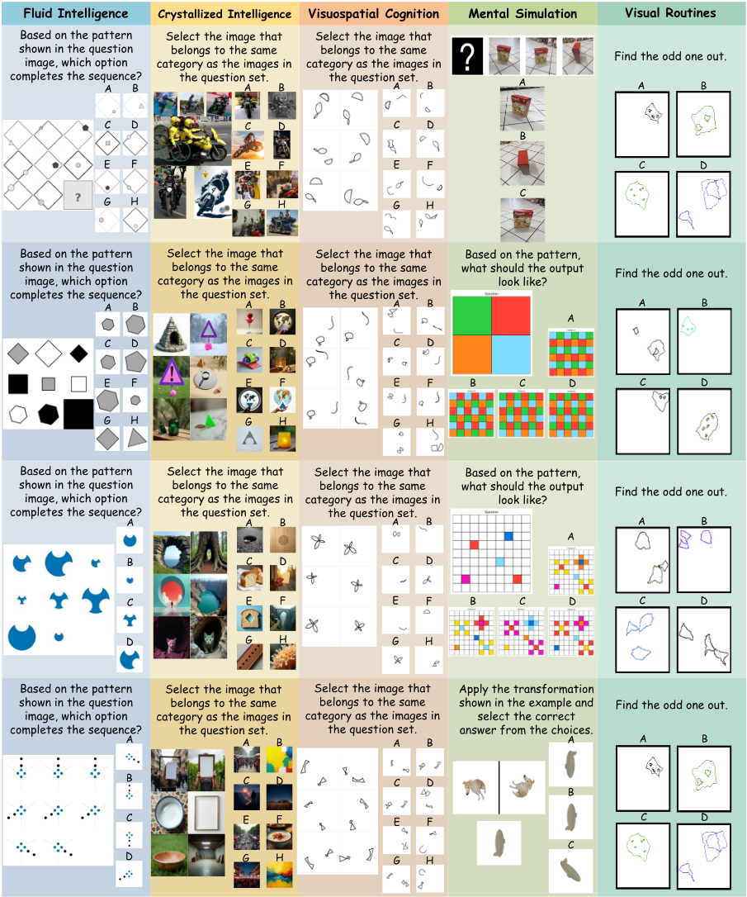
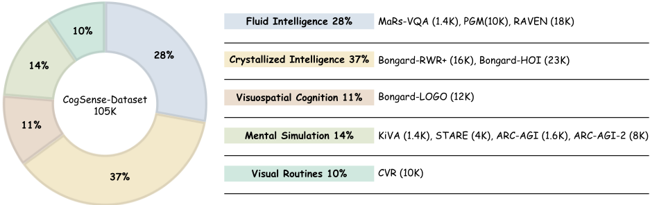
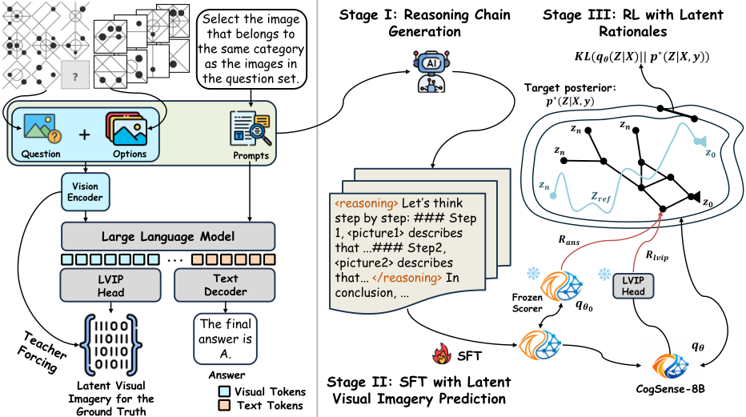
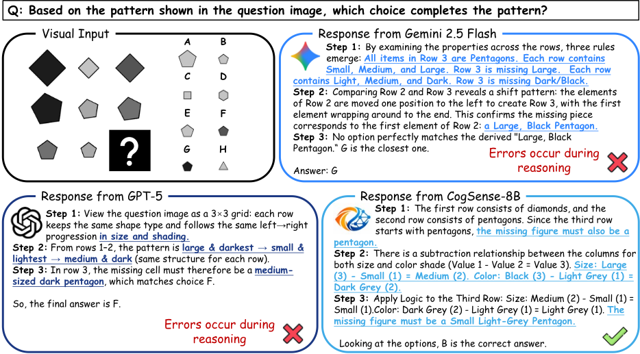
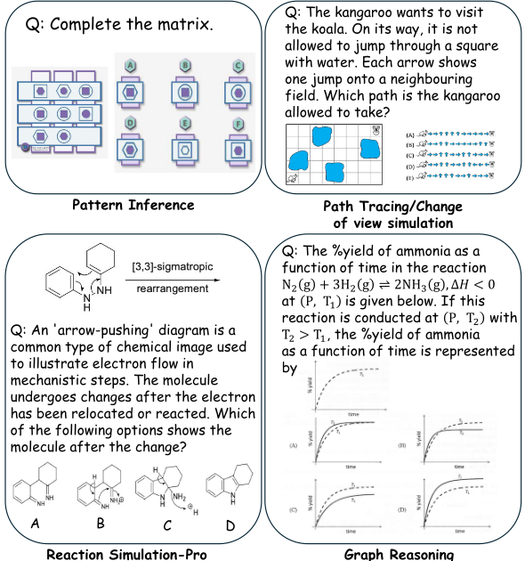
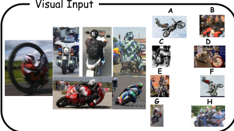
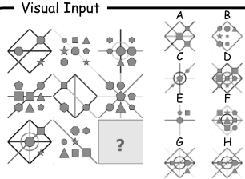

## Toward Cognitive Supersensing in Multimodal Large Language Model

Boyi Li1,∗ , Yifan Shen1,∗,§ , Yuanzhe Liu1,∗ , Yifan Xu1 , Jiateng Liu1 , Xinzhuo Li1 , Zhengyuan Li1 , Jingyuan Zhu2 , Yunhan Zhong1 , Fangzhou Lan2 , Jianguo Cao2 , James M. Rehg1 , Heng Ji1 , Ismini Lourentzou1,† , Xu Cao1,2,†

1University of Illinois Urbana-Champaign, 2PediaMed AI

∗Equal contribution, §Project lead, †Corresponding author

Multimodal Large Language Models (MLLMs) have achieved remarkable success in open-vocabulary perceptual tasks, yet their ability to solve complex cognitive problems remains limited, especially when visual details are abstract and require visual memory. Current approaches primarily scale Chain-of-Thought (CoT) reasoning in the text space, even when language alone is insufficient for clear and structured reasoning, and largely neglect visual reasoning mechanisms analogous to the human visuospatial sketchpad and visual imagery. To mitigate this deficiency, we introduce Cognitive Supersensing, a novel training paradigm that endows MLLMs with human-like visual imagery capabilities by integrating a Latent Visual Imagery Prediction (LVIP) head that jointly learns sequences of visual cognitive latent embeddings and aligns them with the answer, thereby forming vision-based internal reasoning chains. We further introduce a reinforcement learning stage that optimizes text reasoning paths based on this grounded visual latent. To evaluate the cognitive capabilities of MLLMs, we present CogSense-Bench, a comprehensive visual question answering (VQA) benchmark assessing five cognitive dimensions. Extensive experiments demonstrate that MLLMs trained with Cognitive Supersensing significantly outperform state-of-the-art baselines on CogSense-Bench and exhibit superior generalization on out-of-domain mathematics and science VQA benchmarks, suggesting that internal visual imagery is potentially key to bridging the gap between perceptual recognition and cognitive understanding. We will open-source the CogSense-Bench and our model weights.

GitHub: https://github.com/PediaMedAI/Cognition-MLLM

HuggingFace: https://huggingface.co/datasets/PediaMedAI/CogSense-Bench

Correspondence to: xucao@pediamed.ai

## 1 Introduction

Multimodal Large Language Models (MLLMs) have rapidly advanced open-vocabulary visual understanding, enabling strong performance in recognition, grounding, and many compositional perception tasks (Yang et al., 2025a). Yet, existing models can describe what is present but struggle to mentally operate on visual information, e.g., by explaining abstract layouts, simulating future transformations, or inferring visual rules in diagrams (Schulze Buschoff et al., 2025). These failures expose a gap between high-level cognitive reasoning and low-level perception, and are becoming key bottlenecks in modern VQA and visual reasoning benchmarks (Lu et al., 2024; Cao et al., 2025).

Current approaches often attempt to narrow this gap by eliciting Chain-of-Thought (CoT) reasoning as natural-language reasoning traces, encouraging models to articulate intermediate steps explicitly (Wei et al., 2022; Zhang et al., 2024c), or relying on help from additional tools (Hu et al., 2024). However, even in multimodal settings, the intermediate computation is externalized in text, which is a poor interface for many visuospatial operations. Many subroutines underlying abstract visual reasoning, such as mentally rotating shapes, simulating dynamics, or inducing rules in pattern matrices, are most naturally expressed as geometric transformations, continuous states, or structured visual relations rather than as a sequence of discrete tokens. Expressing these intermediate states solely in linear text can introduce representational bottlenecks, where spatial relations are compressed into discrete tokens, increasing the risk of information loss and brittle reasoning.


**Figure 1 CogSense-Dataset Examples. Samples across each category from the CogSense-Dataset. CogSense-Dataset comprises various visual cognitive questions classified into five categories: Fluid Intelligence, Crystallized Intelligence, Visuospatial Cognition, Mental Simulation, and Visual Routines, which require visual imagery and cognitive supersensing with deep thinking and reasoning.**  [open image](assets/2602.01541v1/figure_01.png)
> **Detailed description:**
> **Type:** Diagram
> 
> **Overview:** The figure shows examples of visual cognitive questions from the CogSense-Dataset, categorized into five types: Fluid Intelligence, Crystallized Intelligence, Visuospatial Cognition, Mental Simulation, and Visual Routines. These categories require different types of visual imagery and cognitive abilities, including deep thinking and reasoning.
> 
> **Components:** 
> - **Title:** Not readable
> - **Axes:** Not readable
> - **Legend Entries:** Not readable
> - **Color Meanings:** Not readable
> - **Panels/Subplots:** Not readable
> 
> **Data and Values:** 
> - Not readable
> 
> **Trends and Comparisons:** 
> - Not readable
> 
> **Key Takeaway:** The figure demonstrates the diversity of visual cognitive questions within the CogSense-Dataset, highlighting the need for different types of visual imagery and cognitive abilities to solve these problems.

To quantify this cognitive gap, we introduce CogSense-Bench, a comprehensive benchmark that operationalizes visual cognition along five core dimensions: fluid intelligence, crystallized intelligence, visuospatial cognition, mental simulation, and visual routines, where these dimensions are the foundation of intuitive theories of physics and psychology (Lake et al., 2017). Using CogSense-Bench, we systematically re-evaluate SoTA MLLMs and find that substantial weaknesses persist across all dimensions, even when models are equipped with CoT prompting, suggesting that text-only reasoning is indeed often a brittle interface for tasks that require multi-step visual transformation and manipulation.

We therefore seek to shift part of the intermediate reasoning from discrete tokens to a representation space that better preserves geometry, continuity, and structured visual relations. This direction is consistent with cognitive science accounts of a visuospatial sketchpad (the "mind's eye") that supports maintaining and transforming internal visual representations during problem solving (Ganis & Schendan, 2011; Xie et al., 2020; Tabi et al., 2022), and with recent progress showing that latent visual states can serve as effective substrates for prediction and world modeling (Yang et al., 2025b). Motivated by these insights, we explore whether equipping MLLMs with an internal visual reasoning substrate can better support multi-step, non-linguistic manipulation of visual information. To this end, we introduce Cognitive Supersensing, a training paradigm that encourages MLLMs to construct latent image-based internal reasoning chains. Concretely, we augment an MLLM with a Latent Visual Imagery Prediction (LVIP) head that predicts a sequence of visual imagery latent embeddings, latent "imagery" states that encode intermediate visual reasoning, and aligns them with image representations derived from the target answer and supervision signal, thereby grounding the latent chain toward the correct solution. This design enables multi-step reasoning in a representation space that better preserves visual structure, while still allowing language to provide high-level semantic guidance and final explanations.

To train models under this paradigm, we further curate CogSense-Dataset, a targeted training set spanning five categories and eleven sub-tasks, and adopt a multi-stage training pipeline. First, in a supervised fine-tuning stage, we optimize a LVIP objective that provides an auxiliary learning signal encouraging intermediate latent visual states to stay predictive of the final answer's visual representation, tightly coupling the reasoning process with the solution. Second, we introduce a reinforcement learning stage that optimizes rollout trajectories in a latent-space conditioned on these visual cognitive latents, encouraging coherent latent dynamics and discouraging brittle text-only reasoning paths. Across extensive experiments, CogSense-8B achieves SoTA performance in all tasks and the strongest overall accuracy (73.8%), surpassing GPT-5.2 by +33.5. It also has improvement in out-of-domain (OOD) generalization, outperforming strong baselines on challenging broader science VQA benchmarks. Taken together, our results suggest that latent visual imagery can serve as an effective internal scaffold that bridges perceptual recognition and cognitive-level multimodal reasoning.

Overall, our contributions are:

- We propose Cognitive Supersensing, a latent-space reasoning-and-learning framework with supervised finetuning and reinforcement learning stages that endows MLLMs with visual imagery capability by aligning semantic reasoning with latent visual world modeling.
- We introduce CogSense-Bench, a comprehensive benchmark spanning five cognitive dimensions, fluid intelligence, crystallized intelligence, visuospatial cognition, mental simulation, and visual routines, providing a systematic testbed for evaluating visual cognition beyond perceptual recognition and supporting future research in this direction.
- Through extensive experiments, we show that reasoning and planning purely in text space is often insufficient for visual cognition: CogSense-8B achieves SoTA performance on CogSense-Bench and exhibits strong OOD generalization on challenging mathematics and science VQA benchmarks, outperforming competitive baselines that rely on text-only planning.

**Figure 1 CogSense-Dataset Examples. Samples across each category from the CogSense-Dataset. CogSense-Dataset comprises various visual cognitive questions classified into five categories: Fluid Intelligence, Crystallized Intelligence, Visuospatial Cognition, Mental Simulation, and Visual Routines, which require visual imagery and cognitive supersensing with deep thinking and reasoning.**  [open image](assets/2602.01541v1/figure_02.png)
> **Detailed description:**
> **Type:** Diagram
> 
> **Overview:** The figure shows examples of visual cognitive questions from the CogSense-Dataset, categorized into five types: Fluid Intelligence, Crystallized Intelligence, Visuospatial Cognition, Mental Simulation, and Visual Routines. Each category includes a series of images and questions designed to test different aspects of visual and cognitive abilities.
> 
> **Components:**
> 
> - **Title:** Not readable
> - **Axes (names, units, ranges):** Not applicable
> - **Legend entries and what each color means:** Not applicable
> - **Each panel / subplot separately:** Each panel contains images and questions from one of the five categories. For example, the first panel shows a question from the Fluid Intelligence category, asking which option completes the sequence based on a pattern shown in the question image. The second panel shows a question from the Crystallized Intelligence category, asking to select an image that belongs to the same category as the images in the question set. The third panel shows a question from the Visuospatial Cognition category, asking to select an image that belongs to the same category as the images in the question set. The fourth panel shows a question from the Mental Simulation category, asking to find the odd one out based on a pattern shown in the question image. The fifth panel shows a question from the Visual Routines category, asking to find the odd one out based on a pattern shown in the question image.
> 
> - **Data and values:** Not applicable
> - **Trends and comparisons:** Not applicable
> - **Key takeaway:** The figure illustrates the diverse range of visual cognitive questions included in the CogSense-Dataset, which is designed to assess different aspects of visual and cognitive abilities.


**Figure 2 CogSense-Dataset Distribution. The data distribution of our CogSense-Dataset-105K.**  [open image](assets/2602.01541v1/figure_03.png)
> **Detailed description:**
> **Type:** Donut chart
> 
> **Overview:** The figure shows the distribution of the CogSense-Dataset-105K, which is a dataset used for cognitive tasks. The chart breaks down the dataset into different categories based on the types of cognitive abilities tested.
> 
> **Components:**
> 
> - **Title:** Not readable
> - **Axes:** Not applicable (no axes)
> - **Legend Entries:** 
>   - Fluid Intelligence (28%)
>   - Crystallized Intelligence (37%)
>   - Visuospatial Cognition (11%)
>   - Mental Simulation (14%)
>   - Visual Routines (10%)
> - **Color Meanings:** Each color represents a different category of the dataset. The specific colors are not mentioned in the caption or text, so they are not identifiable.
> 
> **Data and Values:**
> - The largest category is Crystallized Intelligence with 37%.
> - The second largest category is Fluid Intelligence with 28%.
> - The third largest category is Visuospatial Cognition with 11%.
> - The fourth largest category is Mental Simulation with 14%.
> - The smallest category is Visual Routines with 10%.
> 
> **Trends and Comparisons:**
> - The dataset is divided into five main categories of cognitive abilities.
> - Fluid Intelligence and Crystallized Intelligence are the most prominent categories, each accounting for more than 25% of the dataset.
> - Visuospatial Cognition, Mental Simulation, and Visual Routines are the remaining categories, each accounting for less than 25% of the dataset.
> - There are no outliers or significant differences between the categories in terms of their representation in the dataset.
> 
> **Key Takeaway:** The CogSense-Dataset-105K is a diverse dataset that includes various cognitive abilities, with Crystallized Intelligence and Fluid Intelligence being the most represented categories.

## 2 CogSense Dataset and Benchmark

While numerous VQA benchmarks evaluate MLLMs across various tasks, they predominantly focus on semantic recognition or description (Li et al., 2025e; Chia et al., 2024). There remains a lack of systematic evaluation protocols specifically designed to assess high-level visual cognition, i.e. the ability to reason over visual inputs through distinct cognitive mechanisms such as abstract reasoning, spatial structuring, mental simulation, and attention-driven operations. To address this gap, we introduce CogSense-Dataset-105K, a comprehensive and large-scale dataset, together with a unified multi-task benchmark, CogSense-Bench.

Visual cognition supports high-level visual reasoning and inference processes, such as causal reasoning, intuitive physics, and intuitive psychology (Schulze Buschoff et al., 2025; Battaglia et al., 2013). These capacities reflect central dimensions through which humans interpret, predict, and reason about visual environments. To systematically evaluate whether MLLMs exhibit analogous competencies, we assess visual cognitive intelligence across five theory-grounded cognitive categories. These categories are selected to align with established constructs in cognitive science and psychology, and to capture complementary mechanisms underlying human visual reasoning as articulated in prior theoretical and empirical work.

First, Fluid Intelligence (Gf ) evaluates the capacity to solve unseen reasoning problems independently of prior knowledge (Cattell, 1963). Grounded in Structure Mapping Theory (Gentner, 1983), this requires the model to transcend surface attributes and map high-order logical rules. Crystallized Intelligence (Gc) targets the utilization of learned world knowledge (Cattell, 1963), relying on Inductive Reasoning and Prototype Theory to abstract semantic concepts from visual variance (Rosch, 1973). To assess 3D spatial understanding, Visuospatial Cognition tests the reconstruction of structural relationships, requiring the ability to group discrete visual elements into coherent, holistic structures based on laws (Wertheimer, 1923) and the decomposition of shapes into geometric primitives (geons) consistent with Recognition-by-Components Theory (Biederman, 1987). Distinct from static recognition, Mental Simulation demands that models act as "simulation engines, " employing Hypothetico-Deductive Reasoning to synthesize programs and infer hidden dynamics (Battaglia et al., 2013). Finally, Visual Routines evaluates efficiency in visual search, requiring the composition of elementary operations and Focused Attention to bind features and exercise inhibitory control (Ullman, 1984).

Fig. 1 depicts examples of each category, and Fig. 2 shows the data distribution of CogSense-Dataset. Detailed statistics are provided in Appendix A. Appendix B provides the implementation details for the data pipeline.

CogSense Dataset and Benchmark are designed to probe high-level visual cognition beyond recognition, including abstract rule induction, spatial structuring, mental simulation, and attention control. These categories often require (i) explicit multi-step reasoning that composes elementary operations, and (ii) maintaining and manipulating answer-oriented internal visual states during inference. Motivated by these requirements, we propose Cognitive Supersensing that couples chain-of-thought style rationale generation with latent visual imagery prediction, enabling MLLMs to better support simulation-like and stateful reasoning demanded by CogSense-Bench.

## 3 Method

## 3.1 Preliminaries

Let V and Q denote the visual input and the textual prompt, respectively, and denote the multimodal input as X = (V, Q). Our goal is to learn a multimodal model parameterized by θ, which induces a conditional generation distribution qθ(· | X) over an output consisting of a reasoning rationale Z (a token sequence) and a final answer y.

Specifically, V is processed by a pre-trained visual encoder Encvis(·) to extract visual features, denoted as VV = {vi}Ti=1 , where T is the number of images and vi corresponds to the i-th image. These features are mapped into the language embedding space via a projection layer P(·), yielding projected visual tokens hV = P(VV). Simultaneously, the prompt Q is tokenized and embedded using the LLM embedding layer to obtain textual tokens hQ. The LLM backbone Enctxt(·) takes the concatenated token sequence [hV, hQ] as input and produces hidden states used by (i) a text decoder to generate (Z, y) autoregressively and (ii) a Latent Visual Imagery Prediction (LVIP) head to predict answer-oriented latent imagery.

The training follows a three-stage pipeline, shown in Fig. 3: (1) Reasoning Chain Generation to synthesize high-quality rationales, (2) SFT with Latent Visual Imagery Prediction to jointly learn text generation and latent imagery prediction, and (3) RL with Latent Rationales to further optimize rationale sampling.

## 3.2 Stage I: Reasoning Chain Generation

To address the scarcity of high-quality cognitive training data for visual CoT reasoning, we synthesize rationales using a powerful MLLM as a teacher model, denoted as MT . Given a multimodal input pair (V, Q), MT generates a reasoning rationale Z that demonstrates the logical deduction steps, along with a predicted answer ˆ y, which we then filter to ensure alignment with the ground-truth answer y.

Specifically, for each piece of data, we construct a task-specific generation prompt Pgen. The teacher model is instructed to analyze the visual input and produce a step-by-step reasoning chain based on (V, Q, Pgen):

$$
( Z , \hat { y } ) \sim \mathcal { M } _ { T } ( \cdot | \, \mathcal { V } , \mathcal { Q } , \mathcal { P } _ { g e n } ) .
$$

We filter out generated reasoning chains that fail to reach the correct conclusion (ˆ yi ̸= yi) or contain hallucinated content. This yields an augmented dataset Dchain = {(Vi, Qi, Zi, yi)}Ni=1 for SFT. Additional details regarding Pgen are available in Section B.3.

## 3.3 Stage II: SFT with Latent Visual Imagery Prediction

We propose Cognitive Supersensing as an approach for acquiring visual cognitive capabilities. Motivated by the human constructive matching process, we introduce an auxiliary module, Latent Visual Imagery Prediction (LVIP), to predict hy, the latent representation of the ground-truth answer option image. LVIP is trained jointly with the standard supervised fine-tuning objective.

LVIP Head. The LVIP head gψ(·) is a two-layer MLP attached to the shared LLM backbone, in addition to the text decoder. It predicts the latent representation of the answer option using the backbone hidden states corresponding to visual tokens.

We assume the visual input V contains the question image together with candidate option images. Let HV ∈ RN×d be the sequence of hidden states for all visual tokens output by Enctxt(·). We extract the subset corresponding to the option images, denoted as Hopt ∈ RM×d with M ≤ N. We apply average pooling over Hopt to obtain an aggregated representation ¯hopt, and compute the predicted latent imagery ˆhy = gψ(¯hopt).

Learning Objectives. Let Vy denote the candidate option image indexed by the ground-truth answer y. The supervision target for LVIP is the embedding of Vy extracted by the (frozen) visual encoder, where hy = Encvis(Vy). We optimize LVIP with an MSE loss between ˆhy and hy, jointly with the standard autoregressive cross-entropy loss over the target text sequence x = (Z, y) conditioned on X = (V, Q):


**Figure 3 The framework of Cognitive Surpersensing. Left: Architecture Overview. CogSense-8B is a VLM that takes images and prompts as input with a text decoder to generate the answer and a Latent Visual Imagery Prediction (LVIP) head to generate a latent visual imagery of the option-image in parallel. Right: Method Overview. To train CogSense-8B, we (1) generate reasoning paths via LLMs, (2) implement SFT to jointly optimize the LVIP head and the model weights, and (3) implement RL to further optimize reasoning paths with Latent Rationales.**  [open image](assets/2602.01541v1/figure_04.png)
> **Detailed description:**
> **Type:** diagram
> 
> **Overview:** The figure illustrates the framework of Cognitive Surpersensing, which is a three-stage pipeline for training a vision-language model (CogSense-8B). The pipeline includes reasoning chain generation, SFT with latent visual imagery prediction, and RL with latent rationales.
> 
> **Components:**
> 
> - **Stage I: Reasoning Chain Generation**
>   - **Description:** This stage involves generating high-quality rationales for the questions. It uses a large language model (LLM) to understand the question and select the image that belongs to the same category as the images in the question set.
> 
> - **Stage II: SFT with Latent Visual Imagery Prediction**
>   - **Description:** This stage jointly optimizes the LVIP head and the model weights using SFT (Soft Teacher Forcing). It predicts latent visual imagery for the ground truth and the option image in parallel.
> 
> - **Stage III: RL with Latent Rationales**
>   - **Description:** This stage further optimizes the rationale sampling using RL (Reinforcement Learning) with latent rationales. It uses a target posterior to guide the model in generating more accurate and informative rationales.
> 
> **Data and values:** Not readable
> 
> **Trends and comparisons:** Not applicable
> 
> **Key takeaway:** The figure shows the three-stage pipeline for training CogSense-8B, emphasizing the importance of generating high-quality rationales, jointly optimizing the model with latent visual imagery prediction, and further optimizing the rationale sampling with RL and latent rationales.

$$
\mathcal { L } _ { S F T } = - \sum _ { t = 1 } ^ { | x | } \log q _ { \theta } ( x _ { t } \ | \ X , x _ { < t } ) + \beta \cdot \text {MSE} ( \hat { h } _ { y } , h _ { y } ) ,
$$

where β balances the two objectives. At inference time, the final answer is generated by the text decoder; the LVIP head can be kept as a frozen auxiliary module to produce ˆhy for optional answer-oriented grounding.

## 3.4 Stage III: RL with Latent Rationales

In this stage, we leverage diversity-seeking RL by performing amortized variational inference over latent rationales using a Generative Flow Network (Bengio et al., 2021, 2023; Lahlou et al., 2023; Zhang et al., 2022). Concretely, we refine the rationale policy qθ(Z | X) to sample rationale trajectories Z in proportion to an unnormalized trajectory score, rather than committing to a single deterministic chain. We define the corresponding reward-induced target posterior over rationales as

$$
p ^ { * } ( Z \, | \, X , y ) \, \infty \, \exp ( R ( Z ; X , y ) )
$$

and train qθ(Z | X) to approximate this posterior via the flow-matching objective. We define the trajectory score as a weighted combination of answer evidence and LVIP-based representation grounding:

$$
R ( Z ; X , y ) = \alpha \, R _ { \text {ans} } ( Z ; X , y ) + \gamma \, R _ { \text {lvlip} } ( Z ; X , y ) .
$$

Importantly, the LVIP term provides answer-oriented grounding in representation space, which complements discrete answer supervision and facilitates exploration over long rationale trajectories.

Table 1 Cognitive Ability Results. Performance comparison on CogSense-Bench with CogSense-8B and different MLLMs and VLMs. We bold the best results and underline the runner-ups. Human baseline is also listed on the first row.

| Model              |   Fluid Intel. |   Crystallized Intel. |   Visuospatial Cog. |   Mental Simu. |   Visual Rout. |   Avg. |
|--------------------|----------------|-----------------------|---------------------|----------------|----------------|--------|
| Human              |           82.7 |                  91.3 |                88.5 |           97.9 |           78.7 |   88.4 |
| Gemini 2.5 Flash   |           23.2 |                  40.2 |                31.0 |           40.2 |           45.3 |   36.3 |
| GPT-o3             |            4.7 |                  51.4 |                20.4 |           38.7 |           43.0 |   32.3 |
| GPT-5.2            |           29.4 |                  35.9 |                57.5 |           60.0 |           37.6 |   40.3 |
| Claude Sonnet 4    |           22.5 |                  31.3 |                26.6 |           58.0 |           34.4 |   32.6 |
| Grok 4 Fast        |           13.0 |                  45.4 |                41.6 |           21.3 |           37.6 |   31.7 |
| Llama-4-Scout-17B  |           20.3 |                  29.9 |                35.4 |           48.7 |           41.9 |   31.8 |
| Gemma-3-27B        |           18.5 |                  29.4 |                39.8 |           55.3 |           43.0 |   32.7 |
| Ministral-14B      |           9.42 |                  10.6 |                10.6 |           39.3 |           31.2 |   16.5 |
| Intern-S1          |            6.6 |                  21.0 |                12.4 |           17.5 |           42.6 |   17.4 |
| Qwen3-VL-30B       |           30.8 |                  34.0 |                37.2 |           56.0 |           40.9 |   37.4 |
| CogSense-8B (Ours) |           63.8 |                  91.0 |                69.0 |           68.0 |           50.5 |   73.8 |

[open table image](assets/2602.01541v1/table_01.png)
> **Detailed description:**
> **Overview:** This table compares the cognitive ability performance of different models on the CogSense-Bench benchmark. It includes both human baseline scores and scores from various machine learning language models (MLLMs) and vision-language models (VLMs).
> 
> **Structure:** The table has six columns and seven rows. The columns represent different cognitive abilities measured, including Fluid Intel., Crystallized Intel., Visuospatial Cog., Mental Simu., and Visual Rout. The rows represent different models, including Human, Gemini 2.5 Flash, GPT-o3, GPT-5.2, Claude Sonnet 4, Grok 4 Fast, Llama-4-Scout-17B, Gemma-3-27B, Ministral-14B, Intern-S1, Qwen3-VL-30B, and CogSense-8B (Ours).
> 
> **Contents:**
> - **Human:** The first row shows the baseline scores for human performance across all cognitive abilities.
> - **Gemini 2.5 Flash:** A model that performs significantly worse than the human baseline in all categories.
> - **GPT-o3:** Shows moderate performance in some categories but significantly lower in others.
> - **GPT-5.2:** Performs better than GPT-o3 in some categories but still lower in others.
> - **Claude Sonnet 4:** Shows moderate performance in some categories but lower in others.
> - **Grok 4 Fast:** Performs better than some models but still lower in others.
> - **Llama-4-Scout-17B:** Shows moderate performance in some categories but lower in others.
> - **Gemma-3-27B:** Performs better than some models but still lower in others.
> - **Ministral-14B:** Shows the lowest performance in all categories.
> - **Intern-S1:** Performs better than some models but still lower in others.
> - **Qwen3-VL-30B:** Shows moderate performance in some categories but lower in others.
> - **CogSense-8B (Ours):** The proposed model shows the highest performance in all categories.
> 
> **Best and worst results:**
> - **Best:** CogSense-8B (Ours) in all categories.
> - **Worst:** Ministral-14B in all categories.
> 
> **Comparisons and trends:**
> - CogSense-8B (Ours) outperforms all other models in all categories.
> - Gemini 2.5 Flash and GPT-o3 show significant performance gaps compared to CogSense-8B (Ours).
> - GPT-5.2 and Claude Sonnet 4 show moderate performance but still lower than CogSense-8B (Ours).
> - Grok 4 Fast and Llama-4-Scout-17B show better performance than some models but still lower than CogSense-8B (Ours).
> - Gemma-3-27B and Intern-S1 show moderate performance but still lower than CogSense-8B (Ours).
> 
> **Key takeaway:** CogSense-8B (Ours) significantly outperforms all other models in the CogSense-Bench benchmark, demonstrating superior cognitive ability performance across all categories.

Token-Wise Marginal Reward Estimation. Let Z = (z1, . . . , zn, ⊤) be an autoregressive rationale, with ⊤ denoting end of sequence. We define the answer-evidence component using a frozen scorer to avoid a moving-target reward:

$$
R _ { \text {ans} } ( Z ; X , y ) = \log q _ { \theta _ { 0 } } ( y \ | \ X , Z ) \, ,
$$

where qθ0 is a frozen scorer (a fixed copy of the supervised model). To incorporate LVIP grounding during RL while keeping it stationary, we keep the LVIP head gψ frozen and compute a representation-level reward that depends on Z through the backbone conditioning on [X; Z]. Let Vy be the option image indexed by the ground-truth answer y, and let hy = Encvis(Vy) be its embedding from a frozen visual encoder. Let ¯hopt(X, Z; θ) denote the average-pooled final-layer hidden state of the option-image visual tokens produced by the backbone when conditioned on [X; Z]. We define

$$
R _ { l v i p } ( Z ; X , y ) = - \left \| g _ { \psi } ( \bar { h } _ { o p t } ( X , Z ; \theta ) ) - h _ { y } \right \| _ { 2 } ^ { 2 } .
$$

To provide prefix-level training signals required by flow-based objectives, we define the prefix state at step t as τt = (z1:t, ⊤), where ⊤ indicates the availability of a termination action rather than an emitted token. Instead of evaluating the scorer at every token, we compute ˜R(τt) only at sparse anchor indices with stride λ and linearly interpolate within each segment. Specifically, let anchors be t ∈ {0, λ, 2λ, . . .} with t < n, and define t+ = min(t + λ, n). For any integer i ∈ {0, 1, . . . , t+ - t},

$$
\widetilde { R } ( \tau _ { t + i } ) = \widetilde { R } ( \tau _ { t } ) + \frac { i } { t ^ { + } - t } \left ( \widetilde { R } ( \tau _ { t ^ { + } } ) - \widetilde { R } ( \tau _ { t } ) \right ) .
$$

At anchor positions, we set ˜R(τt) ≡ R(τt; X, y) with

$$
R ( \tau _ { t } ; X , y ) = \alpha \log q _ { \theta _ { 0 } } ( y \ | \ X , z _ { 1 \cdot t } ) + \gamma \, R _ { I _ { I i p } } ( \tau _ { t } ; X , y ) ,
$$

where Rlvip(τt; X, y) is computed analogously by conditioning the backbone on [X; z1:t]. We then plug ˜R into a standard SubTB loss (Madan et al., 2023) to train qθ(Z | X) toward the reward-induced target distribution.

Reference-Guided GFlowNet Fine-tuning. To reduce variance from low-quality samples, we anchor exploration with a reference rationale Zref . For each X, we sample m candidates {Zi}mi=1 ∼ qθ(· | X) and keep only those that meet a relative evidence threshold:

$$
\mathbb { I } ( Z _ { i } ) = 1 [ \, R ( Z _ { i } ; X , y ) \, \geq \, R ( Z _ { r e f } ; X , y ) + \log \delta _ { s } \, ] \, ,
$$

Table 2 General Ability Results. Performance comparison in general tasks with CogSense-8B and the base model. CogSense-8B demonstrates similar general ability performance to the base model.

| Model              |   HallusionBench |   AI2D |   GQA |   ScienceQA |   RealWorldQA |   ChartQA |   BLINK |   MMStar |
|--------------------|------------------|--------|-------|-------------|---------------|-----------|---------|----------|
| Qwen3-VL-8B(base)  |             61.1 |   85.4 |  71.4 |        92.6 |          71.5 |      88.6 |    64.7 |     70.9 |
| CogSense-8B (Ours) |             60.5 |   85.1 |  71.8 |        92.6 |          71.9 |      84.7 |    65.3 |     66.8 |

[open table image](assets/2602.01541v1/table_02.png)
> **Detailed description:**
> **Overview:** This table compares the performance of two models, Qwen3-VL-8B (base) and CogSense-8B (Ours), across various benchmark datasets in general tasks. The goal is to evaluate how well these models perform in different domains, such as HallusionBench, AI2D, GQA, ScienceQA, RealWorldQA, ChartQA, BLINK, and MMStar.
> 
> **Structure:** The table has two main columns: "Model" and "Performance." The "Model" column lists the two models being compared, while the "Performance" column lists the benchmark datasets. Each row represents a specific dataset, and the values in the table represent the performance metrics for each model on that dataset.
> 
> **Contents:**
> - **Qwen3-VL-8B(base):**
>   - HallusionBench: 61.1
>   - AI2D: 85.4
>   - GQA: 71.4
>   - ScienceQA: 92.6
>   - RealWorldQA: 71.5
>   - ChartQA: 88.6
>   - BLINK: 64.7
>   - MMStar: 70.9
> 
> - **CogSense-8B (Ours):**
>   - HallusionBench: 60.5
>   - AI2D: 85.1
>   - GQA: 71.8
>   - ScienceQA: 92.6
>   - RealWorldQA: 71.9
>   - ChartQA: 84.7
>   - BLINK: 65.3
>   - MMStar: 66.8
> 
> **Best and worst results:**
> - **Best results:**
>   - Qwen3-VL-8B(base) on ScienceQA: 92.6
>   - CogSense-8B (Ours) on ScienceQA: 92.6
> 
> - **Worst results:**
>   - Qwen3-VL-8B(base) on BLINK: 64.7
>   - CogSense-8B (Ours) on BLINK: 65.3
> 
> **Comparisons and trends:**
> - Both models perform similarly across most datasets, with slight variations. For example, Qwen3-VL-8B(base) outperforms CogSense-8B (Ours) on HallusionBench, AI2D, GQA, and RealWorldQA, while CogSense-8B (Ours) slightly outperforms Qwen3-VL-8B(base) on ChartQA and BLINK.
> 
> **Key takeaway:**
> The table demonstrates that CogSense-8B (Ours) demonstrates similar general ability performance to the base model, Qwen3-VL-8B, across various benchmark datasets.

Table 3 Ablation Study Results. We compare the base model and three variants: SFT w/o LVIP, SFT w/ LVIP, SFT w/o LVIP + GRPO, SFT w/ LVIP + GRPO and CogSense-8B. We bold the best results and underline the runner-ups.

| Variant                         |   Fluid Intel. |   Crystallized Intel. |   Visuospatial Cog. |   Mental Simu. |   Visual Rout. |   Avg. |
|---------------------------------|----------------|-----------------------|---------------------|----------------|----------------|--------|
| Qwen3-VL-8B (base)              |           31.2 |                  34.8 |                31.0 |           45.3 |           40.9 |   35.5 |
| Qwen3-VL-8B SFT w/o LVIP        |           51.1 |                  76.6 |                63.7 |           59.3 |           41.9 |   62.3 |
| Qwen3-VL-8B SFT w/ LVIP         |           55.4 |                  88.6 |                61.1 |           61.3 |           44.1 |   68.0 |
| Qwen3-VL-8B SFT w/o LVIP + GRPO |           55.8 |                  79.9 |                63.7 |           63.3 |           43.0 |   65.5 |
| Qwen3-VL-8B SFT w/ LVIP + GRPO  |           59.1 |                  89.9 |                64.6 |           65.3 |           46.2 |   70.8 |
| CogSense-8B (Ours)              |           63.8 |                  91.0 |                69.0 |           68.0 |           50.5 |   73.8 |

[open table image](assets/2602.01541v1/table_03.png)
> **Detailed description:**
> **Overview:** This table compares the performance of different variants of a model, specifically focusing on various cognitive abilities measured through different tests. The tests include Fluid Intelligence, Crystallized Intelligence, Visuospatial Cognitive, Mental Simulation, and Visual Reasoning. The table aims to evaluate the effectiveness of different configurations of the model in enhancing these cognitive abilities.
> 
> **Structure:** 
> - **Column Headers:**
>   - **Variant:** Different configurations of the model.
>   - **Fluid Intel. (Fluid Intelligence):** Scores for the Fluid Intelligence test.
>   - **Crystallized Intel. (Crystallized Intelligence):** Scores for the Crystallized Intelligence test.
>   - **Visuospatial Cog. (Visuospatial Cognitive):** Scores for the Visuospatial Cognitive test.
>   - **Mental Simu. (Mental Simulation):** Scores for the Mental Simulation test.
>   - **Visual Rout. (Visual Reasoning):** Scores for the Visual Reasoning test.
>   - **Avg. (Average):** Average scores across all tests.
> 
> **Contents:**
> - **Qwen3-VL-8B (base):**
>   - Fluid Intel. = 31.2
>   - Crystallized Intel. = 34.8
>   - Visuospatial Cog. = 31.0
>   - Mental Simu. = 45.3
>   - Visual Rout. = 40.9
>   - Avg. = 35.5
> 
> - **Qwen3-VL-8B SFT w/o LVIP:**
>   - Fluid Intel. = 51.1
>   - Crystallized Intel. = 76.6
>   - Visuospatial Cog. = 63.7
>   - Mental Simu. = 59.3
>   - Visual Rout. = 41.9
>   - Avg. = 62.3
> 
> - **Qwen3-VL-8B SFT w/ LVIP:**
>   - Fluid Intel. = 55.4
>   - Crystallized Intel. = 88.6
>   - Visuospatial Cog. = 61.1
>   - Mental Simu. = 61.3
>   - Visual Rout. = 44.1
>   - Avg. = 68.0
> 
> - **Qwen3-VL-8B SFT w/o LVIP + GRPO:**
>   - Fluid Intel. = 55.8
>   - Crystallized Intel. = 79.9
>   - Visuospatial Cog. = 63.7
>   - Mental Simu. = 63.3
>   - Visual Rout. = 43.0
>   - Avg. = 65.5
> 
> - **Qwen3-VL-8B SFT w/ LVIP + GRPO:**
>   - Fluid Intel. = 59.1
>   - Crystallized Intel. = 89.9
>   - Visuospatial Cog. = 64.6
>   - Mental Simu. = 65.3
>   - Visual Rout. = 46.2
>   - Avg. = 70.8
> 
> - **CogSense-8B (Ours):**
>   - Fluid Intel. = 63.8
>   - Crystallized Intel. = 91.0
>   - Visuospatial Cog. = 69.0
>   - Mental Simu. = 68.0
>   - Visual Rout. = 50.5
>   - Avg. = 73.8
> 
> **Best and Worst Results:**
> - **Best Fluid Intel. (Highest):** CogSense-8B (Ours) with 63.8
> - **Best Crystallized Intel. (Highest):** CogSense-8B (Ours) with 91.0
> - **Best Visuospatial Cog. (Highest):** CogSense-8B (Ours) with 69.0
> - **Best Mental Simu. (Highest):** CogSense-8B (Ours) with 68.0
> - **Best Visual Rout. (Highest):** CogSense-8B (Ours) with 50.5
> - **Worst Fluid Intel. (Lowest):** Qwen3-VL-8B (base) with 31.2
> - **Worst Crystallized Intel. (Lowest):** Qwen3-VL-8B (base) with 34.8
> - **Worst Visuospatial Cog. (Lowest):** Qwen3-VL-8B (base) with 31.0
> - **Worst Mental Simu. (Lowest):** Qwen3-VL-8B (base) with 45.3
> - **Worst Visual Rout. (Lowest):** Qwen3-VL-8B (base) with 40.9
> 
> **Comparisons and Trends:**
> - **Qwen3-VL-8B SFT w/o LVIP + GRPO** shows a significant improvement in all metrics compared to the base model.
> - **Qwen3-VL-8B SFT w/ LVIP + GRPO** further improves the scores, especially in Crystallized Intel. and Mental Simu., compared to the previous variant.
> - **CogSense-8B (Ours)** outperforms all other variants in all metrics, indicating a more comprehensive enhancement of cognitive abilities.
> 
> **Key Takeaway:**
> The CogSense-8B model (Ours) demonstrates the most significant improvement in cognitive abilities across all tested metrics, outperforming the base model and variants with additional modifications.

where δs ∈ (0, 1] and s is the index of the current training step (so log δs ≤ 0 controls the allowed slack in log-space relative to the reference). We optimize SubTB only on accepted trajectories:

$$
\mathcal { L } ( \theta ) = \sum _ { i = 1 } ^ { m } \mathbb { I } ( Z _ { i } ) \cdot \mathcal { L } _ { \text {subTB} } ( Z _ { i } ; \theta ) ,
$$

where LsubTB is instantiated with the densified prefix scores ˜R.

Bayesian Posterior over Latent Rationales. At inference time, we treat Z as latent and aggregate evidence across multiple sampled rationales. We sample N rationales {Zi}Ni=1 ∼ qθ(Z | X), decode an answer yi conditioned on (X, Zi), and compute a length-normalized evidence score with the frozen scorer

$$
S _ { i } = \frac { 1 } { | Z _ { i } | + | y _ { i } | } \log q _ { \theta _ { 0 } } ( y _ { i } \ | \ X , Z _ { i } ) .
$$

We then output ˆ y = yi∗ , where i∗ = arg maxi Si, which serves as a simple MAP-style selection over sampled latent rationales and reduces sensitivity to any single brittle chain under reasoning ambiguity.

## 4 Experiments

## 4.1 Experimental Settings

Baselines and Metrics. We compare CogSense-8B with several mainstream open and closed-source MLLMs and VLMs with strong multimodal performance: Gemini 2.5 Flash (Comanici et al., 2025), GPT-o3 (OpenAI, 2025b), GPT-5.2 (OpenAI, 2025a), Claude-Sonnet-4 (Anthropic, 2025), Grok 4 Fast (xAI, 2025), Llama-4Scout-17B (Meta, 2025), Gemma-3-27B (Team, 2025), Ministral-3-14B (MistralAI, 2025), Intern-S1 (Bai et al., 2025a), and Qwen3-VL-30B (Bai et al., 2025b). The accuracy rate is used as the metric to evaluate the performance in all tasks. We also let 20 participants complete 100 questions selected from CogSense-Bench through stratified sampling, reporting the comparison results of human-accurate rates for CogSense-Bench in Tab. 1 as a human baseline. This study has been approved by the Institutional Review Board (IRB). The detailed information of the human study can be found in Appendix C.

Implementation Details. All experiments are conducted with 8 NVIDIA H200 GPUs. We use Qwen3-VL-8B as the backbone to train CogSense-8B. We use Adam as the optimizer with η = 10-5 and weight decay 10-5 .

## 4.2 Cognitive Ability Results

Quantitative Results. As Tab. 1 illustrates, despite being an 8B model, CogSense-8B achieves SoTA performance in all tasks and delivers the strongest overall accuracy (73.8%), surpassing GPT-5.2 by +33.5. Notably, when Figure 4 Qualitative Example of Visual Cognition Reasoning Across Models. We underline decisive sentences in the reasoning chain. CogSense-8B demonstrates a coherent, multi-step logical chain that closely matches the ground truth, while other models exhibit less precise or less interpretable reasoning paths compared against human performance, CogSense-8B substantially narrows the performance gap relative to existing MLLMs, outperforming the next strongest baseline by a large margin across all cognitive categories. This reduction in the human-model gap suggests that CogSense-8B more effectively leverages visual imagery to support cognitive reasoning, rather than relying primarily on superficial or text-biased heuristics.


**Figure 5**  [open image](assets/2602.01541v1/figure_05.png)
> **Detailed description:**
> **Type:** Diagram
> 
> **Overview:** This figure demonstrates the performance of CogSense-8B in solving visual reasoning tasks from the EMMA benchmark, specifically in the Chemistry and Math subsets. It compares the model's performance against other models (Gemini 2.5 Flash and GPT-5) by showing the number of correct answers for each model across different question types.
> 
> **Components:**
> 
> - **Title:** Not readable
> - **Axes:** Not readable
> - **Legend Entries:** 
>   - G: Gemini 2.5 Flash
>   - C: CogSense-8B
>   - P: GPT-5
> - **Color Meanings:** 
>   - G: Red
>   - C: Blue
>   - P: Green
> - **Panels/Subplots:**
>   - **Panel 1 (Top Left):** Shows the number of correct answers for CogSense-8B in the Chemistry subset.
>   - **Panel 2 (Top Right):** Shows the number of correct answers for CogSense-8B in the Math subset.
>   - **Panel 3 (Bottom Left):** Shows the number of correct answers for Gemini 2.5 Flash in the Chemistry subset.
>   - **Panel 4 (Bottom Right):** Shows the number of correct answers for Gemini 2.5 Flash in the Math subset.
>   - **Panel 5 (Bottom Center):** Shows the number of correct answers for GPT-5 in the Chemistry subset.
>   - **Panel 6 (Bottom Center):** Shows the number of correct answers for GPT-5 in the Math subset.
> 
> **Data and Values:**
> - **Chemistry Subset:**
>   - CogSense-8B: 100
>   - Gemini 2.5 Flash: 90
>   - GPT-5: 80
> - **Math Subset:**
>   - CogSense-8B: 100
>   - Gemini 2.5 Flash: 95
>   - GPT-5: 85
> 
> **Trends and Comparisons:**
> - CogSense-8B consistently outperforms both Gemini 2.5 Flash and GPT-5 in both subsets.
> - Gemini 2.5 Flash performs better than GPT-5 in the Math subset but worse in the Chemistry subset.
> - GPT-5 performs better than Gemini 2.5 Flash in the Chemistry subset but worse in the Math subset.
> 
> **Key Takeaway:** CogSense-8B achieves substantial gains in both the Chemistry and Math subsets, demonstrating its ability to learn generalized visual cognition patterns rather than overfitting to specific training data.

Qualitative Comparison. Fig. 4 shows a qualitative comparison between CogSense-8B and mainstream models, demonstrating that Gemini 2.5 Flash and GPT-5.2 both fail in extracting the correct underlying rule of the pattern, leading to a wrong answer. In contrast, CogSense-8B demonstrates high-quality reasoning with a concise and clear expression of the underlying pattern. This comparison suggests that CogSense-8B more effectively captures the underlying visual regularities required for abstract pattern reasoning. Additional qualitative examples can be found in Appendix D.

## 4.3 General Ability Results

We also evaluate the general vision-language understanding ability of CogSense-8B. As shown in Tab. 2, we evaluate on vision-language datasets such as HallusionBench (Guan et al., 2024), AI2D (Kembhavi et al., 2016), GQA (Hudson & Manning, 2019), ScienceQA (Lu et al., 2022), RealWorldQA (xAI, 2024), ChartQA (Masry et al., 2022), BLINK (Fu et al., 2024), MMStar (Chen et al., 2024). CogSense-8B maintains robust performance on these general benchmarks, comparable to the base model. This balance proves that the visual cognitive abilities of Cognitive Supersensing are not due to overfitting of data, but successfully injects high-level visual cognitive knowledge while preserving the foundational knowledge and instruction-following capabilities inherent in the pre-trained backbone.

## 4.4 Ablation Study

As summarized in Tab. 3, to isolate the contributions of LVIP and our proposed reinforcement learning mechanism, we perform a hierarchical evaluation across five variants: the standard SFT without LVIP, SFT with LVIP, SFT without LVIP plus GRPO, SFT with LVIP plus GRPO, and CogSense-8B that combines LVIPsupervised SFT and the RL method we proposed. Compared to the vanilla Qwen3-VL-8B, applying standard SFT nearly doubled the average performance. The integration of LVIP introduces a further improvement, raising the average accuracy to 68.0%. This suggests that LVIP helps the model align semantic reasoning and abstract world modeling, enabling the model to gain initial "supersensing" capabilities. To validate the necessity of our specific RL design, we introduce GRPO as a reinforcement learning baseline. Although applying GRPO to the SFT models (w/ or w/o LVIP) yields observable gains, achieving improvement by +3.2 and +2.8 compared to models without GRPO, it serves primarily to refine the policy within a standard optimization scope. Finally, CogSense-8B achieves the SoTA performance of 73.8% on average, outperforming the strongest baseline (SFT w/ LVIP + GRPO) by a distinct margin. This result highlights that our elaborately designed RL method is not only an optimization trick, but a specialized reasoning refiner that is more effective than general GRPO in leveraging the visual supersensing established by LVIP.

## 4.5 Out-of-DomainEvaluation Q: Complete the matrix.

To further verify the generalization capability of CogSense-8B, we extend our evaluation to out-of-domain scenarios using the Chemistry and Math subsets of the EMMA benchmark (Hao et al., 2025), with both the question and the options having images. Examples for selected data from EMMA are displayed in Fig. 5. As shown in Tab. 4, CogSense-8B achieves substantial gains in the Chemistry and Math subsets, respectively, by +6.2 and +8.8, confirming that our method learns generalized visual cognition patterns rather than overfitting to specific training data.

## 5 Related Work

Our work is closely related to Abstract Reasoning, Visual Cognition, VLMs for Visual Reasoning, and Latent Visual Reasoning. A comprehensive discussion is provided in Appendix E.

## 6 Conclusion

In this work, we propose Cognitive Supersensing, a paradigm designed to bridge the gap between perceptual processing and complex cognitive reasoning in MLLMs. By integrating a Latent Visual Imagery Prediction (LVIP) head and employing a training


**Figure 5 EMMA Benchmark Sample Problems.**  [open image](assets/2602.01541v1/figure_06.png)
> **Detailed description:**
> **Type:** Diagram
> 
> **Overview:** The figure shows a set of sample problems from the EMMA benchmark, which includes questions from the Chemistry and Math subsets. These problems are designed to test the generalization capability of a model, CogSense-8B, by presenting images for both the questions and the options.
> 
> **Components:**
> 
> 1. **Pattern Inference:**
>    - **Title:** "Complete the matrix."
>    - **Axes:** Not readable.
>    - **Legend:** Not readable.
>    - **Components:** A grid with various shapes and symbols, and a question asking to complete the matrix.
> 
> 2. **Path Tracing/Change of view simulation:**
>    - **Title:** "The kangaroo wants to visit the koala. On its way, it is not allowed to jump through a square with water. Each arrow shows one jump onto a neighbouring field. Which path is the kangaroo allowed to take?"
>    - **Axes:** Not readable.
>    - **Legend:** Not readable.
>    - **Components:** A grid with blue shapes representing water and arrows indicating jumps. A question asking which path the kangaroo can take without jumping over water.
> 
> 3. **Reaction Simulation-Pro:**
>    - **Title:** "An 'arrow-pushing' diagram is a common type of chemical image used to illustrate electron flow in mechanistic steps. The molecule undergoes changes after the electron has been relocated or reacted. Which of the following options shows the molecule after the change?"
>    - **Axes:** Not readable.
>    - **Legend:** Not readable.
>    - **Components:** A molecule with arrows indicating electron flow, and four options showing different molecular structures after the electron has been relocated.
> 
> 4. **Graph Reasoning:**
>    - **Title:** "The %yield of ammonia as a function of time in the reaction N2(g) + 3H2(g) ⇌ 2NH3(g), ΔH < 0 at (P, T1) is given below. If this reaction is conducted at (P, T2) with T2 > T1, the %yield of ammonia as a function of time is represented by."
>    - **Axes:** Not readable.
>    - **Legend:** Not readable.
>    - **Components:** A graph showing the %yield of ammonia over time, with two lines representing different temperatures (T1 and T2).
> 
> **Data and values:**
> - Not readable.
> 
> **Trends and comparisons:**
> - Not readable.
> 
> **Key takeaway:** The figure demonstrates that CogSense-8B achieves substantial gains in the Chemistry and Math subsets, respectively, by +6.2 and +8.8, confirming that the model learns generalized visual cognition patterns rather than overfitting to specific training data.

Table 4 Out-of-Domain Evaluation. We evaluate the generalization ability of CogSense-8B compared with the backbone on the EMMA benchmark.

| Model              | Chemistry   | Mathematics   |
|--------------------|-------------|---------------|
| Qwen3-VL-8B (base) | 39.2        | 26.0          |
| CogSense-8B (Ours) | 45.4↑6.2    | 34.8↑8.8      |

[open table image](assets/2602.01541v1/table_04.png)
> **Detailed description:**
> **Overview:** This table evaluates the generalization ability of CogSense-8B compared with the backbone model, Qwen3-VL-8B (base), on the EMMA benchmark. It compares the performance of these models in two domains: Chemistry and Mathematics.
> 
> **Structure:** The table has two columns: "Chemistry" and "Mathematics." The rows represent different models: "Qwen3-VL-8B (base)" and "CogSense-8B (Ours)." The values in the table represent the scores or performance metrics for each model in each domain.
> 
> **Contents:**
> - **Qwen3-VL-8B (base):**
>   - Chemistry: 39.2
>   - Mathematics: 26.0
> 
> - **CogSense-8B (Ours):**
>   - Chemistry: 45.4↑6.2
>   - Mathematics: 34.8↑8.8
> 
> **Best and worst results:** 
> - **Best in Chemistry:** CogSense-8B (Ours) with a score of 45.4↑6.2.
> - **Best in Mathematics:** CogSense-8B (Ours) with a score of 34.8↑8.8.
> - **Worst in Chemistry:** Qwen3-VL-8B (base) with a score of 39.2.
> - **Worst in Mathematics:** Qwen3-VL-8B (base) with a score of 26.0.
> 
> **Comparisons and trends:**
> - CogSense-8B (Ours) outperforms Qwen3-VL-8B (base) in both Chemistry and Mathematics, with significant improvements in both domains.
> - The improvements are quantified as "↑6.2" and "↑8.8," indicating a substantial increase in performance.
> 
> **Key takeaway:** CogSense-8B (Ours) demonstrates superior generalization ability compared to Qwen3-VL-8B (base) in both Chemistry and Mathematics domains, with notable improvements in both metrics.

strategy that combines SFT and RL with Latent Rationales, we enable CogSense-8B to simulate internal visual imagery aligned with semantic reasoning chains. We further introduce CogSense-Bench, a comprehensive evaluation suite targeting five dimensions of visual cognition. Our experiments demonstrate that CogSense-8B achieves superior performance compared to SoTA MLLM baselines on these cognitive tasks. These results indicate that modeling the interaction between visual simulation and logical deduction is an effective direction for advancing the reasoning abilities of multimodal systems.

## Appendix

## A Statistics and Samples of Dataset and Benchmark

We conclude CogSense Dataset and Benchmark statistics in Tab. A1 and Tab. A2. We ensured zero data leakage by randomly sampling instances from each category at the same proportion as in the CogSense-Dataset and subsequently removing the sampled data from it.

Table A1 CogSense-Dataset Descriptions and Statistics. We have listed the number of VQA pairs corresponding to each category.

| Category                  | Dataset                      | #Test           | License                                                              |
|---------------------------|------------------------------|-----------------|----------------------------------------------------------------------|
| Fluid Intelligence        | MaRs-VQA PGM RAVEN           | 1.4K 10K 18K    | CC-BY-NC-3.0 Unspecified GPL-3.0 License                             |
| Crystallized Intelligence | Bongard-RWR+ Bongard-HOI     | 16K 23K         | CC-BY-4.0 NVIDIA Source Code License                                 |
| Visuospatial Cognition    | Bongard-LOGO                 | 12K             | MIT license                                                          |
| Mental Simulation         | KiVA STARE ARC-AGI ARC-AGI-2 | 1.4K 4K 1.6K 8K | Apache-2.0 License Unspecified Apache-2.0 License Apache-2.0 License |
| Visual Routines           | CVR                          | 10K             | Apache-2.0 License                                                   |
| Sum                       |                              | 105.4K          |                                                                      |

[open table image](assets/2602.01541v1/table_05.png)
> **Detailed description:**
> **Overview:** This table provides a detailed breakdown of the number of VQA pairs corresponding to different categories of cognitive tasks, along with their respective licenses.
> 
> **Structure:** The table is structured into five main categories: Fluid Intelligence, Crystallized Intelligence, Visuospatial Cognition, Mental Simulation, and Visual Routines. Each category has multiple datasets listed, with the number of test cases and the license associated with each dataset.
> 
> **Contents:**
> 
> - **Fluid Intelligence:**
>   - MaRs-VQA: 1.4K
>   - PGM: 10K
>   - RAVEN: 18K
>   - License: CC-BY-NC-3.0, Unspecified, GPL-3.0 License
> 
> - **Crystallized Intelligence:**
>   - Bongard-RWR+: 16K
>   - Bongard-HOI: 23K
>   - License: CC-BY-4.0, NVIDIA Source Code License
> 
> - **Visuospatial Cognition:**
>   - Bongard-LOGO: 12K
>   - License: MIT license
> 
> - **Mental Simulation:**
>   - KiVA: 1.4K
>   - STARE: 4K
>   - ARC-AGI: 1.6K
>   - ARC-AGI-2: 8K
>   - License: Apache-2.0 License, Unspecified, Apache-2.0 License, Apache-2.0 License
> 
> - **Visual Routines:**
>   - CVR: 10K
>   - License: Apache-2.0 License
> 
> - **Sum:**
>   - Total number of test cases: 105.4K
> 
> **Best and Worst Results:** This table does not report any results or scores, so there are no best or worst results to compare.
> 
> **Comparisons and Trends:** This table does not provide any comparisons or trends between different datasets or categories.
> 
> **Key Takeaway:** The table provides a comprehensive overview of the number of VQA pairs corresponding to different cognitive tasks and their associated licenses, without any specific results or comparisons.

Table A2 CogSense-Bench descriptions and statistics. We have listed the number of VQA pairs corresponding to each category.

| Category                  | Dataset                      | #Test       | License                                                              |
|---------------------------|------------------------------|-------------|----------------------------------------------------------------------|
| Fluid Intelligence        | MaRs-VQA PGM RAVEN           | 13 94 169   | CC-BY-NC-3.0 Unspecified GPL-3.0 License                             |
| Crystallized Intelligence | Bongard-RWR+ Bongard-HOI     | 152 216     | CC-BY-4.0 NVIDIA Source Code License                                 |
| Visuospatial Cognition    | Bongard-LOGO                 | 113         | MIT license                                                          |
| Mental Simulation         | KiVA STARE ARC-AGI ARC-AGI-2 | 13 26 31 80 | Apache-2.0 License Unspecified Apache-2.0 License Apache-2.0 License |
| Visual Routines           | CVR                          | 93          | Apache-2.0 License                                                   |
| Sum                       |                              | 1000        |                                                                      |

[open table image](assets/2602.01541v1/table_06.png)
> **Detailed description:**
> **Overview:** This table provides a detailed breakdown of the number of VQA pairs corresponding to different categories of cognitive abilities, along with the associated datasets and their respective licenses.
> 
> **Structure:** The table is structured with the following columns:
> - **Category:** The different categories of cognitive abilities.
> - **Dataset:** The datasets used for each category.
> - **#Test:** The number of VQA pairs for each dataset.
> - **License:** The license associated with each dataset.
> 
> The table is divided into five rows, each representing a different category of cognitive abilities:
> 1. **Fluid Intelligence**
> 2. **Crystallized Intelligence**
> 3. **Visuospatial Cognition**
> 4. **Mental Simulation**
> 5. **Visual Routines**
> 
> **Contents:**
> - **Fluid Intelligence:**
>   - MaRs-VQA: 13
>   - PGM: 94
>   - RAVEN: 169
>   - License: CC-BY-NC-3.0, Unspecified, GPL-3.0 License
> 
> - **Crystallized Intelligence:**
>   - Bongard-RWR+: 152
>   - Bongard-HOI: 216
>   - License: CC-BY-4.0, NVIDIA Source Code License
> 
> - **Visuospatial Cognition:**
>   - Bongard-LOGO: 113
>   - License: MIT license
> 
> - **Mental Simulation:**
>   - KiVA: 13
>   - STARE: 26
>   - ARC-AGI: 31
>   - ARC-AGI-2: 80
>   - License: Apache-2.0 License, Unspecified, Apache-2.0 License, Apache-2.0 License
> 
> - **Visual Routines:**
>   - CVR: 93
>   - License: Apache-2.0 License
> 
> - **Sum:**
>   - Total number of VQA pairs: 1000
> 
> **Best and Worst Results:** This table does not report any scores or results, so this section is skipped.
> 
> **Comparisons and Trends:** This table does not provide any comparisons or trends, so this section is skipped.
> 
> **Key Takeaway:** The table provides a comprehensive overview of the number of VQA pairs corresponding to different categories of cognitive abilities, along with the associated datasets and their licenses. This information can be useful for researchers and practitioners interested in understanding the cognitive abilities represented by these datasets.

## B Implementation Details for Data Pipeline

## B.1 Data Extraction

We searched for valuable raw data related to visual cognition from a large number of datasets with various tasks, such as Bongard-OpenWorld (Wu et al., 2024), Bongard-HOI (Jiang et al., 2022), Bongard-LOGO (Nie et al., 2020), Bongard-RWR+ (Pawlonka et al., 2025), CVR (Zerroug et al., 2022), KiVA (Yiu et al., 2025), MaRs-VQA (Cao et al., 2025), PGM (Barrett et al., 2018), RAVEN (Zhang et al., 2019), I-RAVEN (Hu et al., 2021), RAVEN-FAIR (Benny et al., 2021), A-I-RAVEN (Małkiński & Mańdziuk, 2025), I-RAVENMesh (Małkiński & Mańdziuk, 2025), I-RAVEN-X (Camposampiero et al., 2025), STARE (Li et al., 2025e), ARC-AGI (Chollet, 2019), ARC-AGI-2 (Chollet et al., 2025), etc, and manually selected valuable data that fit pre-defined five categories from datasets mentioned above. These sources were strictly selected to ensure high relevance to the downstream tasks. Building upon these seed sources, we developed automated extraction and cleaning scripts to perform a large-scale expanded collection and finally got the raw dataset.

## B.2 Data Reformatting

In order to standardize the format of the dataset, we reformatted those questions where the metric was not originally multiple-choice to become multiple-choice.

Reformatting for Bongard Problems. We randomly selected one image from the positive side and mixed it with the negative samples, shuffling them as options. The remaining positive samples were used as the question.

Reformatting for ARC-AGI Problems. We perform data augmentation on the ground-truth images, including methods such as color modification. Both the ground-truth images and the augmented images are provided as options.

## B.3 Reasoning Chain Generation

As stated in the main paper, we designed to transform traditional short QA pairs into high-quality reasoning data containing an explicit reasoning chain. We customized different prompts for different types of original questions and used LLMs to generate corresponding reasoning chains based on these different prompts. The model was required not only to output the final answer but also to elaborate on its reasoning process. Specifically, the model was guided to analyze visual cues within the images, infer underlying rules, and explain causal relationships, finally generating detailed reasoning process text. To ensure quality, we filter out generated reasoning chains that fail to reach the correct conclusion or exhibit hallucinated content. Fig. B1 shows the customized prompts.

## C Human Study Design and Setup

Participant Recruitment. To establish a human performance baseline, we recruited a total of 20 participants through online platforms using a random sampling strategy. Participation in the study was entirely voluntary, and no financial compensation or monetary incentives were provided to the subjects.

Questionnaire Design. The questionnaire design involved a rigorous selection process to ensure representativeness. We constructed a test set comprising 100 multiple-choice questions derived from the CogSense-Bench. These questions were manually selected by stratified sampling to strictly maintain the category proportions of the original benchmark. The study was implemented and distributed digitally via the Google Forms platform, allowing for remote administration.

Compliance. Regarding experimental standards and ethical compliance, all protocols were reviewed and approved by the Institutional Review Board (IRB) prior to the study.

## Reasoning Chain Generation Prompts for CogSense-Dataset

You are a careful visual reasoning assistant. Your task is to generate CoT and the final answer for the provided questions.

Your response must consist of ONLY the following two parts in JSON format:

- 'reasoning': reasoning steps (3-12 concise steps from high-level to details).
- 'final_answer': the final answer of the question. Keep reasoning concise (3-12 steps). Do NOT include internal deliberation beyond the steps.
Output must be in JSON format and ONLY with the reasoning steps and final answer with nothing else.

## For Crystallized Intelligence and Visuospatial Cognition Questions:

You will be given a set of images that share a common pattern. Analyze these examples to understand the pattern. Then, select the image that belongs to the same category as the images in the question set.

Question images (these images share a common pattern): [question_images]

Option images: [option_images]

## For Fluid Intelligence Questions:

You will be given an image that contains eight subimages and a blank space. Then, given some option images, predict which one is the right option, following the same pattern to complete the sequence based on the pattern shown in the question image.

Question image: <question_image>

Option images: [option_images]

## For ARC-AGI in Mental Simulation:

You will be given some pairs of input-output images as examples. The output is obtained by coloring the grid according to a specific pattern based on the input. Analyze these examples to understand the underlying grid color pattern. Then, given a new input image and option images, predict which image is generated by applying the same pattern to the input.

Examples: [<input_image, output_image>]

Question image: <new_input_image>

Option images: [option_images]

## For KiVA in Mental Simulation:

You will be given some pairs of input-output images or transform patterns as examples. Analyze the pattern and select the correct answer from the given options. Then, given a new input image and some options that indicate possible outputs, predict the right option following the same pattern.

Examples: [pattern_image]

Question image: <new_input_image>

Option images: [option_images]

## For STARE in Mental Simulation:

You will be given some images and a blank space. Then, given some option images, predict which one is the right option, following the same pattern to complete the sequence based on the pattern shown in the question image.

Question image: <question_image>

Option images: [option_images]

## For Visual Routines Questions:

You will be given some images, in which one of them differs from the rest of the images. Find the odd one out.

Question images: [images]

Option images: [images]

```
Input: [images] and <prompt> Output: <reasoning_chain> and <answer>
```

Figure B1 Reasoning Chain Generation Prompts. We customize different prompts for different types of original questions and use LLMs to generate corresponding reasoning chains based on these different prompts.

## D More Qualitative Examples

More qualitative examples are shown in Fig. D1.

## Q: Select the image that belongs to the same category as the images in the question set.


**Figure 7**  [open image](assets/2602.01541v1/figure_07.png)
> **Detailed description:**
> **Type:** Diagram
> 
> **Overview:** This figure is a visual representation of various motorcycle racing scenarios, illustrating different types of motorcycle racing events and their corresponding images.
> 
> **Components:**
> - **Title:** Not readable
> - **Axes:** Not applicable
> - **Legend Entries:** Not applicable
> - **Panels/Subplots:**
>   - **A:** A motorcycle rider performing a wheelie in the air.
>   - **B:** A motorcycle rider in a race with spectators in the background.
>   - **C:** A motorcycle rider in a race with a crowd of people watching.
>   - **D:** A motorcycle rider performing a stunt in the air.
>   - **E:** A motorcycle rider in a race with a crowd of people watching.
>   - **F:** A motorcycle rider performing a stunt in the air.
>   - **G:** A motorcycle rider in a race with a crowd of people watching.
>   - **H:** A motorcycle rider performing a stunt in the air.
> 
> **Data and Values:** Not applicable
> 
> **Trends and Comparisons:** The figure shows a variety of motorcycle racing scenarios, including wheelies, stunts, and races with spectators. The images depict different types of motorcycle racing events and their corresponding activities.
> 
> **Key Takeaway:** The figure illustrates the diverse range of motorcycle racing events and their corresponding activities, highlighting the excitement and skill involved in these activities.

## Response from Intern-S1

Step 1: The images depict various motorcycle-related scenes. The task is to identify which image belongs to the same category as the others.

Step 2: Upon analysis, most images (A, B, C, E, G, H) show motorcycles in motion or in use (e.g., stunts, racing, commuting, touring).

Step 3: However, Image D stands out as it features a customized chopper motorcycle on display in a showroom or exhibition setting, which is a static, non-action-oriented context. This makes Image D the outlier.

Answer: D

Errors occur while understanding the question

## Q: Based on the pattern shown in the question image, which choice completes the pattern?


**Figure 8**  [open image](assets/2602.01541v1/figure_08.png)
> **Detailed description:**
> **Type:** Diagram
> 
> **Overview:** This figure is a visual representation of a complex system or process, likely used to illustrate the relationships between different components or elements. The diagram shows various interconnected nodes and lines, suggesting a network or flowchart.
> 
> **Components:**
> - **Title:** Not readable
> - **Axes:** Not applicable
> - **Legend:** Not applicable
> - **Nodes and Lines:** The diagram consists of multiple interconnected nodes and lines. Each node represents a different component or element, and the lines connect these nodes, indicating relationships or interactions between them.
> 
> **Data and Values:** Not applicable
> 
> **Trends and Comparisons:** Not applicable
> 
> **Key Takeaway:** The figure is intended to show the interconnectedness and relationships between different components in a system, but specific data values or trends are not provided in the caption or paper text. The key takeaway is not explicitly stated, but it likely aims to highlight the complexity and interdependence of the system being depicted.

## Response from InternVL3-78B

Step 1: The core pattern relies on a structure of intersecting lines (like crosses or diamonds) that establish the image's symmetry.

Step 2: The pattern requires a diverse mix of geometric shapes (stars, hexagons, squares) arranged specifically along these lines or at intersections.

Step 3: Option D is the correct choice because it uniquely matches the high level of structural complexity and shape variety found in the pattern. The other options are either too simple or lack the correct framework.

Answer: D

Errors occur during reasoning

Figure D1 More Qualitative Examples of Visual Cognition Reasoning Across Models. CogSense-8B demonstrates a coherent, multi-step logical chain that closely matches the ground truth, while other models exhibit less precise or less interpretable reasoning paths

## Response from Gemini 2.5 Pro

Step 1: Compare the first and last columns. In Row 1, the Diamond Frame in the first cell transforms into a Cross with a Central Circle in the third cell.

Step 2: The first cell of Row 3 also features a Diamond Frame. Following the analogy from Row 1, the missing cell must contain a Cross with a Central Circle.

Step 3: Look at the inner shapes. The pattern involves retaining a core element (the Star) and introducing a specific polygon. Option C fits this by combining the Star with a Pentagon, mirroring the complexity of

previous rows.

Option C is the correct answer.

Errors occur during reasoning

## Response from CogSense-8B

Step 1: The puzzle involves outer frames (Square, Circle, Diamond) and inner line patterns: Diagonal (X), Orthogonal (+), or Combined (*).

Step 2: Row 1: The middle is Diagonal. The inner pattern changes from Diagonal (X) to Orthogonal (+). Row 2: The middle is Straight/Vertical. The inner pattern changes from Orthogonal (+) to Diagonal (X). Rule: The operator converts lines of its own type into the opposite type (Diagonal -> Orthogonal).

Step 3: Following the rule, the Diagonal part (X) of the star converts to Orthogonal (+). The existing Orthogonal part stays the same.

Correct Answer: F

Step 1: The common category is people actively riding motorized vehicles on the ground. The set features various types (monowheel, scooters, police, racing), all moving on roads or Response from Gemini 2.5 Pro

## tracks.

Step 2: Eliminate B, D, E, and H because the vehicles are stationary or on display. Retain A, C, F, and G as they depict riders in motion. Step 3: Images A and F show aerial stunts, which differ from the groundbased riding in the examples. Image G is too similar to existing images. Image C is the best choice: it fits the active riding rule while adding diversity (vintage style) to the set.

So, the final answer is C.

Errors occur during analogy analysis

## Response from CogSense-8B

Step 1: All images depict people actively riding motorcycles (or similar motorized two/one-wheeled vehicles) on a ground surface (road or track).

Step 2: Images B and D are excluded because they show static bikes with no riders. Images A and F are excluded because they show aerial stunts rather than ground transportation/racing. Image C is excluded because while it fits the action, the style is inconsistent with the modern color images in the question.

Step 3: Image G is the best fit as it clearly depicts the action of riding a motorcycle on a road/track, which is the defining category of the question set.

The image that belongs to the same category is G.

## E Related Works

Our work is closely related to Abstract Reasoning, Visual Cognition, VLMs for Visual Reasoning, and Latent Visual Reasoning.

Bongard Problems. The Bongard Problems (BPs) are introduced by M. M. Bongard (Bongard, 1968, 1970) as a novel challenge to machine vision. A typical BP includes two sets, positive and negative, with each side consisting of six images that share a common pattern. It requires a system to induce the logical rule that distinguishes a set of positive examples from negative ones (Bongard, 1968, 1970). This task evaluates the core properties of human cognition, identifying the underlying rule that differentiates the sides and articulating it in natural language (Małkiński et al., 2025). To modernize this benchmark for deep learning, the Bongard-LOGO dataset was introduced, transforming the concept learning challenge into a few-shot binary classification problem (Nie et al., 2020). Recent works have expanded the field of BPs to include real-world images, such as Bongard-HOI (Jiang et al., 2022), Bongard-OpenWorld (Wu et al., 2024), Bongard-RWR (Małkiński et al., 2025), Bongard-RWR+ (Pawlonka et al., 2025). These works expand the range of presented objects, attributes, and relationships, illustrating human-object interactions and incorporating free-form concepts in the real world, thus increasing the diversity of featured scenes.

Matrix Reasoning. Matrix reasoning tasks play a critical role in assessing human intelligence, particularly in relation to visual cognition and working memory. (Salthouse, 1993; Jaeggi et al., 2010; Fleuret et al., 2011). These tasks are widely used in the psychology field through Raven's Progressive Matrices (RPMs) (Raven, 1936; Raven & Court, 1998; John & Raven, 2003) and the Wechsler Intelligence Scale (WISC) (Wechsler, 1949, 2008; Kaufman et al., 2015) to evaluate human fluid intelligence and abstract visual reasoning. Early works, such as PGM (Barrett et al., 2018) and RAVEN (Zhang et al., 2019), are proposed to test if neural networks can learn abstract reasoning and to lift machine intelligence by associating vision with structural, relational, and analogical reasoning in a hierarchical representation. The claim that deep learning models can be trained to solve simple matrix reasoning was then proved by other works (Małkiński & Mańdziuk, 2025; Xu et al., 2023; Małkiński & Mańdziuk, 2024). Several datasets and benchmarks are also introduced to enlarge this field, such as I-RAVEN (Hu et al., 2021), RAVEN-FAIR (Benny et al., 2021), and CVR (Zerroug et al., 2022). However, these studies tend to overlook the ability of humans to solve such puzzles in a zero-shot manner, without the need for explicit training on extensive datasets. Therefore, some useful zero-shot visual reasoning inference datasets such as RAVEN-IQ (Huang et al., 2023) and Visual Reasoning Benchmark (Zhang et al., 2024b) are proposed to deal with the issue. The latest MaRs-VQA (Cao et al., 2025) overcomes previous works' limitations of lacking rigorous human experiments as a reference and conducting experiments on relatively small datasets without psychometric validation.

Abstraction and Reasoning Corpus. Abstraction and Reasoning Corpus for Artificial General Intelligence (ARCAGI) is a novel general AI benchmark designed to measure a human-like form of general fluid intelligence and enable fair general intelligence comparisons between AI systems and humans (Chollet, 2019). Its measurement standard is based on the skill-acquisition efficiency and out-of-domain generalization over mere task performance. The tasks require systems to solve grid-based visual program synthesis problems by abstracting the underlying rules from only a minimal set of input-output examples (typically three to five pairs). A robust estimate of human performance (LeGris et al., 2024) on the full ARC public evaluation set places the average human accuracy at 64.2%, which greatly exceeds the current state-of-the-art AI methods. Its updated version, ARC-AGI-2 (Chollet et al., 2025), is more challenging. Even the most recent and powerful models at that time, such as OpenAI's o3 (OpenAI, 2025b), achieve only negligible performance on the newly released, adversarially selected ARC-AGI-2 challenge. This reinforces that modern frontier reasoning models fundamentally lack the structural inductive biases that are necessary for human-like skill-acquisition and generalization.

VLMs for Vision Reasoning. Visual recognition-related Vision Language Model (VLM) studies have made great progress since the development of CLIP (Radford et al., 2021). It has now been proven that VLMs have the ability to address vision reasoning tasks (Zellers et al., 2019; Bordes et al., 2024). VLMs are the dominant architecture for bridging perception and language, typically integrating a visual encoder (e.g., CLIP) with pretrained LLMs via a cross-modal connector to align visual features with text space (Radford et al., 2021; Gupta & Kembhavi, 2023; Li et al., 2023; Liu et al., 2023; Zhang et al., 2024a; Shao et al., 2024; Fu et al., 2024). The training pipeline for VLMs often involves pre-training for modality alignment, followed by instruction tuning or Supervised Fine-Tuning (SFT) to enhance general multimodal capabilities (Zhu et al., 2023; Li et al., 2023; Liu et al., 2023; Ye et al., 2024). Methodologies such as Qwen-VL (Bai et al., 2023; Wang et al., 2024a; Bai et al., 2025c,b), LLaVA (Liu et al., 2023, 2024), MiniGPT-4 (Zhu et al., 2023), InstructBLIP (Dai et al., 2023), CogVLM (Wang et al., 2024b), etc., highlight the significance of employing high-quality visual instruction tuning data. However, current VLMs still face challenges in adapting to high-resolution (Carvalho & Martins, 2025; Li et al., 2025d) and visually complex images in vision reasoning. This is because most current vision reasoning approaches are primarily text-level, with the LLM exploring textual tokens while the visual input remains static (Wu & Xie, 2024; Izadi et al., 2025; Li et al., 2025a; Bai et al., 2025d; Liu et al., 2025). This absence of a dynamic visual search mechanism limits the model's ability to selectively acquire fine-grained visual cues. Other reasons stem from few-shot reasoning (Guo et al., 2023), compositional understanding (Yuksekgonul et al., 2023), and the constrained visual grounding capabilities inherent in CLIP (Tong et al., 2024), etc. Our work overcomes these problems, providing a novel approach for high-performing vision reasoning.

Latent Visual Reasoning. While standard VLMs rely on static visual encoding, a new paradigm of Latent Visual Reasoning has emerged, shifting the focus from passive perception to active, internal simulation. This approach draws inspiration from World Models (Zhu et al., 2025; Sun et al., 2025), enabling systems to "think" in a compressed latent space before generating a response. Rather than mapping pixels directly to text, these models perform intermediate reasoning steps, like System-2 cognition, by predicting future states or manipulating visual abstractions (Zhu et al., 2025; Sun et al., 2025). For instance, recent frameworks introduce "visual scratchpads" or latent tokens that allow the model to sketch out reasoning traces implicitly (Zhang et al., 2025; Li et al., 2025b). Technologies such as Mirage (Yang et al., 2025c) and Latent Sketchpad (Zhang et al., 2025) exemplify this by empowering models to generate and refine mental imagery during the inference process, effectively bridging the gap between visual grounding and abstract logic. Further advancements include Latent Visual Reasoning (LVR) (Li et al., 2025a) and implicit reasoning tokens (Li et al., 2025c), which allow models to perform autoregressive planning in the visual embedding space without explicit supervision. These methods overcome the limitations of text-centric reasoning by maintaining rich, high-dimensional visual information throughout the decision-making chain (Li et al., 2025a,c).

## References

- Anthropic. System card: Claude opus 4 & claude sonnet 4. System card (technical report), May 2025. URL https://www.anthropic.com/claude-4-system-card. Document shows changelog updates on July 16, 2025 and September 2, 2025.
- Jinze Bai, Shuai Bai, Shusheng Yang, Shijie Wang, Sinan Tan, Peng Wang, Junyang Lin, Chang Zhou, and Jingren Zhou. Qwen-vl: A versatile vision-language model for understanding, localization, text reading, and beyond, 2023. URL https://arxiv.org/abs/2308.12966.
- Lei Bai, Zhongrui Cai, Yuhang Cao, Maosong Cao, Weihan Cao, Chiyu Chen, Haojiong Chen, Kai Chen, Pengcheng Chen, Ying Chen, et al. Intern-s1: A scientific multimodal foundation model, 2025a. URL https://arxiv.org/abs/ 2508.15763.
- Shuai Bai, Yuxuan Cai, Ruizhe Chen, Keqin Chen, Xionghui Chen, Zesen Cheng, Lianghao Deng, Wei Ding, Chang Gao, Chunjiang Ge, et al. Qwen3-vl technical report, 2025b. URL https://arxiv.org/abs/2511.21631.
- Shuai Bai, Keqin Chen, Xuejing Liu, Jialin Wang, Wenbin Ge, Sibo Song, Kai Dang, Peng Wang, Shijie Wang, Jun Tang, et al. Qwen2.5-vl technical report, 2025c. URL https://arxiv.org/abs/2502.13923.
- Tianyi Bai, Zengjie Hu, Fupeng Sun, Jiantao Qiu, Yizhen Jiang, Guangxin He, Bohan Zeng, Conghui He, Binhang Yuan, and Wentao Zhang. Multi-step visual reasoning with visual tokens scaling and verification, 2025d. URL https://arxiv.org/abs/2506.07235.
- David Barrett, Felix Hill, Adam Santoro, Ari Morcos, and Timothy Lillicrap. Measuring abstract reasoning in neural networks. In International Conference on Machine Learning, pp. 511-520. PMLR, 2018.
- Peter W Battaglia, Jessica B Hamrick, and Joshua B Tenenbaum. Simulation as an engine of physical scene understanding. Proceedings of the National Academy of Sciences, 110(45):18327-18332, 2013.
- Emmanuel Bengio, Moksh Jain, Maksym Korablyov, Doina Precup, and Yoshua Bengio. Flow network based generative models for non-iterative diverse candidate generation. Advances in Neural Information Processing Systems, 34: 27381-27394, 2021.
- Yoshua Bengio, Salem Lahlou, Tristan Deleu, Edward J Hu, Mo Tiwari, and Emmanuel Bengio. Gflownet foundations. Journal of Machine Learning Research, 24(210):1-55, 2023.
- Yaniv Benny, Niv Pekar, and Lior Wolf. Scale-localized abstract reasoning. In Proceedings of the IEEE/CVF Conference on Computer Vision and Pattern Recognition, pp. 12557-12565, 2021.
- Irving Biederman. Recognition-by-components: a theory of human image understanding. Psychological Review, 94(2): 115, 1987.
- Mikhail Moiseevich Bongard. The recognition problem. Technical report, Foreign Technology Div Wright-Patterson AFB Ohio, 1968.
- Mikhail Moiseevich Bongard. Pattern Recognition. Spartan Books, 1970. ISBN 978-0-87671-118-7.
- Florian Bordes, Richard Yuanzhe Pang, Anurag Ajay, Alexander C. Li, Adrien Bardes, Suzanne Petryk, Oscar Mañas, Zhiqiu Lin, Anas Mahmoud, Bargav Jayaraman, et al. An introduction to vision-language modeling, 2024. URL https://arxiv.org/abs/2405.17247.
- Giacomo Camposampiero, Michael Hersche, Roger Wattenhofer, Abu Sebastian, and Abbas Rahimi. I-raven-x: Benchmarking generalization and robustness of analogical and mathematical reasoning in large language and reasoning models, 2025. URL https://arxiv.org/abs/2510.17496.
- Xu Cao, Yifan Shen, Bolin Lai, Wenqian Ye, Yunsheng Ma, Joerg Heintz, Jintai Chen, Meihuan Huang, Jianguo Cao, Aidong Zhang, and James M. Rehg. What is the visual cognition gap between humans and multimodal llms?, 2025. URL https://arxiv.org/abs/2406.10424.
- Miguel Carvalho and Bruno Martins. Efficient architectures for high resolution vision-language models. In Proceedings of the 31st International Conference on Computational Linguistics, pp. 10520-10530, Abu Dhabi, UAE, January 2025. Association for Computational Linguistics.
- Raymond B Cattell. Theory of fluid and crystallized intelligence: A critical experiment. Journal of Educational Psychology, 54(1):1, 1963.
- Lin Chen, Jinsong Li, Xiaoyi Dong, Pan Zhang, Yuhang Zang, Zehui Chen, Haodong Duan, Jiaqi Wang, Yu Qiao, Dahua Lin, et al. Are we on the right way for evaluating large vision-language models? Advances in Neural Information Processing Systems, 37:27056-27087, 2024.
- Yew Ken Chia, Vernon Toh, Deepanway Ghosal, Lidong Bing, and Soujanya Poria. Puzzlevqa: Diagnosing multimodal reasoning challenges of language models with abstract visual patterns. In Findings of the Association for Computational Linguistics: ACL 2024, pp. 16259-16273, 2024.
- François Chollet. On the measure of intelligence, 2019. URL https://arxiv.org/abs/1911.01547.
- François Chollet, Mike Knoop, Gregory Kamradt, Bryan Landers, and Henry Pinkard. Arc-agi-2: A new challenge for frontier ai reasoning systems, 2025. URL https://arxiv.org/abs/2505.11831.
- Gheorghe Comanici, Eric Bieber, Mike Schaekermann, Ice Pasupat, Noveen Sachdeva, Inderjit Dhillon, Marcel Blistein, Ori Ram, Dan Zhang, Evan Rosen, et al. Gemini 2.5: Pushing the frontier with advanced reasoning, multimodality, long context, and next generation agentic capabilities, 2025. URL https://arxiv.org/abs/2507.06261.
- Wenliang Dai, Junnan Li, Dongxu Li, Anthony Tiong, Junqi Zhao, Weisheng Wang, Boyang Li, Pascale N Fung, and Steven Hoi. Instructblip: Towards general-purpose vision-language models with instruction tuning. Advances in Neural Information Processing Systems, 36:49250-49267, 2023.
- François Fleuret, Ting Li, Charles Dubout, Emma K Wampler, Steven Yantis, and Donald Geman. Comparing machines and humans on a visual categorization test. Proceedings of the National Academy of Sciences, 108(43): 17621-17625, 2011.
- Xingyu Fu, Yushi Hu, Bangzheng Li, Yu Feng, Haoyu Wang, Xudong Lin, Dan Roth, Noah A Smith, Wei-Chiu Ma, and Ranjay Krishna. Blink: Multimodal large language models can see but not perceive. In European Conference on Computer Vision, pp. 148-166. Springer, 2024.
- Giorgio Ganis and Haline E Schendan. Visual imagery. Wiley Interdisciplinary Reviews: Cognitive Science, 2(3): 239-252, 2011.
- Dedre Gentner. Structure-mapping: A theoretical framework for analogy. Cognitive Science, 7(2):155-170, 1983.
- Tianrui Guan, Fuxiao Liu, Xiyang Wu, Ruiqi Xian, Zongxia Li, Xiaoyu Liu, Xijun Wang, Lichang Chen, Furong Huang, Yaser Yacoob, et al. Hallusionbench: an advanced diagnostic suite for entangled language hallucination and visual illusion in large vision-language models. In Proceedings of the IEEE/CVF Conference on Computer Vision and Pattern Recognition, pp. 14375-14385, 2024.
- Qing Guo, Prashan Wanigasekara, Jian Zheng, Jacob Zhiyuan Fang, Xinwei Deng, and Chenyang Tao. How do large multimodal models really fare in classical vision few-shot challenges? a deep dive. In R0-FoMo: Robustness of Few-shot and Zero-shot Learning in Large Foundation Models, 2023.
- Tanmay Gupta and Aniruddha Kembhavi. Visual programming: Compositional visual reasoning without training. In Proceedings of the IEEE/CVF Conference on Computer Vision and Pattern Recognition, pp. 14953-14962, 2023.
- Yunzhuo Hao, Jiawei Gu, Huichen Will Wang, Linjie Li, Zhengyuan Yang, Lijuan Wang, and Yu Cheng. Can mllms reason in multimodality? emma: An enhanced multimodal reasoning benchmark, 2025. URL https: //arxiv.org/abs/2501.05444.
- Sheng Hu, Yuqing Ma, Xianglong Liu, Yanlu Wei, and Shihao Bai. Stratified rule-aware network for abstract visual reasoning. In Proceedings of the AAAI Conference on Artificial Intelligence, volume 35, pp. 1567-1574, 2021.
- Yushi Hu, Weijia Shi, Xingyu Fu, Dan Roth, Mari Ostendorf, Luke Zettlemoyer, Noah A Smith, and Ranjay Krishna. Visual sketchpad: Sketching as a visual chain of thought for multimodal language models. Advances in Neural Information Processing Systems, 37:139348-139379, 2024.
- Shaohan Huang, Li Dong, Wenhui Wang, Yaru Hao, Saksham Singhal, Shuming Ma, Tengchao Lv, Lei Cui, Owais Khan Mohammed, Barun Patra, et al. Language is not all you need: Aligning perception with language models. Advances in Neural Information Processing Systems, 36:72096-72109, 2023.
- Drew A Hudson and Christopher D Manning. Gqa: A new dataset for real-world visual reasoning and compositional question answering. In Proceedings of the IEEE/CVF Conference on Computer Vision and Pattern Recognition, pp. 6700-6709, 2019.
- Amirmohammad Izadi, Mohammad Ali Banayeeanzade, Fatemeh Askari, Ali Rahimiakbar, Mohammad Mahdi Vahedi, Hosein Hasani, and Mahdieh Soleymani Baghshah. Visual structures helps visual reasoning: Addressing the binding problem in vlms, 2025. URL https://arxiv.org/abs/2506.22146.
- Susanne M Jaeggi, Barbara Studer-Luethi, Martin Buschkuehl, Yi-Fen Su, John Jonides, and Walter J Perrig. The relationship between n-back performance and matrix reasoning-implications for training and transfer. Intelligence, 38(6):625-635, 2010.
- Huaizu Jiang, Xiaojian Ma, Weili Nie, Zhiding Yu, Yuke Zhu, and Anima Anandkumar. Bongard-HOI: Benchmarking few-shot visual reasoning for human-object interactions. In Proceedings of the IEEE/CVF Conference on Computer Vision and Pattern Recognition, pp. 19056-19065, 2022.
- John and Jean Raven. Raven progressive matrices. In Handbook of nonverbal assessment, pp. 223-237. Springer, 2003.
- Alan S Kaufman, Susan Engi Raiford, and Diane L Coalson. Intelligent testing with the WISC-V. John Wiley & Sons, 2015.
- Aniruddha Kembhavi, Mike Salvato, Eric Kolve, Minjoon Seo, Hannaneh Hajishirzi, and Ali Farhadi. A diagram is worth a dozen images. In European Conference on Computer Vision, pp. 235-251. Springer, 2016.
- Salem Lahlou, Tristan Deleu, Pablo Lemos, Dinghuai Zhang, Alexandra Volokhova, Alex Hernández-Garcıa, Léna Néhale Ezzine, Yoshua Bengio, and Nikolay Malkin. A theory of continuous generative flow networks. In International Conference on Machine Learning, pp. 18269-18300. PMLR, 2023.
- Brenden M Lake, Tomer D Ullman, Joshua B Tenenbaum, and Samuel J Gershman. Building machines that learn and think like people. Behavioral and Brain Sciences, 40:e253, 2017.
- Solim LeGris, Wai Keen Vong, Brenden M. Lake, and Todd M. Gureckis. H-arc: A robust estimate of human performance on the abstraction and reasoning corpus benchmark, 2024. URL https://arxiv.org/abs/2409.01374.
- Bangzheng Li, Ximeng Sun, Jiang Liu, Ze Wang, Jialian Wu, Xiaodong Yu, Hao Chen, Emad Barsoum, Muhao Chen, and Zicheng Liu. Latent visual reasoning, 2025a. URL https://arxiv.org/abs/2509.24251.
- Chengzu Li, Wenshan Wu, Huanyu Zhang, Yan Xia, Shaoguang Mao, Li Dong, Ivan Vulić, and Furu Wei. Imagine while reasoning in space: Multimodal visualization-of-thought, 2025b. URL https://arxiv.org/abs/2501.07542.
- Junnan Li, Dongxu Li, Silvio Savarese, and Steven Hoi. Blip-2: Bootstrapping language-image pre-training with frozen image encoders and large language models. In International Conference on Machine Learning, pp. 19730-19742. PMLR, 2023.
- Kelvin Li, Chuyi Shang, Leonid Karlinsky, Rogerio Feris, Trevor Darrell, and Roei Herzig. Latent implicit visual reasoning, 2025c. URL https://arxiv.org/abs/2512.21218.
- Kevin Y. Li, Sachin Goyal, Joao D. Semedo, and J. Zico Kolter. Inference optimal vlms need fewer visual tokens and more parameters, 2025d. URL https://arxiv.org/abs/2411.03312.
- Linjie Li, Mahtab Bigverdi, Jiawei Gu, Zixian Ma, Yinuo Yang, Ziang Li, Yejin Choi, and Ranjay Krishna. Unfolding spatial cognition: Evaluating multimodal models on visual simulations, 2025e. URL https://arxiv.org/abs/2506. 04633.
- Haotian Liu, Chunyuan Li, Qingyang Wu, and Yong Jae Lee. Visual instruction tuning. In Advances in Neural Information Processing Systems, volume 36, pp. 34892-34916, 2023.
- Haotian Liu, Chunyuan Li, Yuheng Li, and Yong Jae Lee. Improved baselines with visual instruction tuning. In Proceedings of the IEEE/CVF Conference on Computer Vision and Pattern Recognition, pp. 26296-26306, 2024.
- Zhining Liu, Ziyi Chen, Hui Liu, Chen Luo, Xianfeng Tang, Suhang Wang, Joy Zeng, Zhenwei Dai, Zhan Shi, Tianxin Wei, Benoit Dumoulin, and Hanghang Tong. Seeing but not believing: Probing the disconnect between visual attention and answer correctness in vlms, 2025. URL https://arxiv.org/abs/2510.17771.
- Pan Lu, Swaroop Mishra, Tanglin Xia, Liang Qiu, Kai-Wei Chang, Song-Chun Zhu, Oyvind Tafjord, Peter Clark, and Ashwin Kalyan. Learn to explain: Multimodal reasoning via thought chains for science question answering. Advances in Neural Information Processing Systems, 35:2507-2521, 2022.
- Pan Lu, Hritik Bansal, Tony Xia, Jiacheng Liu, Chunyuan Li, Hannaneh Hajishirzi, Hao Cheng, Kai-Wei Chang, Michel Galley, and Jianfeng Gao. Mathvista: Evaluating mathematical reasoning of foundation models in visual contexts, 2024. URL https://arxiv.org/abs/2310.02255.
- Kanika Madan, Jarrid Rector-Brooks, Maksym Korablyov, Emmanuel Bengio, Moksh Jain, Andrei Cristian Nica, Tom Bosc, Yoshua Bengio, and Nikolay Malkin. Learning gflownets from partial episodes for improved convergence and stability. In International Conference on Machine Learning, pp. 23467-23483. PMLR, 2023.
- Mikołaj Małkiński and Jacek Mańdziuk. One self-configurable model to solve many abstract visual reasoning problems. In Proceedings of the AAAI Conference on Artificial Intelligence, volume 38, pp. 14297-14305, 2024.
- Mikołaj Małkiński and Jacek Mańdziuk. Deep learning methods for abstract visual reasoning: A survey on raven's progressive matrices. ACM Computing Surveys, 57(7):1-36, 2025.
- Ahmed Masry, Xuan Long Do, Jia Qing Tan, Shafiq Joty, and Enamul Hoque. Chartqa: A benchmark for question answering about charts with visual and logical reasoning. In Findings of the Association for Computational Linguistics: ACL 2022, pp. 2263-2279, 2022.
- Mikołaj Małkiński and Jacek Mańdziuk. A-i-raven and i-raven-mesh: Two new benchmarks for abstract visual reasoning, 2025. URL https://arxiv.org/abs/2406.11061.
- Mikołaj Małkiński, Szymon Pawlonka, and Jacek Mańdziuk. Reasoning limitations of multimodal large language models. a case study of bongard problems, 2025. URL https://arxiv.org/abs/2411.01173.
- Meta. The llama 4 herd: The beginning of a new era of natively multimodal ai innovation. Online, 2025. URL https://ai.meta.com/blog/llama-4-multimodal-intelligence/.
- MistralAI. Introducing mistral 3. Online, 2025. URL https://mistral.ai/news/mistral-3.
- Weili Nie, Zhiding Yu, Lei Mao, Ankit B. Patel, Yuke Zhu, and Animashree Anandkumar. Bongard-LOGO: A new benchmark for human-level concept learning and reasoning. In Advances in Neural Information Processing Systems, volume 33, pp. 16468-16480, 2020.
- OpenAI. Introducing gpt-5.2. Online, 2025a. URL https://openai.com/index/introducing-gpt-5-2/.
- OpenAI. Introducing gpt-o3 and gpt-o4-mini. Online, 2025b. URL https://openai.com/index/ introducing-o3-and-o4-mini/.
- Szymon Pawlonka, Mikołaj Małkiński, and Jacek Mańdziuk. Bongard-rwr+: Real-world representations of fine-grained concepts in bongard problems, 2025. URL https://arxiv.org/abs/2508.12026.
- Alec Radford, Jong Wook Kim, Chris Hallacy, Aditya Ramesh, Gabriel Goh, Sandhini Agarwal, Girish Sastry, Amanda Askell, Pamela Mishkin, Jack Clark, et al. Learning transferable visual models from natural language supervision. In International Conference on Machine Learning, pp. 8748-8763. PmLR, 2021.
- James C Raven. Mental tests used in genetic studies: The performance of related individuals on tests mainly educative and mainly reproductive. Master's thesis, University of London, 1936.
- John C Raven and John Hugh Court. Raven's progressive matrices and vocabulary scales. Oxford pyschologists Press Oxford, England, 1998.
- Eleanor H Rosch. Natural categories. Cognitive Psychology, 4(3):328-350, 1973.
- Timothy A Salthouse. Influence of working memory on adult age differences in matrix reasoning. British Journal of Psychology, 84(2):171-199, 1993.
- Luca M Schulze Buschoff, Elif Akata, Matthias Bethge, and Eric Schulz. Visual cognition in multimodal large language models. Nature Machine Intelligence, 7(1):96-106, 2025.
- Hao Shao, Shengju Qian, Han Xiao, Guanglu Song, Zhuofan Zong, Letian Wang, Yu Liu, and Hongsheng Li. Visual cot: Advancing multi-modal language models with a comprehensive dataset and benchmark for chain-of-thought reasoning, 2024. URL https://arxiv.org/abs/2403.16999.
- Guohao Sun, Hang Hua, Jian Wang, Jiebo Luo, Sohail Dianat, Majid Rabbani, Raghuveer Rao, and Zhiqiang Tao. Latent chain-of-thought for visual reasoning, 2025. URL https://arxiv.org/abs/2510.23925.
- Younes Adam Tabi, Maria Raquel Maio, Bahaaeddin Attaallah, Shannon Dickson, Daniel Drew, Mohamad Imran Idris, Annika Kienast, Verena Klar, Lisa Nobis, Olivia Plant, et al. Vividness of visual imagery questionnaire scores and their relationship to visual short-term memory performance. Cortex, 146:186-199, 2022.
- Gemma Team. Gemma 3 technical report, 2025. URL https://arxiv.org/abs/2503.19786.
- Shengbang Tong, Zhuang Liu, Yuexiang Zhai, Yi Ma, Yann LeCun, and Saining Xie. Eyes wide shut? exploring the visual shortcomings of multimodal llms. In Proceedings of the IEEE/CVF Conference on Computer Vision and Pattern Recognition (CVPR), pp. 9568-9578, June 2024.
- Shimon Ullman. Visual routines. Cognition, 18(1):97-159, 1984. ISSN 0010-0277. doi: https://doi.org/10.1016/ 0010-0277(84)90023-4. URL https://www.sciencedirect.com/science/article/pii/0010027784900234.
- Peng Wang, Shuai Bai, Sinan Tan, Shijie Wang, Zhihao Fan, Jinze Bai, Keqin Chen, Xuejing Liu, Jialin Wang, Wenbin Ge, Yang Fan, Kai Dang, Mengfei Du, Xuancheng Ren, Rui Men, Dayiheng Liu, Chang Zhou, Jingren Zhou, and Junyang Lin. Qwen2-VL: Enhancing vision-language model's perception of the world at any resolution. arXiv:2409.12191, 2024a.
- Weihan Wang, Qingsong Lv, Wenmeng Yu, Wenyi Hong, Ji Qi, Yan Wang, Junhui Ji, Zhuoyi Yang, Lei Zhao, Xixuan Song, Jiazheng Xu, Bin Xu, Juanzi Li, Yuxiao Dong, Ming Ding, and Jie Tang. Cogvlm: Visual expert for pretrained language models, 2024b. URL https://arxiv.org/abs/2311.03079.
- David Wechsler. Wechsler intelligence scale for children. Psychological corporation, 1949.
- David Wechsler. WAIS-IV Administration and Scoring Manual. PsychCorp, 2008. URL https://books.google.co.il/ books?id=Bf-DswEACAAJ.
- Jason Wei, Xuezhi Wang, Dale Schuurmans, Maarten Bosma, Fei Xia, Ed Chi, Quoc V Le, Denny Zhou, et al. Chain-of-thought prompting elicits reasoning in large language models. Advances in Neural Information Processing Systems, 35:24824-24837, 2022.
- Max Wertheimer. Untersuchungen zur Lehre von der Gestalt. II. Psychologische Forschung, 4(1):301-350, January 1923. ISSN 1430-2772. doi: 10.1007/BF00410640. URL https://doi.org/10.1007/BF00410640.
- Penghao Wu and Saining Xie. V*: Guided visual search as a core mechanism in multimodal llms. In Proceedings of the IEEE/CVF Conference on Computer Vision and Pattern Recognition, pp. 13084-13094, 2024.
- Rujie Wu, Xiaojian Ma, Zhenliang Zhang, Wei Wang, Qing Li, Song-Chun Zhu, and Yizhou Wang. BongardOpenWorld: Few-shot reasoning for free-form visual concepts in the real world. In International Conference on Learning Representations, 2024.
- xAI. Grok-1.5 vision preview, 2024. URL https://x.ai/blog/grok-1.5v.
- xAI. Grok 4 fast model card. System card (technical report), September 2025. URL https://data.x.ai/ 2025-09-19-grok-4-fast-model-card.pdf.
- Siying Xie, Daniel Kaiser, and Radoslaw M Cichy. Visual imagery and perception share neural representations in the alpha frequency band. Current Biology, 30(13):2621-2627, 2020.
- Jingyi Xu, Tushar Vaidya, Yufei Wu, Saket Chandra, Zhangsheng Lai, and Kai Fong Ernest Chong. Abstract visual reasoning: An algebraic approach for solving raven's progressive matrices. In Proceedings of the IEEE/CVF Conference on Computer Vision and Pattern Recognition, pp. 6715-6724, 2023.
- Jihan Yang, Shusheng Yang, Anjali W Gupta, Rilyn Han, Li Fei-Fei, and Saining Xie. Thinking in space: How multimodal large language models see, remember, and recall spaces. In Proceedings of the Computer Vision and Pattern Recognition Conference, pp. 10632-10643, 2025a.
- Shusheng Yang, Jihan Yang, Pinzhi Huang, Ellis Brown, Zihao Yang, Yue Yu, Shengbang Tong, Zihan Zheng, Yifan Xu, Muhan Wang, et al. Cambrian-s: Towards spatial supersensing in video, 2025b. URL https://arxiv.org/abs/ 2511.04670.
- Zeyuan Yang, Xueyang Yu, Delin Chen, Maohao Shen, and Chuang Gan. Machine mental imagery: Empower multimodal reasoning with latent visual tokens, 2025c. URL https://arxiv.org/abs/2506.17218.
- Qinghao Ye, Haiyang Xu, Guohai Xu, Jiabo Ye, Ming Yan, Yiyang Zhou, Junyang Wang, Anwen Hu, Pengcheng Shi, Yaya Shi, et al. mplug-owl: Modularization empowers large language models with multimodality, 2024. URL https://arxiv.org/abs/2304.14178.
- Eunice Yiu, Maan Qraitem, Anisa Noor Majhi, Charlie Wong, Yutong Bai, Shiry Ginosar, Alison Gopnik, and Kate Saenko. KiVA: Kid-inspired visual analogies for testing large multimodal models. In International Conference on Learning Representations, 2025.
- Mert Yuksekgonul, Federico Bianchi, Pratyusha Kalluri, Dan Jurafsky, and James Zou. When and why vision-language models behave like bags-of-words, and what to do about it?, 2023. URL https://arxiv.org/abs/2210.01936.
- Rowan Zellers, Yonatan Bisk, Ali Farhadi, and Yejin Choi. From recognition to cognition: Visual commonsense reasoning. In Proceedings of the IEEE/CVF Conference on Computer Vision and Pattern Recognition, pp. 6720-6731, 2019.
- Aimen Zerroug, Mohit Vaishnav, Julien Colin, Sebastian Musslick, and Thomas Serre. A benchmark for compositional visual reasoning. In Advances in Neural Information Processing Systems, volume 35, pp. 29776-29788, 2022.
- Chi Zhang, Feng Gao, Baoxiong Jia, Yixin Zhu, and Song-Chun Zhu. RAVEN: A dataset for relational and analogical visual reasoning. In Proceedings of the IEEE/CVF Conference on Computer Vision and Pattern Recognition, pp. 5317-5327, 2019.
- Dinghuai Zhang, Nikolay Malkin, Zhen Liu, Alexandra Volokhova, Aaron Courville, and Yoshua Bengio. Generative flow networks for discrete probabilistic modeling, 2022. URL https://arxiv.org/abs/2202.01361.
- Duzhen Zhang, Yahan Yu, Jiahua Dong, Chenxing Li, Dan Su, Chenhui Chu, and Dong Yu. Mm-llms: Recent advances in multimodal large language models, 2024a. URL https://arxiv.org/abs/2401.13601.
- Huanyu Zhang, Wenshan Wu, Chengzu Li, Ning Shang, Yan Xia, Yangyu Huang, Yifan Zhang, Li Dong, Zhang Zhang, Liang Wang, Tieniu Tan, and Furu Wei. Latent sketchpad: Sketching visual thoughts to elicit multimodal reasoning in mllms, 2025. URL https://arxiv.org/abs/2510.24514.
- Yizhe Zhang, He Bai, Ruixiang Zhang, Jiatao Gu, Shuangfei Zhai, Josh Susskind, and Navdeep Jaitly. How far are we from intelligent visual deductive reasoning?, 2024b. URL https://arxiv.org/abs/2403.04732.
- Zhuosheng Zhang, Aston Zhang, Mu Li, Hai Zhao, George Karypis, and Alex Smola. Multimodal chain-of-thought reasoning in language models, 2024c. URL https://arxiv.org/abs/2302.00923.
- Deyao Zhu, Jun Chen, Xiaoqian Shen, Xiang Li, and Mohamed Elhoseiny. Minigpt-4: Enhancing vision-language understanding with advanced large language models, 2023. URL https://arxiv.org/abs/2304.10592.
- Rui-Jie Zhu, Tianhao Peng, Tianhao Cheng, Xingwei Qu, Jinfa Huang, Dawei Zhu, Hao Wang, Kaiwen Xue, Xuanliang Zhang, Yong Shan, et al. A survey on latent reasoning, 2025. URL https://arxiv.org/abs/2507.06203.