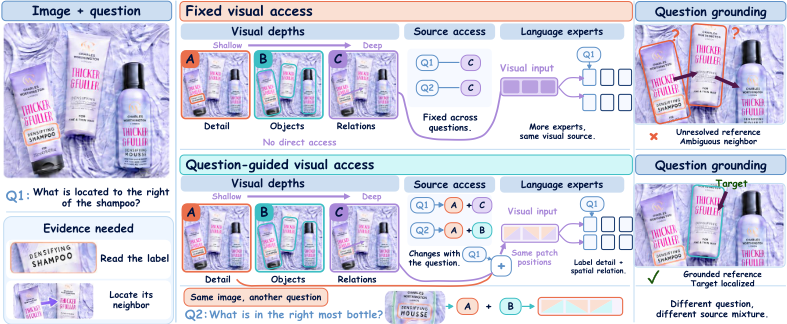
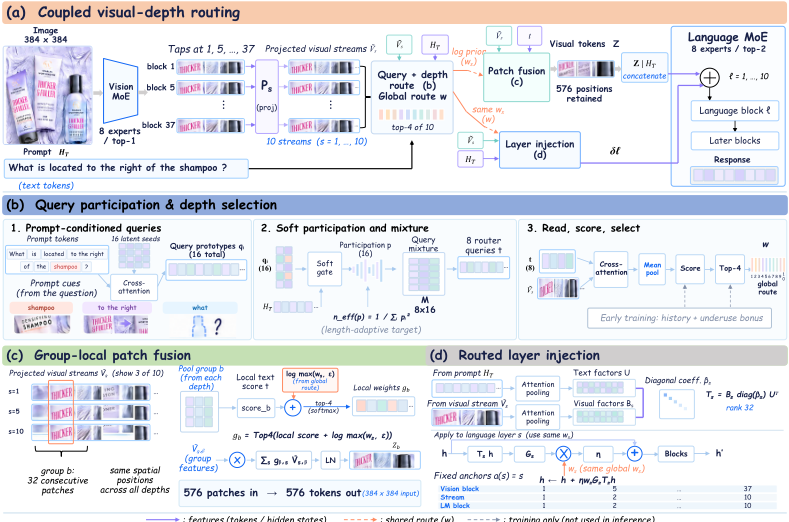
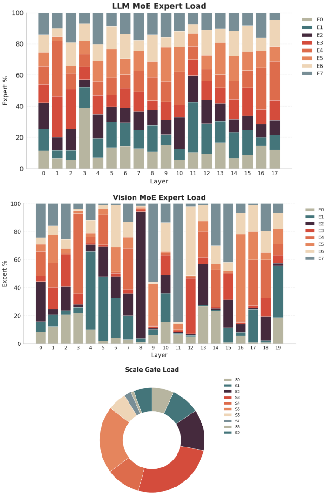

## OMNIMOE-VL: A SPARSE VISION-LANGUAGE MODEL WITH COUPLED VISUAL-DEPTH ROUTING

Long Qian1,2 , Bingke Zhu1,2∗, Jiaqi Wei1,3†, Yingying Chen1,2 , Jinqiao Wang1,2,4

1Foundation Model Research Center, Institute of Automation, Chinese Academy of Sciences

2School of Future Technology, University of Chinese Academy of Sciences

3School of Engineering, Cardiff University

4Wuhan AI Research

qianlong2024@ia.ac.cn, WeiJ16@cardiff.ac.uk, {bingke.zhu,yingying.chen,jqwang}@nlpr.ia.ac.cn

## ABSTRACT

Vision-language models (VLMs) increasingly use sparse mixture-of-experts (MoE) to scale language-side computation, yet visual information is typically routed only after passing through a fixed cross-modal interface. This leaves an important decision unresolved: which intermediate visual representations should be exposed to language computation for a given question? We introduce OmniMoE-VL, a sparse VLM with a coupled visual-depth routed projector. For each image-prompt pair, the projector selects a sparse set of intermediate visual depths and reuses the resulting global preference to guide both local patch fusion and dynamic visual injection into the language model. This design enables question-dependent visual access while preserving the native visual-token sequence, and complements token-level expert routing in the vision and language stacks. Across eight imagebased benchmarks, OmniMoE-VL achieves an average score of 85.9 with 28B total and 9B activated parameters. Controlled comparisons show that the routed visual interface provides the dominant architectural gain, while matched route and component controls, same-image route analysis, and route interventions further support the value of coupling and question-conditioned visual access.

## 1 INTRODUCTION

Vision-language models (VLMs) connect a visual encoder to a language model through a multimodal interface, enabling image understanding, text recognition, and multimodal reasoning (Liu et al., 2023; Li et al., 2024). Scaling this interface is increasingly important as VLMs are asked to read fine text, recognize objects, resolve spatial relations, and combine evidence across an image. Sparse mixtureof-experts (MoE) (Lin et al., 2026; Jing et al., 2025) offers a direct capacity-compute trade-off by assigning each token to a small subset of parameter experts. These models establish language-side conditional computation as a practical way to scale VLMs, but the visual representation delivered to that computation is still determined by the interface before the language experts are invoked.

The interface therefore controls a decision that language-side routing does not: which visual source representations become available to the model. Intermediate encoder depths carry different kinds of evidence. Earlier streams retain local appearance and text detail, middle streams organize neighboring patches into objects, and later streams provide broader contextual structure. A dense projector or a fixed visual stream merges this depth axis before the language router sees the representation. The language router can then choose how to process these tokens, but it cannot recover a visual stream that was not exposed at the interface. Even when visual tokens are prepended before the first LLM block, this remains a post-projection routing problem: the source-depth decision has been made.

Question-dependent source access also has two downstream destinations. The projector fuses aligned visual patches into the sequence that enters the language model, while deep visual injection supplies additional information to intermediate language states (Meng et al., 2024). If these destinations select depths independently, the input sequence and the layer updates can emphasize different visual evidence for the same image-question pair. We instead require a shared global preference over visual depths, then give each destination the operation it needs: local patch compatibility refines the preference into group-specific weights for fusion, whereas fixed depth-to-layer anchors use the global weights to scale dynamic residual updates. This separates global question-dependent selection from local spatial adaptation while keeping both pathways aligned. The resulting hypothesis is directly testable: different questions about one image should change the route, and replacing the native route with a route induced by another question should impair prediction.

∗Corresponding author.

**Figure 1: Question-dependent visual evidence motivates depth selection. The first question requires label recognition and spatial context to identify the shampoo and its right-hand neighbor; the second requires the label on the rightmost bottle. A fixed interface supplies the same visual source to language experts across questions. Prompt-conditioned depth selection combines intermediate streams according to the evidence needed, connecting fine detail, object context, and spatial relations. Colors track the contributing visual streams.**  [open image](assets/2609.32780v1/figure_01.png)
> **Detailed description:**
> **Type:** Diagram
> 
> **Overview:** The figure illustrates the process of question-dependent visual evidence in a model for visual language understanding, specifically focusing on how the model selects the most relevant visual evidence for answering questions.
> 
> **Components:**
> 
> - **Title:** "Figure 1: Question-dependent visual evidence motivates depth selection."
> - **Axes:** Not applicable (the figure is a diagram, not a graph).
> - **Legend Entries:** Not applicable (the figure does not have a legend).
> - **Colors:** Not applicable (the figure does not use colors to represent different elements).
> 
> **Data and Values:** Not applicable (the figure does not contain numerical data).
> 
> **Trends and Comparisons:**
> 
> - **Trends:** The figure shows how the model selects different visual evidence based on the questions asked. It demonstrates how the model uses different visual depths (shallow and deep) and different source access (fixed across questions and variable with the question) to answer the questions.
> - **Comparisons:** The figure compares the model's performance when using fixed visual access versus question-guided visual access. It shows how the model can adapt its visual evidence selection based on the question, improving its ability to answer questions.
> 
> **Key Takeaway:** The model's ability to adapt its visual evidence selection based on the question improves its performance in answering questions, as demonstrated by the figure.

To address these challenges, we introduce OmniMoE-VL, a sparse VLM built around this routed interface (Figure 1). The vision and language stacks use token-level parameter experts, while the projector performs sample-level routing over ten streams tapped at blocks 1, 5, . . . , 37. A promptconditioned bank of 16 softly participating prototypes forms eight router queries; cross-attention over the projected streams produces a top-4 global route w. The route supplies the logarithmic prior for group-local top-4 weights gb, whose aligned weighted fusion preserves the patch sequence, and the same w weights dynamic transformations injected at fixed language layers a(s) = s. Thus the model has one explicit source-selection decision with two coordinated uses, rather than three unrelated sparse modules. An ordered usage prior and underuse bonus guide exploration during early training.

Across eight benchmarks, OmniMoE-VLachieves strong performance with 28B total and 9B activated parameters, reaching an average score of 85.9. Under a common training recipe, introducing the routed visual interface improves the LLM-only MoE baseline by 4.9 points, with vision-side experts providing a further complementary gain. Matched controls show that coupling fusion and injection through a shared depth preference is more effective than learning the two routes independently. Beyond aggregate performance, the learned route changes with questions posed about the same image, and route interventions show that mismatched visual-depth preferences impair prediction. The projector also retains its advantage under image down-sampling and blur. Our contributions are:

- We analyze the source-access bottleneck created when sparse language computation receives a fixed or already fused visual representation, and quantify question-dependent visual access with same-image route comparisons and route interventions.
- We introduce OmniMoE-VL, a sparse vision-language model whose projector couples a prompt-conditioned global route visual depths with group-local patch fusion and dynamic language-layer injection, while token-level experts scale the vision and language stacks.
- We evaluate OmniMoE-VL on eight benchmarks and matched architectural controls, showing an 80.3→85.2→85.9 progression from LLM-only MoE to routed projector to the full model, together with a 1.1-point benefit from sharing the fusion and injection route.
## 2 RELATED WORK

Sparse multimodal computation. MoE-LLaVA expands multimodal language-model capacity through sparse experts (Lin et al., 2026), while EvoMoE develops expert initialization and tokenaware multimodal routing (Jing et al., 2025). These routers assign tokens to parameter experts. OmniMoE-VL complements this computation with a projector that selects which intermediate visual streams contribute to the input sequence and language-layer updates.

Visual interfaces and deep injection. LLaVA-style models align image features with language embeddings through a projector (Liu et al., 2023; Li et al., 2024), and BLIP-2 uses learned queries to bridge the backbones (Li et al., 2023a). DeepStack extends visual access by supplying visual tokens to deeper language layers (Meng et al., 2024). OmniMoE-VL connects input fusion and deep injection through a route computed for each image-prompt pair. Prompt-conditioned queries compare visual streams, local fusion refines the resulting preference for each patch group, and the same preference weights residual injection at assigned language layers. This connection preserves patch positions while coordinating the two visual pathways.

Low-rank adaptation and routing structure. LoRA represents learned weight updates with low-rank factors (Hu et al., 2021). In OmniMoE-VL, attention over the image and prompt constructs dynamic low-rank transformations, and the depth route weights their application. Query-participation control regulates the descriptors used for selection, while an ordered usage prior encourages exploration across visual depths during training.

## 3 METHOD

## 3.1 OMNIMOE-VL OVERVIEW

OmniMoE-VL combines token-level vision and language experts with a sample-level visual-depth projector. For image-prompt pair x = (xV , xT ), let HT ∈ RLT ×d denote prompt embeddings and Vs ∈ RN×dV a visual stream. We extract S = 10 streams at blocks π(s) = 1 + 4(s - 1), or 1, 5, . . . , 37, with aligned patch positions. Prompt-conditioned queries select four depths through w(x) ∈ ∆S-1 , shared by visual input tokens Z and language-layer transformations Aℓ:

$$
Z ( x ) = \mathcal { P } ( V _ { 1 \colon S } , H _ { T } ; w ( x ) ) ,
$$

$$
A _ { \ell } ( x ) = \sum _ { s \colon a ( s ) = \ell } w _ { s } ( x ) G _ { \ell } T _ { s } ( x ) .
$$

Here P fuses projected streams at corresponding patch positions into tokens that join the prompt at the language input. The image and prompt generate Ts(x), and learned low-rank Gℓ maps its output to layer ℓ. Fixed anchors a(s) = s connect the streams to language layers 1, . . . , 10.

Figure 2 traces three distributions: query weights p determine the prompt descriptors; w selects visual depths; and local weights gb refine this preference for patch group b. The same w directly weights injection. Table 8 distinguishes these axes from token-level parameter-expert routing.

## 3.2 PROMPT-CONDITIONED QUERY PARTICIPATION

A learned bank C ∈ RQ×d cross-attends to HT , producing Q = 16 prompt-conditioned prototypes qi with participation weights pi:

$$
q _ { 1 \cdot Q } = L N \left ( \ A t { n } ( C , H _ { T } , H _ { T } ) + \rho C \right ) , \quad p = ( 1 - Q \epsilon _ { q } ) \text { softmax} ( u ( x _ { T } ) ) + \epsilon _ { q } 1 . \quad ( 3 )
$$

The residual ρC retains each seed's contribution. Logits u combine prototype features, prompt context, and query biases; ϵq = 10-4 keeps each prototype available. Prompt length sets a smooth

**Figure 2: OmniMoE-VL couples visual-depth selection with fusion and language-layer updates. (a) The model routes ten projected visual streams through one global depth distribution w. (b) Sixteen softly weighted prototypes form eight queries for top-4 depth selection. (c) The route supplies a prior for group-local weights gb, which fuse aligned features into 576 visual tokens. (d) The same w scales rank-32 updates at fixed language layers a(s) = s. Solid arrows carry features; dashed peach arrows carry shared routing weights.**  [open image](assets/2609.32780v1/figure_02.png)
> **Detailed description:**
> **Type:** Model Architecture
> 
> **Overview:** This figure illustrates the architecture of a model that couples visual and depth selection with fusion and language-layer updates. The model routes projected visual streams through a global depth distribution and uses this information to refine patch group weights and update language layers.
> 
> **Components:**
> 
> 1. **Title:** "Coupled visual-depth routing"
> 2. **Axes:** Not applicable (no axes are mentioned in the caption or text).
> 3. **Legend Entries:** Not applicable (no legend is provided).
> 4. **Panels:**
>    - **Panel (a):** Coupled visual-depth routing
>      - **Description:** The model routes ten projected visual streams through one global depth distribution \( w \). It uses this information to refine patch group weights and update language layers.
>    - **Panel (b):** Query participation & depth selection
>      - **Description:** Sixteen softly weighted prototypes form eight queries for top-4 depth selection. The same \( w \) directly weights injection.
>    - **Panel (c):** Group-local patch fusion
>      - **Description:** The route supplies a prior for group-local weights \( g_b \), which fuse aligned features into 576 visual tokens.
>    - **Panel (d):** Routed layer injection
>      - **Description:** The same \( w \) scales rank-32 updates at fixed language layers \( a(s) = s \).
> 
> **Data and Values:** Not applicable (no specific data values are provided in the caption or text).
> 
> **Trends and Comparisons:** Not applicable (no trends or comparisons are mentioned in the caption or text).
> 
> **Key Takeaway:** The model couples visual and depth selection with fusion and language-layer updates, using a global depth distribution to refine patch group weights and update language layers.

: features (tokens / hidden states)

: shared route (w)

: training only (not used in inference)

participation target:

$$
n _ { \text {eff} } ( p ) & = \frac { 1 } { \sum _ { i } p _ { i } ^ { 2 } } , \quad \mathcal { L } _ { q } = ( n _ { \text {eff} } ( p ) - n _ { \text {tgt} } ( L _ { T } ) ) ^ { 2 } , \quad n _ { \text {tgt} } ( L _ { T } ) = \text {clip} \left ( \log ( 1 + L _ { T } ) + 4 , 2 , Q \right ) . \\ \\ \text {The effective count increases as probability mass exceeds across the bank } \, L \, \text {on} \, \text {arguments receive a}
$$

The effective count increases as probability mass spreads across the bank. Longer prompts receive a larger participation target within the same fixed capacity. A learned M ∈ RR×Q uses the soft weights p to form R = 8 router queries:

$$
\alpha _ { r i } = \text {softmax} _ { i } \left ( \frac { M _ { r i } + \log p _ { i } } { \tau _ { q } } \right ) , \quad t _ { r } = \sum _ { i } \alpha _ { r i } q _ { i } , \quad \tau _ { q } = 0 . 9 .
$$

These mixtures retain multiple prompt-conditioned descriptors for the visual-depth comparison that follows. All prototypes participate through soft weights, while the bank size remains fixed.

## 3.3 GLOBAL DEPTH SELECTION AND LOCAL PATCH FUSION

Depth-specific projections ˜ Vs = Ps(Vs) ∈ RN×d let router queries read all streams at language width. A scoring network maps each mean readout to its depth score:

$$
d _ { s } ( x ) = \frac { 1 } { R } \sum _ { r = 1 } ^ { R } A t t { n _ { s } ( t _ { 1 \colon R } , \widetilde { V } _ { s } , \widetilde { V } _ { s } ) _ { r } } , \quad r _ { s } ( x ) = f _ { s } ( d _ { s } ( x ) ) .
$$

At inference, the resulting scores determine the global route, w = TopKSoftmax4(r/T ). Here TopKSoftmaxk retains the k largest logits, applies softmax on that support, and sets the remaining entries to zero.

During early training, we smooth historical usage across neighboring depths and add an underuse bonus. With cs the exponential moving average of depth usage, the augmented logits are

$$
K _ { i j } = e ^ { - ( i - j ) ^ { 2 } / \gamma } , \quad \bar { p } = \frac { K ( c + \alpha 1 ) } { 1 ^ { \top } K ( c + \alpha 1 ) } , \quad z _ { s } = \frac { r _ { s } } { T } + \lambda _ { h } \log \bar { p } _ { s } + b _ { s } ( c ) .
$$

The kernel spreads historical mass to nearby depths, while bs favors underused streams through a normalized inverse-square-root count bonus. Both additions are disabled after exploration and during evaluation, when content scores determine the route. Appendix A.3 specifies the exploration schedule and auxiliary objectives for depth routing.

To refine the global preference locally, we partition patches into consecutive groups Bb of 32 tokens. Let vb,s be the normalized group mean of ˜ Vs and ¯ t the normalized mean of t1:R. Local compatibility and the global prior jointly determine fusion:

$$
g _ { b } = \text {TopKSoftmax} _ { 4 } \left ( \left \{ \frac { \langle v _ { b , s } , \bar { t } \rangle } { \tau _ { g } } + \log \max ( w _ { s } , \epsilon _ { w } ) \right \} _ { s = 1 } ^ { s } \right ) ,
$$

$$
Z _ { \mathcal { B } _ { b } } = L N \left ( \sum _ { s = 1 } ^ { S } g _ { b , s } \widetilde { V } _ { s , \mathcal { B } _ { b } } \right ) , \quad \tau _ { g } = 0 . 7 , \ \epsilon _ { w } = 1 0 ^ { - 1 2 } .
$$

Each group uses its own gb to refine the sample-wide preference w, and concatenating the fused groups restores the original patch sequence. The log floor assigns a small local prior to globally inactive depths. Their global weights remain zero for the injection branch, which uses w directly.

## 3.4 ROUTED VISUAL INJECTION INTO LANGUAGE LAYERS

Alongside the fused input, the selected streams provide visual updates to intermediate language states. Attention over the prompt constructs directions U(xT ) ∈ Rd×rT , and attention over each projected stream constructs visual directions Bs(xV ) ∈ Rd×rT . Pairing the text and visual directions gives coefficients βs(x) and the transformation

$$
T _ { s } ( x ) = B _ { s } ( x _ { V } ) \, \text {diag} ( \beta _ { s } ( x ) ) U ( x _ { T } ) ^ { \top } , \quad r _ { T } = 3 2 .
$$

Applied to a hidden state, these factors first read prompt-derived coordinates and then reconstruct a visual residual through Bs. A learned rank-32 adapter Ga(s) maps the residual to its assigned language layer. Equation 2 weights this update by the same ws that guides projector fusion, linking the two uses of stream s.

For a column-vector hidden state hℓ,t, the update is

$$
\delta _ { \ell , t } = \eta _ { \ell , t } \, A _ { \ell } ( x ) h _ { \ell , t } , \quad H _ { \ell + 1 } = \Phi _ { \ell } ( H _ { \ell } + \Delta _ { \ell } ) .
$$

Here ηℓ,t combines injection gain, token-type weighting, and residual-norm control. Factorized evaluation avoids a dense d × d matrix. The update enters before the assigned block, with w, U, Bs, and βs determined by the image and prompt.

## 4 ARCHITECTURAL ANALYSIS

## 4.1 GLOBAL SELECTION, LOCAL ADAPTATION, AND LAYER-WISE ACCESS

Each patch group refines the common depth preference through gb. Write cb,s = ⟨vb,s, ¯ t⟩ and ¯ws = max(ws, ϵw). For two depths retained by local top-k selection,

$$
\log \frac { g _ { b , i } } { g _ { b , j } } = \log \frac { \bar { w } _ { i } } { \bar { w } _ { j } } + \frac { c _ { b , i } - c _ { b , j } } { \tau _ { g } } .
$$

The shared prior sets the depth preference, and local compatibility adjusts it across patch groups. Injection carries this preference into language computation: ws scales the prompt-stream transformation at anchor a(s), whose destination is fixed and content is input-dependent.

Table 1: Training configs for OmniMoE-VL.

| Config                                            | Stage I                                          | Stage II                                         | Stage III                                        | Stage IV                                         |
|---------------------------------------------------|--------------------------------------------------|--------------------------------------------------|--------------------------------------------------|--------------------------------------------------|
| Vision MoE (experts / top-k)                      | -                                                | -                                                | 8 / 2                                            | 8 / 1                                            |
| LLM MoE (experts / top-k)                         | -                                                | 8 / 2                                            | 8 / 2                                            | 8 / 2                                            |
| Projector MoE (scales / top-k)                    | 10 / 4                                           | 10 / 4                                           | 10 / 4                                           | 10 / 4                                           |
| Trainable MoE params                              | Projector only                                   | LLM only                                         | Vision only                                      | Projector + LLM + Vision                         |
| Data                                              | OMVL-16M-Alignment                               | OMVL-16M-LLM                                     | OMVL-16M-Vision                                  | OMVL-16M-Joint                                   |
| Image resolution Base Vision Tower Base LLM Model | 384 × 384 siglip2-giant-opt-patch16-384 Qwen3-8B | 384 × 384 siglip2-giant-opt-patch16-384 Qwen3-8B | 384 × 384 siglip2-giant-opt-patch16-384 Qwen3-8B | 384 × 384 siglip2-giant-opt-patch16-384 Qwen3-8B |
| Epochs Learning rate                              | 1e - 4                                           | 5e - 5                                           | 1 5e - 5 cosine                                  | 1e - 5                                           |
| LR schedule Batch size per GPU Precision          | 2                                                | 1                                                | 1 BF16                                           | 1                                                |
| Deepspeed's ZeRO config                           | ZeRO-2 offload                                   | ZeRO-2                                           | ZeRO-2 offload                                   | ZeRO-2 offload                                   |

[open table image](assets/2609.32780v1/table_01.png)
> **Detailed description:**
> **Overview:** This table compares different training configurations for OmniMoE-VL, a model that combines vision and language models. It evaluates the performance of the model across four stages of training, focusing on the number of experts and top-k values used in each stage.
> 
> **Structure:** The table has five columns and four rows. The columns represent different aspects of the training configuration, including the type of MoE (Multi-Objective Estimation) used, the number of trainable MoE parameters, the data used, the base vision and language models, and the training parameters. The rows represent different stages of training, labeled as Stage I, Stage II, Stage III, and Stage IV.
> 
> **Contents:**
> 
> - **Config:** The first column lists the types of MoE used in each stage. "Vision MoE" and "LLM MoE" refer to the use of vision and language models, respectively. "Projector MoE" refers to the use of a projector model. The values in this column are not bolded or underlined.
> - **Stage I:** This row shows the initial stage of training, where no MoE is used. The values are not bolded or underlined.
> - **Stage II:** This row shows the second stage of training, where LLM MoE is used. The values are not bolded or underlined.
> - **Stage III:** This row shows the third stage of training, where Vision MoE is used. The values are not bolded or underlined.
> - **Stage IV:** This row shows the fourth stage of training, where both Vision and LLM MoE are used. The values are not bolded or underlined.
> - **Trainable MoE params:** This column shows the type of MoE parameters that are trainable in each stage. "Projector only" means only the projector model is trainable, "LLM only" means only the LLM model is trainable, "Vision only" means only the vision model is trainable, and "Projector + LLM + Vision" means all three models are trainable.
> - **Data:** This column lists the data used for training. "OMVL-16M-Alignment" refers to a specific dataset, and "OMVL-16M-LLM" refers to a dataset with both vision and language models. The values are not bolded or underlined.
> - **Image resolution:** This column shows the image resolution used in each stage. The values are not bolded or underlined.
> - **Base Vision Tower Base LLM Model:** This column lists the base vision and language models used in each stage. The values are not bolded or underlined.
> - **Epochs:** This column shows the number of epochs used in each stage. The values are not bolded or underlined.
> - **Learning rate:** This column shows the learning rate used in each stage. The values are not bolded or underlined.
> - **LR schedule:** This column shows the learning rate schedule used in each stage. The values are not bolded or underlined.
> - **Batch size per GPU:** This column shows the batch size used per GPU in each stage. The values are not bolded or underlined.
> - **Precision:** This column shows the precision used in each stage. The values are not bolded or underlined.
> - **Deepspeed's ZeRO config:** This column shows the Deepspeed's ZeRO configuration used in each stage. The values are not bolded or underlined.
> 
> **Best and worst results:** There are no specific results or scores reported in this table, so this section is skipped.
> 
> **Comparisons and trends:** There are no specific comparisons or trends reported in this table, so this section is skipped.
> 
> **Key takeaway:** This table provides a detailed comparison of different training configurations for OmniMoE-VL, focusing on the number of experts and top-k values used in each stage of training, the types of MoE parameters that are trainable, the data used, the base models, the training parameters, and the Deepspeed's ZeRO configuration.

## 4.2 LEARNING A ROUTE THROUGH BOTH VISUAL PATHWAYS

Both pathways train w through the language-modeling loss. Holding the selection support fixed, its effects on visual tokens Z and transformations Aℓ give

$$
\nabla _ { w } \mathcal { L } _ { L M } = J _ { Z , w } ^ { \top } \nabla _ { Z } \mathcal { L } _ { L M } + \sum _ { \ell } J _ { A _ { \ell } , w } ^ { \top } \nabla _ { A _ { \ell } } \mathcal { L } _ { L M } .
$$

The local Jacobians hold other inputs fixed. Table 3(b) tests shared versus independent routing during training; Table 5(b) tests each pathway's use of the learned route at inference.

## 4.3 CAPACITY AND COMPUTATION

Fusion reads ten streams from one vision-encoder pass and retains the 576-position patch grid. Depth selection therefore changes features without extending the language input. Injection applies its two factors to L states at cost O(Ld(rT + rG)), in addition to constructing them. Before token-dependent gains, their composition has rank at most min(rT , rG) = 32 per anchor.

The model stores 28B parameters and activates 9B. Execution also includes dense attention, visual processing, and dispatch, while storage covers the full expert pool. Section 5.5 reports memory and throughput; Appendix C develops the mathematical properties.

## 5 EXPERIMENTS

## 5.1 EXPERIMENTAL SETUP

Model and training. We initialize the vision encoder from SigLIP2-Giant at 384 × 384 resolution and the language model from Qwen3-8B (Tschannen et al., 2025; Bai et al., 2025a). Their evenindexed blocks contain eight feed-forward experts, using top-1 routing in the final vision stack and top-2 in the language stack. The projector connects the backbones through ten visual depths, 16 query prototypes, eight router queries, and top-4 depth selection. Table 1 gives the training configuration, and Appendix A details the routing and injection settings.

Data. We train on OMVL-16M, approximately 16.2M multimodal instruction samples curated from LLaVA-NeXT, Infinity-MM, LLaVA-OneVision, and LLaVA-Instruct (Liu et al., 2024a; Gu et al., 2025; Li et al., 2024; Liu et al., 2023). Appendix B.1 describes benchmark de-duplication. Stack-wise variants share these data and the progressive recipe. A second setting uses the public MoE-LLaVA/EvoMoE data and recipe; each component replacement retains the backbone, query bank, visual depths, routing budget, and remaining modules.

Progressive optimization. Stage I aligns the backbones through the projector. Stages II and III train language and vision experts in turn, and Stage IV jointly tunes all stacks at a lower LR.

Benchmarks and metrics. Our eight benchmarks are MMBench, MM-Vet, TextVQA, DocVQA, POPE, MMMU, OCRBench, and ChartQA (Liu et al., 2024b; Yu et al., 2024; Singh et al., 2019;

Table 2: Eight-benchmark comparison. Parameters are in billions; V QAT /V QAD denote TextVQA/DocVQA. Avg. uses listed scores; superscripts give their count. † marks independent evaluations (Appendix B.4). Bold/underlined scores denote first/second place.

| Methods                      | # Params   | # Act.   | Benchmarks - MMBench   | Benchmarks - MMVet   | Benchmarks - V QAT   | Benchmarks - V QAD   | Benchmarks - POPE   | Benchmarks - MMMU   | Benchmarks - OCRBench   | Benchmarks - ChartQA   | Avg.    |
|------------------------------|------------|----------|------------------------|----------------------|----------------------|----------------------|---------------------|---------------------|-------------------------|------------------------|---------|
| Dense models                 |            |          |                        |                      |                      |                      |                     |                     |                         |                        |         |
| Qwen3-VL-8B-Instruct         | 8B         | 8B       | 85.0                   | -                    | 82.9†                | -                    | -                   | 69.6                | 89.6                    | 89.6                   | 83.3(5) |
| GLM-4.6V-Flash               | 9B         | 9B       | 86.9                   | -                    | -                    | -                    | -                   | 71.1                | 84.7                    | -                      | 80.9(3) |
| Qwen2.5-VL-7B                | 7B         | 7B       | 83.5                   | 67.1                 | 84.9                 | 95.7                 | 86.4                | 58.6                | 86.4                    | 87.3                   | 81.2(8) |
| Sparse models                |            |          |                        |                      |                      |                      |                     |                     |                         |                        |         |
| Step-3                       | 321B       | 38B      | 81.1†                  | 79.4†                | -                    | -                    | -                   | 74.2                | 83.7†                   | -                      | 79.6(4) |
| MoE-LLaVA                    | 5B         | 4B       | 68.0                   | 35.9                 | 57.0                 | 25.6†                | 85.7                | -                   | -                       | 15.4†                  | 47.9(6) |
| EvoMoE                       | 7B         | 7B       | 65.8                   | -                    | 53.8                 | -                    | 87.3                | -                   | -                       | -                      | 69.0(3) |
| OmniMoE-VL (w/o. Vision MoE) | 25B        | 9B       | 86.9                   | 77.9                 | 86.1                 | 95.7                 | 88.3                | 69.4                | 88.2                    | 89.3                   | 85.2(8) |
| OmniMoE-VL                   | 28B        | 9B       | 87.8                   | 78.3                 | 87.9                 | 96.1                 | 88.2                | 70.1                | 89.3                    | 89.6                   | 85.9(8) |

[open table image](assets/2609.32780v1/table_02.png)
> **Detailed description:**
> **Overview:** This table compares the performance of different models on eight benchmark tasks, including MMBench, MMVet, VQA^T, VQA^D, POPE, MMMU, OCRBench, and ChartQA. The models are categorized into dense and sparse models, and the table shows their parameters, activations, and scores on each benchmark.
> 
> **Structure:**
> - **Column Headers:**
>   - **Methods:** Different models compared.
>   - **# Params:** Number of parameters in billions.
>   - **# Act.:** Number of activations in billions.
>   - **Benchmarks - MMBench:** Scores on MMBench.
>   - **Benchmarks - MMVet:** Scores on MMVet.
>   - **Benchmarks - V QAT:** Scores on VQA^T.
>   - **Benchmarks - V QAD:** Scores on VQA^D.
>   - **Benchmarks - POPE:** Scores on POPE.
>   - **Benchmarks - MMMU:** Scores on MMMU.
>   - **Benchmarks - OCRBench:** Scores on OCRBench.
>   - **Benchmarks - ChartQA:** Scores on ChartQA.
>   - **Avg.:** Average scores across all benchmarks.
> 
> **Contents:**
> - **Dense models:**
>   - **Qwen3-VL-8B-Instruct:** 8B parameters, 8B activations, scores: MMBench 85.0, MMVet - (not reported), VQA^T 82.9†, VQA^D - (not reported), POPE 69.6, MMMU 89.6, OCRBench 89.6, ChartQA 89.6, Avg. 83.3(5).
>   - **GLM-4.6V-Flash:** 9B parameters, 9B activations, scores: MMBench 86.9, MMVet - (not reported), VQA^T - (not reported), VQA^D - (not reported), POPE 71.1, MMMU 84.7, OCRBench - (not reported), ChartQA - (not reported), Avg. 80.9(3).
>   - **Qwen2.5-VL-7B:** 7B parameters, 7B activations, scores: MMBench 83.5, MMVet 67.1, VQA^T 84.9, VQA^D 95.7, POPE 86.4, MMMU 58.6, OCRBench 86.4, ChartQA 87.3, Avg. 81.2(8).
> 
> - **Sparse models:**
>   - **Step-3:** 321B parameters, 38B activations, scores: MMBench 81.1†, MMVet 79.4†, VQA^T - (not reported), VQA^D - (not reported), POPE 74.2, MMMU - (not reported), OCRBench - (not reported), ChartQA - (not reported), Avg. 79.6(4).
>   - **MoE-LLaVA:** 5B parameters, 4B activations, scores: MMBench 68.0, MMVet 35.9, VQA^T 57.0, VQA^D 25.6†, POPE 85.7, MMMU - (not reported), OCRBench - (not reported), ChartQA - (not reported), Avg. 47.9(6).
>   - **EvoMoE:** 7B parameters, 7B activations, scores: MMBench 65.8, MMVet - (not reported), VQA^T 53.8, VQA^D - (not reported), POPE 87.3, MMMU - (not reported), OCRBench - (not reported), ChartQA - (not reported), Avg. 69.0(3).
>   - **OmniMoE-VL (w/o. Vision MoE):** 25B parameters, 9B activations, scores: MMBench 86.9, MMVet 77.9, VQA^T 86.1, VQA^D 95.7, POPE 88.3, MMMU 69.4, OCRBench 88.2, ChartQA 89.3, Avg. 85.2(8).
>   - **OmniMoE-VL:** 28B parameters, 9B activations, scores: MMBench 87.8, MMVet 78.3, VQA^T 87.9, VQA^D 96.1, POPE 88.2, MMMU 70.1, OCRBench 89.3, ChartQA 89.6, Avg. 85.9(8).
> 
> **Best and worst results:**
> - **Best scores:**
>   - **VQA^D:** 96.1 (OmniMoE-VL with 28B parameters and 9B activations).
>   - **POPE:** 88.3 (OmniMoE-VL with 25B parameters and 9B activations).
>   - **ChartQA:** 89.6 (OmniMoE-VL with 28B parameters and 9B activations).
> - **Worst scores:**
>   - **MMVet:** 35.9 (MoE-LLaVA with 5B parameters and 4B activations).
>   - **OCRBench:** 69.4 (OmniMoE-VL with 25B parameters and 9B activations).
>   - **ChartQA:** 89.6 (OmniMoE-VL with 28B parameters and 9B activations).
> 
> **Comparisons and trends:**
> - **OmniMoE-VL:** Generally outperforms other models across all benchmarks, with the best scores in VQA^D and POPE.
> - **Qwen3-VL-8B-Instruct:** Performs well in MMBench and ChartQA but has lower scores in other benchmarks.
> - **Step-3:** Performs well in MMBench and POPE but has lower scores in other benchmarks.
> - **MoE-LLaVA:** Performs well in MMBench and POPE but has lower scores in other benchmarks.
> - **EvoMoE:** Performs well in MMBench and POPE but has lower scores in other benchmarks.
> 
> **Key takeaway:** OmniMoE-VL with 28B parameters and 9B activations generally outperforms other models across all benchmarks, with the best scores in VQA^D and POPE.

Table 3: Public-recipe results and matched projector controls. Left: comparison scores (benchmark coverage in Appendix B.3). Right: shared versus independent routes at matched parameter count, followed by component replacements. Visual experts are disabled throughout (b).

(a) Comparison under public recipes

(b) Matched projector controls

| Method                             |   Avg. | Variant                              | Avg.        |
|------------------------------------|--------|--------------------------------------|-------------|
| MoE-LLaVA (Lin et al., 2026)       |   61.7 | Full coupled projector               | 83.7        |
| EvoMoE (Jing et al., 2025)         |   69.0 | Independent fusion/injection routes  | 82.6 (-1.1) |
| OmniMoE-VL (w/o. Visual stack MoE) |   83.7 | Plain softmax gate + matched reg     | 81.8 (-1.9) |
|                                    |        | Standard router + load-balance/UCB   | 83.1 (-0.6) |
| Full OmniMoE-VL                    |   84.1 | Per-layer LoRA (matched rank/params) | 83.3 (-0.4) |

[open table image](assets/2609.32780v1/table_03.png)
> **Detailed description:**
> **Overview:** This table compares the performance of different methods and variants in a specific context, likely related to machine learning or deep learning models. The table shows the average performance of various methods and their variants, comparing them under different conditions or settings.
> 
> **Structure:** The table has two main columns: "Method" and "Variant." The "Method" column lists different models or techniques, while the "Variant" column shows the variants or configurations of these methods. The "Avg." column indicates the average performance of each method or variant.
> 
> **Contents:**
> - **MoE-LLaVA (Lin et al., 2026):** Avg. = 61.7
> - **EvoMoE (Jing et al., 2025):** Avg. = 69.0
> - **OmniMoE-VL (w/o. Visual stack MoE):** Avg. = 83.7
> - **Full OmniMoE-VL:** Avg. = 84.1
> 
> **Best and worst results:**
> - **Best:** Full OmniMoE-VL (Avg. = 84.1)
> - **Worst:** MoE-LLaVA (Avg. = 61.7)
> 
> **Comparisons and trends:**
> - **Full coupled projector:** Avg. = 83.7
> - **Independent fusion/injection routes:** Avg. = 82.6 (-1.1)
> - **Plain softmax gate + matched reg:** Avg. = 81.8 (-1.9)
> - **Standard router + load-balance/UCB:** Avg. = 83.1 (-0.6)
> - **Per-layer LoRA (matched rank/params):** Avg. = 83.3 (-0.4)
> 
> **Key takeaway:** The table shows that the Full OmniMoE-VL method performs the best, with an average performance of 84.1, while MoE-LLaVA performs the worst with an average performance of 61.7. The table also indicates that the Full coupled projector variant performs better than the Independent fusion/injection routes variant, with an average performance of 83.7 compared to 82.6.

Mathew et al., 2020; Li et al., 2023b; Yue et al., 2024; Liu et al., 2024c; Masry et al., 2022), covering multimodal understanding, text recognition, documents, object hallucination, multidisciplinary reasoning, and charts. We express all scores on a 0-100 scale, normalizing OCRBench by its maximum, and report each mean with its task count in Table 2. Percentage changes use the stated comparison score as their reference. Component ablations-removal and corruption-robustness experiment experiments use MMBench, MM-Vet, TextVQA, DocVQA, and POPE.

## 5.2 COMPARISON WITH DENSE AND SPARSE VLMS

Table 2 places OmniMoE-VL alongside dense and sparse VLMs using model releases and published evaluations (Bai et al., 2025b; Team et al., 2025; Bai et al., 2025c; Team, 2025b; Lin et al., 2026; Jing et al., 2025). Its eight-task average of 85.9 exceeds Qwen2.5-VL-7B's 81.2 by 4.7 points (+5.8%), with gains on every task. The largest are 11.5 points on MMMU (+19.6%) and 11.2 on MM-Vet (+16.7%). OmniMoE-VL leads the listed MMBench, TextVQA, and DocVQA results, matches Qwen3-VL-8B on ChartQA, and gains 5.0 points (+6.0%) over it on TextVQA. Step-3 leads MMMU and MM-Vet at 74.2 and 79.4. The following controls examine the architectural sources of OmniMoE-VL's performance.

Under the public recipe (Table 3), the projector reaches 83.7, and vision experts raise the score to 84.1, a 0.5% relative gain. The accompanying controls examine routing coupling and the projector's individual operations.

## 5.3 STACK PLACEMENT AND PROJECTOR COMPONENTS

Table 4(a) places most of the gain at the visual interface. The routed projector raises the eight-task average from 80.3 to 85.2 (+6.1%), adding 4.7 points on MMMU, 5.0 on OCRBench, and 1.2 on ChartQA. Vision experts add a further 0.7 average points (+0.8%), bringing the total gain to 7.0%. They raise TextVQA from 86.1 to 87.9 and OCRBench from 88.2 to 89.

Table 4: Architectural ablations. (a) Stack placement across eight benchmarks: V/P/L denote vision/projector/language experts; ‡ marks the aggregate-derived mean (Appendix B.2). (b) Projector removals under the component protocol: Q/R/I denote query control, depth routing, and visual injection.

| (a) Stack placement - Variant   | (a) Stack placement - V   | (a) Stack placement - P   | (a) Stack placement - L   | (a) Stack placement - Avg.   | (b) Projector components - Variant   | (b) Projector components - Q   | (b) Projector components - R   | (b) Projector components - I   |   (b) Projector components - Avg. |
|---------------------------------|---------------------------|---------------------------|---------------------------|------------------------------|--------------------------------------|--------------------------------|--------------------------------|--------------------------------|-----------------------------------|
| LLM-only MoE                    | ✗                         | ✗                         | ✓                         | 80.3‡                        | Full                                 | ✓                              | ✓                              | ✓                              |                              87.6 |
| LLM + Projector MoE             | ✗                         | ✓                         | ✓                         | 85.2                         | MLP-only projector                   | ✗                              | ✗                              | ✗                              |                              81.3 |
| Full OmniMoE-VL                 | ✓                         | ✓                         | ✓                         | 85.9                         | w/o. Q                               | ✗                              | ✓                              | ✓                              |                              84.3 |
|                                 |                           |                           |                           |                              | w/o. I                               | ✓                              | ✓                              | ✗                              |                              83.8 |
|                                 |                           |                           |                           |                              | w/o. Q&R                             | ✗                              | ✗                              | ✓                              |                              83.1 |

[open table image](assets/2609.32780v1/table_04.png)
> **Detailed description:**
> **Overview:** This table compares different architectural ablations for a model, focusing on two aspects: (a) the placement of experts in the stack (V/P/L) and (b) the removal of projector components (Q/R/I). The table aims to understand how different configurations affect the model's performance across eight benchmarks.
> 
> **Structure:**
> - **Column Headers:**
>   - **(a) Stack placement - Variant:** Different variants of the model architecture.
>   - **(a) Stack placement - V:** Vision expert placement.
>   - **(a) Stack placement - P:** Projector expert placement.
>   - **(a) Stack placement - L:** Language expert placement.
>   - **(a) Stack placement - Avg.:** Average performance across all experts.
>   - **(b) Projector components - Variant:** Different variants of the projector components.
>   - **(b) Projector components - Q:** Query control.
>   - **(b) Projector components - R:** Depth routing.
>   - **(b) Projector components - I:** Visual injection.
>   - **(b) Projector components - Avg.:** Average performance across all projector components.
> 
> **Contents:**
> - **LLM-only MoE:**
>   - **V:** ✗
>   - **P:** ✗
>   - **L:** ✓
>   - **Avg.:** 80.3‡
> - **LLM + Projector MoE:**
>   - **V:** ✗
>   - **P:** ✓
>   - **L:** ✓
>   - **Avg.:** 85.2
> - **Full OmniMoE-VL:**
>   - **V:** ✓
>   - **P:** ✓
>   - **L:** ✓
>   - **Avg.:** 85.9
>   - **w/o. Q:** ✗
>   - **w/o. I:** ✓
>   - **w/o. Q&R:** ✗
>   - **Avg.:** 84.3
>   - **w/o. Q&R:** ✗
>   - **Avg.:** 83.1
> 
> **Best and Worst Results:**
> - **Best:**
>   - **LLM + Projector MoE:** Avg. = 85.2
>   - **Full OmniMoE-VL:** Avg. = 85.9
> - **Worst:**
>   - **LLM-only MoE:** Avg. = 80.3‡
> 
> **Comparisons and Trends:**
> - The Full OmniMoE-VL variant performs the best across all variants, achieving an average score of 85.9.
> - The LLM-only MoE variant performs the worst, with an average score of 80.3‡.
> - The LLM + Projector MoE variant performs better than the LLM-only MoE variant but worse than the Full OmniMoE-VL variant.
> - Removing the query control (Q) component slightly decreases the performance, as seen in the w/o. Q variant with an average score of 84.3.
> - Removing the depth routing (R) component slightly decreases the performance, as seen in the w/o. I variant with an average score of 83.8.
> - Removing both query control (Q) and depth routing (R) components decreases the performance further, as seen in the w/o. Q&R variant with an average score of 83.1.
> 
> **Key Takeaway:**
> The Full OmniMoE-VL variant is the most effective configuration for the model, achieving the highest average performance across all variants.

Table 5: Question-conditioned visual access. For same-image comparisons, Qwen3-VL depthprofile distances are measured in nats/token, while OmniMoE-VL route distances use total variation (TV). ∆D = Ddifferent - Dparaphrase. The lower block reports route interventions in OmniMoE-VL while holding the image, target question, and non-route inputs fixed.

| Comparison                                             | Images                                                 | Targets                                                | Qwen3-VL: Dprof - Different                            | Qwen3-VL: Dprof - Paraphrase                           | Qwen3-VL: Dprof - ∆D                                   | OmniMoE-VL: DTV - Different                            | OmniMoE-VL: DTV - Paraphrase                           | OmniMoE-VL: DTV - ∆D                                   |
|--------------------------------------------------------|--------------------------------------------------------|--------------------------------------------------------|--------------------------------------------------------|--------------------------------------------------------|--------------------------------------------------------|--------------------------------------------------------|--------------------------------------------------------|--------------------------------------------------------|
| Fixed target                                           | 283                                                    | 322                                                    | 0.257                                                  | 0.171                                                  | 0.086                                                  | 0.301                                                  | 0.162                                                  | 0.139                                                  |
| + matched structural type                              | 136                                                    | 174                                                    | 0.251                                                  | 0.169                                                  | 0.083                                                  | 0.282                                                  | 0.159                                                  | 0.123                                                  |
| + matched answer length                                | 193                                                    | 214                                                    | 0.253                                                  | 0.193                                                  | 0.060                                                  | 0.264                                                  | 0.171                                                  | 0.093                                                  |
| + identical reference answer                           | 44                                                     | 53                                                     | 0.137                                                  | 0.089                                                  | 0.049                                                  | 0.217                                                  | 0.145                                                  | 0.072                                                  |
| Route intervention: reference-answer ∆NLL (nats/token) | Route intervention: reference-answer ∆NLL (nats/token) | Route intervention: reference-answer ∆NLL (nats/token) | Route intervention: reference-answer ∆NLL (nats/token) | Route intervention: reference-answer ∆NLL (nats/token) | Route intervention: reference-answer ∆NLL (nats/token) | Route intervention: reference-answer ∆NLL (nats/token) | Route intervention: reference-answer ∆NLL (nats/token) | Route intervention: reference-answer ∆NLL (nats/token) |
| Fusion route                                           | Fusion route                                           | Fusion route                                           | Fusion route                                           | Injection route                                        | Injection route                                        | Injection route                                        | Injection route                                        | ∆NLL ↓                                                 |
| Native wA                                              | Native wA                                              | Native wA                                              | Native wA                                              | Native wA                                              | Native wA                                              | Native wA                                              | Native wA                                              | 0.00                                                   |
| Paraphrase w′A                                         | Paraphrase w′A                                         | Paraphrase w′A                                         | Paraphrase w′A                                         | Paraphrase w′A                                         | Paraphrase w′A                                         | Paraphrase w′A                                         | Paraphrase w′A                                         | 0.01                                                   |
| Other-question wB                                      | Other-question wB                                      | Other-question wB                                      | Other-question wB                                      | Native wA                                              | Native wA                                              | Native wA                                              | Native wA                                              | 0.04                                                   |
| Native wA                                              | Native wA                                              | Native wA                                              | Native wA                                              | Other-question wB                                      | Other-question wB                                      | Other-question wB                                      | Other-question wB                                      | 0.03                                                   |
| Other-question wB                                      | Other-question wB                                      | Other-question wB                                      | Other-question wB                                      | Other-question wB                                      | Other-question wB                                      | Other-question wB                                      | Other-question wB                                      | 0.09                                                   |

[open table image](assets/2609.32780v1/table_05.png)
> **Detailed description:**
> **Overview:** This table compares the performance of two methods, Qwen3-VL and OmniMoE-VL, in measuring the distance between different image-target pairs. The distance is measured in nats/token for Qwen3-VL and total variation (TV) for OmniMoE-VL. The table also reports the difference in distances between different and paraphrase cases, denoted as ∆D.
> 
> **Structure:**
> - **Comparison:** The table compares different configurations of the methods.
> - **Images:** The number of images used in each comparison.
> - **Targets:** The number of target questions used in each comparison.
> - **Qwen3-VL: Dprof - Different:** The distance between different image-target pairs measured in nats/token.
> - **Qwen3-VL: Dprof - Paraphrase:** The distance between paraphrase image-target pairs measured in nats/token.
> - **Qwen3-VL: Dprof - ∆D:** The difference in distances between different and paraphrase cases.
> - **OmniMoE-VL: DTV - Different:** The distance between different image-target pairs measured in TV.
> - **OmniMoE-VL: DTV - Paraphrase:** The distance between paraphrase image-target pairs measured in TV.
> - **OmniMoE-VL: DTV - ∆D:** The difference in distances between different and paraphrase cases.
> 
> **Contents:**
> - **Fixed target:** 283 images, 322 targets, Qwen3-VL: 0.257, OmniMoE-VL: 0.301, ∆D: 0.086.
> - **+ matched structural type:** 136 images, 174 targets, Qwen3-VL: 0.251, OmniMoE-VL: 0.282, ∆D: 0.083.
> - **+ matched answer length:** 193 images, 214 targets, Qwen3-VL: 0.253, OmniMoE-VL: 0.264, ∆D: 0.060.
> - **+ identical reference answer:** 44 images, 53 targets, Qwen3-VL: 0.137, OmniMoE-VL: 0.217, ∆D: 0.049.
> 
> **Route intervention: reference-answer ∆NLL (nats/token):**
> - **Native wA:** 0.00.
> - **Paraphrase w′A:** 0.01.
> - **Other-question wB:** 0.04.
> - **Native wA:** 0.03.
> - **Other-question wB:** 0.09.
> 
> **Best and worst results:**
> - **Qwen3-VL: Dprof - Different:** Best: 0.137 (44 images, 53 targets).
> - **Qwen3-VL: Dprof - Paraphrase:** Best: 0.089 (44 images, 53 targets).
> - **Qwen3-VL: Dprof - ∆D:** Best: 0.049 (44 images, 53 targets).
> - **OmniMoE-VL: DTV - Different:** Best: 0.162 (283 images, 322 targets).
> - **OmniMoE-VL: DTV - Paraphrase:** Best: 0.159 (283 images, 322 targets).
> - **OmniMoE-VL: DTV - ∆D:** Best: 0.072 (283 images, 322 targets).
> 
> **Comparisons and trends:**
> - The fixed target comparison shows the baseline performance of the methods.
> - The + matched structural type and + matched answer length comparisons show the impact of matching structural type and answer length on the distances.
> - The + identical reference answer comparison shows the impact of having the same reference answer.
> - The route intervention comparison shows the impact of different injection routes on the distances.
> 
> **Key takeaway:** The fixed target comparison shows the baseline performance of the methods. The + matched structural type and + matched answer length comparisons show that matching structural type and answer length can reduce the distances. The + identical reference answer comparison shows that having the same reference answer can also reduce the distances. The route intervention comparison shows that different injection routes can have different impacts on the distances.

Removing query control lowers the score from 87.6 to 84.3 (3.8%); removing injection gives 83.8 (4.3%). Removing both query control and structured routing gives 83.1 (5.1%; Table 4(b)). Both selecting depths and applying their transformations contribute to the projector's gain.

At matched parameter count, independent fusion/injection routes score 82.6 vs. 83.7 for the coupled projector (Table 3(b)). Sharing the depth preference therefore improves the average by 1.1 points.

The softmax replacement removes the length-adaptive target while retaining the query synthesizer, 16 prototypes, ten depths, top-4 routing, and entropy, diversity, and balancing terms. With the same validation split and tuning budget, it scores 81.8, trailing the full projector by 1.9 points (+2.3%). The standard load-balanced/UCB router scores 83.1, and rank- and parameter-matched per-layer LoRA scores 83.3; the proposed operations improve over these alternatives by 0.7% and 0.5%.

## 5.4 QUESTION-CONDITIONED VISUAL ACCESS

We use 397 GQA images with four questions each (Hudson & Manning, 2019), including 322 equivalent wordings across 283 images with the same semantic program and answer. Each target is paired with its own equivalent wording and with eligible other questions about the same image. The three controls separately match structural question type, reference-answer token count, or exact reference answer between the target and other question. We average eligible comparisons within targets, then targets within images, and weight images equally.

Visual-depth contributions. In Qwen3-VL-30B-A3B-Instruct (Bai et al., 2025b), we zero one DeepStack output from encoder index 8, 16, or 24 (zero-based), retaining the other paths and main visual input. Evaluation uses BF16 and at most 262,144 pixels. Each entry of e(q) is the change in reference-token NLL, excluding EOS. We center this profile to compare relative depth contributions:

$$
\widetilde { e } ( q ) = e ( q ) - \frac { 1 } { 3 } ( 1 ^ { \top } e ( q ) ) 1 , \quad D _ { p r o f } ( q , q ^ { \prime } ) = \frac { \| \widetilde { e } ( q ) - \widetilde { e } ( q ^ { \prime } ) \| _ { 2 } } { \sqrt { 3 } } .
$$

Different questions have more distinct profiles than equivalent wordings in all four comparisons (Table 5(a)), linking visual-depth contributions to the question's information demand.

Route variation in OmniMoE-VL. We next measure how the model's global route changes with the question. For the same image, w(q) is a distribution over ten depths with top-4 support. Its total variation distance is

$$
D _ { T V } ( q _ { i } , q _ { j } ) = \frac { 1 } { 2 } \| w ( q _ { i } ) - w ( q _ { j } ) \| _ { 1 } \in [ 0 , 1 ] .
$$

Table 5(a) gives distances of 0.301 for other questions and 0.162 for paraphrases, a paired gap of 0.139. Matching structural type, answer length, or the exact answer preserves this ordering, connecting route variation to question content beyond these controls.

The identical-answer control compares different questions with the same reference answer: route distances are 0.217 versus 0.145, a gap of 0.072. Thus, the distinction persists even when the output is fixed. Structural-type and answer-length matching preserve gaps of 0.123 and 0.093, respectively.

Route interventions. For target qA, we replace its native route wA with a same-image paraphrase route w′A or another question's route wB. Only routing changes; the image, target prompt, queries, and operator factors remain fixed. Writing fusion and injection routes as u, v, we score reference answer Y by

$$
N L ( q ; u , v ) = - \frac { 1 } { | Y | } \sum _ { t = 1 } ^ { | Y | } \log p ( y _ { t } \, | \, y _ { < t } , x , q ; u , v ) .
$$

We report ∆NLL = NLL(qA; u, v) - NLL(qA; wA, wA) in nats per answer token. All conditions score the same reference answer with teacher forcing. Local fusion is recomputed under the transferred prior, while injection retains the target question's operator factors. Fusion-only, injection-only, and joint replacement increase NLL by 0.04, 0.03, and 0.09, versus 0.01 for paraphrase transfer (Table 5(b)). Matching routes to the question benefits prediction through both pathways.

## 5.5 VISUAL DEGRADATION AND DEPLOYMENT COST

Under down-sampling and blur (Table 6(a)), LLM-only MoE loses 3.9 points (4.8%), the projector variant 1.2 (1.4%), and the full model 0.8 (0.9%). The interface's gains therefore persist with degraded input, with vision experts adding further robustness.

Table 6: Robustness and deployment. (a) Clean/degraded scores under down-sampling and blur; drop is relative to clean accuracy. (b) Peak VRAM and decoding throughput on two H800 GPUs, BF16, 384 × 384 images (Appendix B.5).

| (a) Visual degradation - Variant   |   (a) Visual degradation - Clean |   (a) Visual degradation - Shifted | (a) Visual degradation - Drop   | (b) Inference profile - Model   | (b) Inference profile - VRAM (GB)   |   (b) Inference profile - Decode (tokens/s) |
|------------------------------------|----------------------------------|------------------------------------|---------------------------------|---------------------------------|-------------------------------------|---------------------------------------------|
| LLM-only MoE                       |                             81.3 |                               77.4 | 4.8%                            | Model                           | Qwen3-VL-8B 11                      |                                       19.71 |
| LLM + Projector MoE                |                             87.0 |                               85.8 | 1.4%                            | Model                           |                                     |                                             |
| Full OmniMoE-VL                    |                             87.6 |                               86.8 | 0.9%                            | Model                           | OmniMoE-VL 52                       |                                       17.52 |

[open table image](assets/2609.32780v1/table_06.png)
> **Detailed description:**
> **Overview:** This table compares the performance of different models under visual degradation and their inference profile on two H800 GPUs. The table measures the clean and degraded scores under down-sampling and blur, and the peak VRAM and decoding throughput.
> 
> **Structure:** 
> - **Column Headers:**
>   - (a) Visual degradation - Variant: Different models compared.
>   - (a) Visual degradation - Clean: Clean accuracy score.
>   - (a) Visual degradation - Shifted: Shifted accuracy score.
>   - (a) Visual degradation - Drop: Drop in accuracy relative to clean accuracy.
>   - (b) Inference profile - Model: Model used for inference.
>   - (b) Inference profile - VRAM (GB): VRAM usage in GB.
>   - (b) Inference profile - Decode (tokens/s): Decoding throughput in tokens per second.
> 
> **Contents:**
> - **LLM-only MoE:**
>   - Clean: 81.3
>   - Shifted: 77.4
>   - Drop: 4.8%
> - **LLM + Projector MoE:**
>   - Clean: 87.0
>   - Shifted: 85.8
>   - Drop: 1.4%
> - **Full OmniMoE-VL:**
>   - Clean: 87.6
>   - Shifted: 86.8
>   - Drop: 0.9%
> 
> **Best and worst results:**
> - **Best Clean Score:** Full OmniMoE-VL with 87.6
> - **Best Drop Score:** Full OmniMoE-VL with 0.9%
> - **Worst Clean Score:** LLM-only MoE with 81.3
> - **Worst Drop Score:** LLM-only MoE with 4.8%
> 
> **Comparisons and trends:**
> - **LLM + Projector MoE** outperforms **LLM-only MoE** in both clean and shifted scores, with a drop of 1.4% in the latter.
> - **Full OmniMoE-VL** outperforms **LLM + Projector MoE** in both clean and shifted scores, with a drop of 0.9% in the latter.
> - **VRAM Usage:** Qwen3-VL-8B uses 11 GB VRAM, while OmniMoE-VL uses 52 GB VRAM.
> - **Decoding Throughput:** Qwen3-VL-8B has a throughput of 19.71 tokens/s, while OmniMoE-VL has a throughput of 17.52 tokens/s.
> 
> **Key takeaway:** Full OmniMoE-VL achieves the highest clean and shifted scores with the lowest drop in accuracy, indicating its robustness under visual degradation. However, it uses significantly more VRAM and has a lower decoding throughput compared to Qwen3-VL-8B.

OmniMoE-VL decodes at 17.52 tokens/s with 52 GB peak VRAM (Table 6(b)): throughput is 11.1% lower and memory 372.7% higher than Qwen3-VL-8B. These costs include the full 28B expert storage, intermediate streams, and dynamic injection. B.6 reports expert and depth utilization.

## 6 CONCLUSION

In this work, we introduce OmniMoE-VL, a sparse vision-language model that extends conditional computation from parameter-expert routing to prompt-conditioned visual access. OmniMoE-VL combines sparse experts in the vision and language stacks with a routed projector that selects intermediate visual depths and coordinates their use in language computation. Across eight benchmarks, the model achieves an average score of 85.9 with 28B total and 9B activated parameters. Stack-wise comparisons show that the routed projector provides the largest architectural gain, improving the LLM-only MoE baseline by 4.9 points, while vision experts provide a further 0.7-point improvement. Component ablations and matched replacements support the contributions of query participation, depth routing, and visual injection, while image-degradation experiments show improved robustness. Overall, these results support prompt-conditioned visual-depth routing as a complementary form of conditional computation for sparse VLMs.

## REFERENCES

- Shuai Bai, Yuxuan Cai, Ruizhe Chen, Keqin Chen, Xionghui Chen, Zesen Cheng, Lianghao Deng, Wei Ding, Chang Gao, Chunjiang Ge, Wenbin Ge, Zhifang Guo, Qidong Huang, Jie Huang, Fei Huang, Binyuan Hui, Shutong Jiang, Zhaohai Li, Mingsheng Li, Mei Li, Kaixin Li, Zicheng Lin, Junyang Lin, Xuejing Liu, Jiawei Liu, Chenglong Liu, Yang Liu, Dayiheng Liu, Shixuan Liu, Dunjie Lu, Ruilin Luo, Chenxu Lv, Rui Men, Lingchen Meng, Xuancheng Ren, Xingzhang Ren, Sibo Song, Yuchong Sun, Jun Tang, Jianhong Tu, Jianqiang Wan, Peng Wang, Pengfei Wang, Qiuyue Wang, Yuxuan Wang, Tianbao Xie, Yiheng Xu, Haiyang Xu, Jin Xu, Zhibo Yang, Mingkun Yang, Jianxin Yang, An Yang, Bowen Yu, Fei Zhang, Hang Zhang, Xi Zhang, Bo Zheng, Humen Zhong, Jingren Zhou, Fan Zhou, Jing Zhou, Yuanzhi Zhu, and Ke Zhu. Qwen3-vl technical report, 2025a. URL https://arxiv.org/abs/2511.21631.
- Shuai Bai, Yuxuan Cai, Ruizhe Chen, Keqin Chen, Xionghui Chen, Zesen Cheng, Lianghao Deng, Wei Ding, Chang Gao, Chunjiang Ge, Wenbin Ge, Zhifang Guo, Qidong Huang, Jie Huang, Fei Huang, Binyuan Hui, Shutong Jiang, Zhaohai Li, Mingsheng Li, Mei Li, Kaixin Li, Zicheng Lin, Junyang Lin, Xuejing Liu, Jiawei Liu, Chenglong Liu, Yang Liu, Dayiheng Liu, Shixuan Liu, Dunjie Lu, Ruilin Luo, Chenxu Lv, Rui Men, Lingchen Meng, Xuancheng Ren, Xingzhang Ren, Sibo Song, Yuchong Sun, Jun Tang, Jianhong Tu, Jianqiang Wan, Peng Wang, Pengfei Wang, Qiuyue Wang, Yuxuan Wang, Tianbao Xie, Yiheng Xu, Haiyang Xu, Jin Xu, Zhibo Yang, Mingkun Yang, Jianxin Yang, An Yang, Bowen Yu, Fei Zhang, Hang Zhang, Xi Zhang, Bo Zheng, Humen Zhong, Jingren Zhou, Fan Zhou, Jing Zhou, Yuanzhi Zhu, and Ke Zhu. Qwen3-vl technical report, 2025b. URL https://arxiv.org/abs/2511.21631.
- Shuai Bai, Keqin Chen, Xuejing Liu, Jialin Wang, Wenbin Ge, Sibo Song, Kai Dang, Peng Wang, Shijie Wang, Jun Tang, Humen Zhong, Yuanzhi Zhu, Mingkun Yang, Zhaohai Li, Jianqiang Wan, Pengfei Wang, Wei Ding, Zheren Fu, Yiheng Xu, Jiabo Ye, Xi Zhang, Tianbao Xie, Zesen Cheng, Hang Zhang, Zhibo Yang, Haiyang Xu, and Junyang Lin. Qwen2.5-vl technical report, 2025c. URL https://arxiv.org/abs/2502.13923.
- Shuhao Gu, Jialing Zhang, Siyuan Zhou, Kevin Yu, Zhaohu Xing, Liangdong Wang, Zhou Cao, Jintao Jia, Zhuoyi Zhang, Yixuan Wang, Zhenchong Hu, Bo-Wen Zhang, Jijie Li, Dong Liang, Yingli Zhao, Songjing Wang, Yulong Ao, Yiming Ju, Huanhuan Ma, Xiaotong Li, Haiwen Diao, Yufeng Cui, Xinlong Wang, Yaoqi Liu, Fangxiang Feng, and Guang Liu. Infinity-mm: Scaling multimodal performance with large-scale and high-quality instruction data, 2025. URL https://arxiv.org/abs/2410.18558.
- Edward J. Hu, Yelong Shen, Phillip Wallis, Zeyuan Allen-Zhu, Yuanzhi Li, Shean Wang, Lu Wang, and Weizhu Chen. Lora: Low-rank adaptation of large language models, 2021. URL https: //arxiv.org/abs/2106.09685.
- Drew A. Hudson and Christopher D. Manning. Gqa: A new dataset for real-world visual reasoning and compositional question answering. In 2019 IEEE/CVF Conference on Computer Vision and Pattern Recognition (CVPR), pp. 6693-6702, 2019. doi: 10.1109/CVPR.2019.00686.
- Linglin Jing, Yuting Gao, Zhigang Wang, Wang Lan, Yiwen Tang, Wenhai Wang, Kaipeng Zhang, and Qingpei Guo. Evomoe: Expert evolution in mixture of experts for multimodal large language models, 2025. URL https://arxiv.org/abs/2505.23830.
- Bo Li, Yuanhan Zhang, Dong Guo, Renrui Zhang, Feng Li, Hao Zhang, Kaichen Zhang, Peiyuan Zhang, Yanwei Li, Ziwei Liu, and Chunyuan Li. Llava-onevision: Easy visual task transfer, 2024. URL https://arxiv.org/abs/2408.03326.
- Junnan Li, Dongxu Li, Silvio Savarese, and Steven Hoi. Blip-2: Bootstrapping language-image pre-training with frozen image encoders and large language models, 2023a. URL https:// arxiv.org/abs/2301.12597.
- Yifan Li, Yifan Du, Kun Zhou, Jinpeng Wang, Wayne Xin Zhao, and Ji-Rong Wen. Evaluating object hallucination in large vision-language models. arXiv preprint arXiv:2305.10355, 2023b.
- Bin Lin, Zhenyu Tang, Yang Ye, Jinfa Huang, Junwu Zhang, Yatian Pang, Peng Jin, Munan Ning, Jiebo Luo, and Li Yuan. Moe-llava: Mixture of experts for large vision-language models. IEEE Transactions on Multimedia, 28:4408-4419, 2026. doi: 10.1109/TMM.2026.3654458.
- Haotian Liu, Chunyuan Li, Qingyang Wu, and Yong Jae Lee. Visual instruction tuning, 2023. URL https://arxiv.org/abs/2304.08485.
- Haotian Liu, Chunyuan Li, Yuheng Li, Bo Li, Yuanhan Zhang, Sheng Shen, and Yong Jae Lee. Llava-next: Improved reasoning, ocr, and world knowledge, January 2024a. URL https: //llava-vl.github.io/blog/2024-01-30-llava-next/.
- Yuan Liu, Haodong Duan, Yuanhan Zhang, Bo Li, Songyang Zhang, Wangbo Zhao, Yike Yuan, Jiaqi Wang, Conghui He, Ziwei Liu, Kai Chen, and Dahua Lin. Mmbench: Is your multi-modal model an all-around player?, 2024b. URL https://arxiv.org/abs/2307.06281.
- Yuliang Liu, Zhang Li, Mingxin Huang, Biao Yang, Wenwen Yu, Chunyuan Li, Xu-Cheng Yin, Cheng-Lin Liu, Lianwen Jin, and Xiang Bai. Ocrbench: on the hidden mystery of ocr in large multimodal models. Science China Information Sciences, 67(12), December 2024c. ISSN 1869-1919. doi: 10.1007/s11432-024-4235-6. URL http://dx.doi.org/10.1007/ s11432-024-4235-6.
- Ahmed Masry, Do Xuan Long, Jia Qing Tan, Shafiq Joty, and Enamul Hoque. Chartqa: A benchmark for question answering about charts with visual and logical reasoning, 2022. URL https: //arxiv.org/abs/2203.10244.
- Minesh Mathew, Dimosthenis Karatzas, and C. V. Jawahar. DocVQA: A dataset for VQA on document images, 2020. URL https://arxiv.org/abs/2007.00398.
- Lingchen Meng, Jianwei Yang, Rui Tian, Xiyang Dai, Zuxuan Wu, Jianfeng Gao, and Yu-Gang Jiang. Deepstack: Deeply stacking visual tokens is surprisingly simple and effective for lmms, 2024. URL https://arxiv.org/abs/2406.04334.
- OpenBMB. MiniCPM-o 4.5: Model card, 2026. URL https://huggingface.co/openbmb/ MiniCPM-o-4_5. Image Understanding (Instruct), revision 55756c1.
- Amanpreet Singh, Vivek Natarajan, Meet Shah, Yu Jiang, Xinlei Chen, Dhruv Batra, Devi Parikh, and Marcus Rohrbach. Towards vqa models that can read. In Proceedings of the IEEE/CVF conference on computer vision and pattern recognition, pp. 8317-8326, 2019.
- StepFun Team. Step-3 is large yet affordable: Model-system co-design for cost-effective decoding, 2025a. URL https://arxiv.org/abs/2507.19427.
- StepFun Team. Step-3 is large yet affordable: Model-system co-design for cost-effective decoding, 2025b. URL https://arxiv.org/abs/2507.19427.
- V Team, Wenyi Hong, Wenmeng Yu, Xiaotao Gu, Guo Wang, Guobing Gan, Haomiao Tang, Jiale Cheng, Ji Qi, Junhui Ji, Lihang Pan, Shuaiqi Duan, Weihan Wang, Yan Wang, Yean Cheng, Zehai He, Zhe Su, Zhen Yang, Ziyang Pan, Aohan Zeng, Baoxu Wang, Bin Chen, Boyan Shi, Changyu Pang, Chenhui Zhang, Da Yin, Fan Yang, Guoqing Chen, Jiazheng Xu, Jiale Zhu, Jiali Chen, Jing Chen, Jinhao Chen, Jinghao Lin, Jinjiang Wang, Junjie Chen, Leqi Lei, Letian Gong, Leyi Pan, Mingdao Liu, Mingde Xu, Mingzhi Zhang, Qinkai Zheng, Sheng Yang, Shi Zhong, Shiyu Huang, Shuyuan Zhao, Siyan Xue, Shangqin Tu, Shengbiao Meng, Tianshu Zhang, Tianwei Luo, Tianxiang Hao, Tianyu Tong, Wenkai Li, Wei Jia, Xiao Liu, Xiaohan Zhang, Xin Lyu, Xinyue Fan, Xuancheng Huang, Yanling Wang, Yadong Xue, Yanfeng Wang, Yanzi Wang, Yifan An, Yifan Du, Yiming Shi, Yiheng Huang, Yilin Niu, Yuan Wang, Yuanchang Yue, Yuchen Li, Yutao Zhang, Yuting Wang, Yu Wang, Yuxuan Zhang, Zhao Xue, Zhenyu Hou, Zhengxiao Du, Zihan Wang, Peng Zhang, Debing Liu, Bin Xu, Juanzi Li, Minlie Huang, Yuxiao Dong, and Jie Tang. Glm-4.5v and glm-4.1v-thinking: Towards versatile multimodal reasoning with scalable reinforcement learning, 2025. URL https://arxiv.org/abs/2507.01006.
- Michael Tschannen, Alexey Gritsenko, Xiao Wang, Muhammad Ferjad Naeem, Ibrahim Alabdulmohsin, Nikhil Parthasarathy, Talfan Evans, Lucas Beyer, Ye Xia, Basil Mustafa, Olivier Hénaff, Jeremiah Harmsen, Andreas Steiner, and Xiaohua Zhai. Siglip 2: Multilingual vision-language encoders with improved semantic understanding, localization, and dense features, 2025. URL https://arxiv.org/abs/2502.14786.
- Longrong Yang, Dong Shen, Chaoxiang Cai, Fan Yang, Tingting Gao, Di Zhang, and Xi Li. Solving token gradient conflict in mixture-of-experts for large vision-language model, 2025. URL https: //arxiv.org/abs/2406.19905.
- Weihao Yu, Zhengyuan Yang, Linjie Li, Jianfeng Wang, Kevin Lin, Zicheng Liu, Xinchao Wang, and Lijuan Wang. Mm-vet: Evaluating large multimodal models for integrated capabilities, 2024. URL https://arxiv.org/abs/2308.02490.
- Xiang Yue, Yuansheng Ni, Kai Zhang, Tianyu Zheng, Ruoqi Liu, Ge Zhang, Samuel Stevens, Dongfu Jiang, Weiming Ren, Yuxuan Sun, Cong Wei, Botao Yu, Ruibin Yuan, Renliang Sun, Ming Yin, Boyuan Zheng, Zhenzhu Yang, Yibo Liu, Wenhao Huang, Huan Sun, Yu Su, and Wenhu Chen. Mmmu: A massive multi-discipline multimodal understanding and reasoning benchmark for expert agi, 2024. URL https://arxiv.org/abs/2311.16502.
## APPENDIX

## A IMPLEMENTATION DETAILS

## A.1 TENSOR FLOW AND ROUTING GRANULARITY

For a batch of B image-prompt pairs, the projector receives prompt embeddings [B, LT , d], a valid-token mask [B, LT ], and ten visual tensors [B, N, dV ]. Query synthesis converts the prompt embeddings into prototypes [B, 16, d] and participation weights [B, 16]. Their weighted mixtures [B, 8, d] read the visual streams to compute w ∈ RB×10 , which is passed to both patch fusion and the injection provider.

Patch fusion operates on projected features of shape [B, 10, N, d], assigning a top-4 depth mixture gb to each group of 32 consecutive patch positions. Concatenating the fused groups restores an output of shape [B, N, d]. Normalization and a learned output scale prepare these tokens for insertion into the language-model input. At 384 × 384 resolution with 16 × 16 patches, the image grid contains 24 × 24 = 576 positions arranged in 18 groups.

For injection, the provider constructs U ∈ RB×d×32 , ten visual-direction matrices of the same shape, and ten coefficient vectors βs ∈ RB×32 . It applies these factors to the hidden states before the assigned Transformer block. With row-oriented hidden states, the operation is

$$
T _ { s } ( H ) = \left ( ( H U ) \odot \beta _ { s } \right ) B _ { s } ^ { \top } ,
$$

where multiplication by βs broadcasts across hidden-state positions. After layer adaptation, ws scales the residual, and token-dependent gain and norm control adjust its magnitude before it enters the block.

Table 7: Current full-model implementation. Visual-depth routing and parameter-expert routing operate on different axes.

| Item                       | Setting                                                        |
|----------------------------|----------------------------------------------------------------|
| Vision backbone            | SigLIP2-Giant, patch size 16, input 384 × 384                  |
| Language backbone          | Qwen3-8B; hidden width d = 4096                                |
| Visual depth taps          | 1, 5, 9, 13, 17, 21, 25, 29, 33, 37 (one-based)                |
| Vision parameter experts   | 8 experts, top-1, even-indexed blocks                          |
| Language parameter experts | 8 experts, top-2, even-indexed blocks                          |
| Query bank                 | Q = 16; probability floor 10-4                                 |
| Router text queries        | R = 8; mixture temperature 0.9                                 |
| Global visual route        | S = 10 depths; top-4 per sample                                |
| Projector output           | Native patch sequence; groups of 32 tokens                     |
| Local visual route         | Top-4 per group; temperature 0.7; log prior from w             |
| Injection anchors          | Stream index s to language layer a(s) = s                      |
| Dynamic / adapter ranks    | rT = 32, rG = 32                                               |
| Token-type injection gain  | Visual tokens: 1; text tokens: 0.25 when the mask is available |
| Factor regularization      | Coefficient 10-5 on low-rank adapter factors                   |

[open table image](assets/2609.32780v1/table_07.png)
> **Detailed description:**
> **Overview:** This table outlines the current full-model implementation settings for a system that involves visual-depth routing and parameter-expert routing. The table compares different configurations and settings used in the system, including vision and language backbones, visual depth taps, vision and language parameter experts, query bank, router text queries, global visual route, projector output, local visual route, injection anchors, dynamic/adapter ranks, token-type injection gain, and factor regularization.
> 
> **Structure:** The table has two main columns: "Item" and "Setting." The "Item" column lists different components or aspects of the system, while the "Setting" column provides the specific configurations or values for each component.
> 
> **Contents:**
> 
> 1. **Vision backbone:** SigLIP2-Giant, patch size 16, input 384 × 384
> 2. **Language backbone:** Qwen3-8B; hidden width d = 4096
> 3. **Visual depth taps:** 1, 5, 9, 13, 17, 21, 25, 29, 33, 37 (one-based)
> 4. **Vision parameter experts:** 8 experts, top-1, even-indexed blocks
> 5. **Language parameter experts:** 8 experts, top-2, even-indexed blocks
> 6. **Query bank:** Q = 16; probability floor 10^-4
> 7. **Router text queries:** R = 8; mixture temperature 0.9
> 8. **Global visual route:** S = 10 depths; top-4 per sample
> 9. **Projector output:** Native patch sequence; groups of 32 tokens
> 10. **Local visual route:** Top-4 per group; temperature 0.7; log prior from w
> 11. **Injection anchors:** Stream index s to language layer a(s) = s
> 12. **Dynamic / adapter ranks:** rT = 32, rG = 32
> 13. **Token-type injection gain:** Visual tokens: 1; text tokens: 0.25 when the mask is available
> 14. **Factor regularization:** Coefficient 10^-5 on low-rank adapter factors
> 
> **Best and Worst Results:** This table does not report any results or scores, so there are no best or worst results to compare.
> 
> **Comparisons and Trends:** This table does not provide any comparisons or trends with other methods or configurations.
> 
> **Key Takeaway:** The table provides a detailed breakdown of the current full-model implementation settings for a system that involves visual-depth routing and parameter-expert routing, including various components and their specific configurations.

Table 8: Routing objects and the decisions they control. Query participation is soft; visual-depth and parameter-expert selection use top-k routes.

| Route                                  | Unit                                             | Candidates                                                                     | Role                                                                                                                       |
|----------------------------------------|--------------------------------------------------|--------------------------------------------------------------------------------|----------------------------------------------------------------------------------------------------------------------------|
| p w gb Vision experts Language experts | Prompt Image-prompt pair Patch group Token Token | 16 queries 10 depths, top-4 10 depths, top-4 8 experts, top-1 8 experts, top-2 | Query participation Shared global depth selection Local feature fusion Visual feature processing Language-state processing |

[open table image](assets/2609.32780v1/table_08.png)
> **Detailed description:**
> **Overview:** This table outlines the routing objects and the decisions they control within a system. It specifically mentions that query participation is soft, while visual-depth and parameter-expert selection use top-k routes. The table compares different units and their corresponding candidates and roles.
> 
> **Structure:** The table has four columns: Route, Unit, Candidates, and Role. The Route column lists the different routing paths, including "p," "w," "gb," "Vision experts," and "Language experts." The Unit column specifies the units associated with each route, such as "Prompt," "Image-prompt pair," "Patch group," and "Token." The Candidates column lists the number of candidates for each route, such as "16 queries," "10 depths, top-4," and "8 experts, top-1." The Role column describes the role each unit plays, such as "Query participation," "Shared global depth selection," "Local feature fusion," "Visual feature processing," and "Language-state processing."
> 
> **Contents:** 
> - **Route p:** Unit is "Prompt," Candidates are "16 queries," and Role is "Query participation."
> - **Route w:** Unit is "Image-prompt pair," Candidates are "10 depths, top-4," and Role is "Shared global depth selection."
> - **Route gb:** Unit is "Patch group," Candidates are "10 depths, top-4," and Role is "Local feature fusion."
> - **Route Vision experts:** Unit is "Token," Candidates are "8 experts, top-1," and Role is "Visual feature processing."
> - **Route Language experts:** Unit is "Token," Candidates are "8 experts, top-2," and Role is "Language-state processing."
> 
> **Best and worst results:** 
> - The best result for "Query participation" is not specified in the table.
> - The best result for "Shared global depth selection" is not specified in the table.
> - The best result for "Local feature fusion" is not specified in the table.
> - The best result for "Visual feature processing" is not specified in the table.
> - The best result for "Language-state processing" is not specified in the table.
> 
> **Comparisons and trends:** 
> - The table does not provide comparisons or trends with other methods or configurations.
> 
> **Key takeaway:** The table provides a detailed breakdown of the routing objects and their corresponding units, candidates, and roles within a system, emphasizing the soft nature of query participation and the use of top-k routes for visual-depth and parameter-expert selection.

## A.2 QUERY GATE AND DYNAMIC FACTORS

The query gate combines a prototype score, prototype-prompt-context interaction, prototype-latentseed alignment, and a learned query bias. Its logits also contain pooled-text and length scalars shared across queries. Since softmax is invariant to these shared shifts, the participation objective supplies the explicit length adaptation. Attention and prompt pooling both exclude padding tokens.

To construct the dynamic injection, independent learned rank banks attend to prompt tokens and projected visual tokens, producing U and Bs. The similarity between paired directions uj and bs,j then determines the coefficient vector:

$$
\beta _ { s , j } = \text {softmax} _ { j } \left ( \frac { u _ { j } ^ { \top } b _ { s , j } } { \sqrt { d } } \right ) .
$$

The resulting transformation feeds the learned low-rank adapter Gℓ, whose shared parameters act on the visual residual constructed for the current image-prompt pair. Residual-norm controls act before and after aggregation when enabled, and the multimodal token mask sets the visual/text gain. During inference, the language-layer updates reuse this injection context.

## A.3 ROUTING SCHEDULE AND AUXILIARY OBJECTIVES

We use an exploration phase of 12,000 routing steps, during which the depth logits include the ordered historical prior, the underuse bonus, and top-k logit noise. These additions are disabled after exploration and during evaluation, leaving the content scores to determine the route. To construct the historical terms, usage counts use EMA coefficient 0.99, Dirichlet smoothing α = 1, kernel width γ = 1, proximal coefficient 1/τ = 1, and inverse-count stabilizer 10-3 . The inverse-square-root bonus is normalized by its mean across depths.

For the query gate, participation and entropy losses have base weights 0.35, and diversity has weight 1.0. The budget and entropy terms anneal over 12,000 steps to minimum scales 0.05 and 0.10. The router adds query-diversity regularization and utility supervision with base coefficients 0.05 and 0.35, while its balancing term follows an 18,000-step schedule with minimum scale 0.25. These auxiliary terms train the route; evaluation proceeds directly from sparse content routing to local fusion and dynamic injection.

## B EVALUATION PROTOCOLS AND SUPPLEMENTARY RESULTS

## B.1 TRAINING RECIPE

Dataset construction and benchmark de-duplication. OMVL-16M aggregates multimodal instruction data from LLaVA-NeXT, Infinity-MM, LLaVA-OneVision, and LLaVA-Instruct. During curation, we screen candidate training records against the benchmark evaluation splits used in this paper. The screening combines image and sample identifier matching, file-hash checks, file-level matching, and image near-duplicate detection to identify exact copies and visually similar duplicates. Records matching evaluation examples are removed before the corpus is organized into the four training-stage subsets. Applying these checks across the merged source collections also identifies evaluation examples that reappear under different dataset entries or file paths. All comparisons trained on OMVL-16M use the resulting filtered subsets, keeping benchmark de-duplication consistent across architectural variants.

Stage-wise optimization. As specified in Table 1, each stage trains for one epoch on its designated OMVL-16M subset with a cosine learning-rate schedule. Stage I establishes visual-language alignment, after which stages II and III train the language and vision expert stacks in turn. Stage IV jointly tunes the system. The stack-wise comparisons use this common data and training setting, while the public-recipe study evaluates matched projector variants under a separate recipe.

## B.2 BENCHMARK AGGREGATION AND COVERAGE

The main evaluation comprises MMBench, MM-Vet, TextVQA, DocVQA, POPE, MMMU, OCRBench, and ChartQA. All scores are expressed on a 0-100 scale. For model m, let Bm be its set of listed task scores and nm = |Bm|. Table 2 reports

$$
A v g _ { m } = \frac { 1 } { n _ { m } } \sum _ { j \in \mathcal { B } _ { m } } S _ { m , j } .
$$

The superscript (nm) records each mean's coverage. With all eight scores, the means are 85.9125 for the full model, 85.225 for the projector variant without vision MoE, and 81.2375 for Qwen2.5-VL-7B, displayed as 85.9, 85.2, and 81.2. For the other rows, Qwen3-VL-8B-Instruct averages five scores to 83.3; GLM-4.6V-Flash averages three to 80.9; Step-3 averages four to 79.6; MoE-LLaVA averages six to 47.9; and EvoMoE averages three to 69.0. These partial means summarize the listed tasks. The full eight-task comparison and stack-wise analysis use nm = 8; emphasis in the Avg. column compares these complete rows.

LLM-only MoE scores 81.3 on average across MMBench, MM-Vet, TextVQA, DocVQA, and POPE, with MMMU 64.7, OCRBench 83.2, and ChartQA 88.1. Combining this aggregate with the three task scores gives

$$
\frac { 5 ( 8 1 . 3 ) + 6 4 . 7 + 8 3 . 2 + 8 8 . 1 } { 8 } = 8 0 . 3 1 2 5 ,
$$

which rounds to 80.3. The aggregate-derived mean is marked with ‡ in Table 4(a). Across the one-decimal rounding interval for 81.3, the eight-task result lies within [80.28125, 80.34375) and rounds to the same 80.3.

Component removals and visual degradation are evaluated on MMBench, MM-Vet, TextVQA, DocVQA, and POPE. The clean averages are 81.3 for LLM-only MoE, 87.0 with the routed projector, and 87.6 with vision experts. The main benchmark comparison evaluates all eight tasks.

## B.3 PUBLIC-RECIPE COMPARISON AND BENCHMARK COVERAGE

The public-recipe scores in Table 3 follow each source's benchmark coverage: MoE-LLaVA's 61.7 averages MMBench, MM-Vet, TextVQA, and POPE, while EvoMoE's 69.0 averages MMBench, TextVQA, and POPE. Under the public training recipe, the routed projector achieves 83.7, and vision experts raise the score to 84.1. At matched parameter count, independent fusion and injection routes score 82.6. The accompanying query-gate, router, and injection replacements change one component at a time under the full projector's training and evaluation protocol.

## B.4 SOURCES FOR THE EXTERNAL BENCHMARK COMPARISON

Table 2 collects results for specific model configurations from model releases and independent evaluations, marking the latter with a dagger. Each entry follows its cited protocol, and the task-count superscript specifies the coverage of its mean. Architectural comparisons use the stack-wise variants trained under the common OMVL-16M setting.

Qwen3-VL-8B-Instruct. The Qwen release (Bai et al., 2025b) supplies the MMBench, MMMU, and OCRBench entries. TextVQA 82.9 comes from OpenBMB's evaluation of the same checkpoint on TextVQA validation (OpenBMB, 2026) and is marked with a dagger. OCRBench 896 is divided by ten to give 89.6.

GLM-4.6V-Flash and Step-3. The GLM-4.6V release (Team et al., 2025) reports MMMU validation 71.1 and OCRBench 84.7 for the 9B Flash model. Its comparison also reports a reproduced Step-3 OCRBench score of 83.7, marked with a dagger here. Step-3's own release supplies MMMU 74.2 (Team, 2025a). The benchmark names distinguish OCRBench from OCRBench v2 and ChartQA from ChartQA-Pro.

MoE-LLaVA and EvoMoE. The MoE-LLaVA row uses Phi-2-2.7B with four experts, top-2 routing, and the SigLIP-384 encoder. Table 1 of Yang et al. (2025) reports DocVQA 25.6 and ChartQA 15.4 for this configuration, alongside the same MMBench 68.0, MM-Vet 35.9, TextVQA 57.0, and POPE 85.7 as the original report. The EvoMoE row corresponds to its OpenChat-7B configuration (Jing et al., 2025). Unlisted tasks retain a dash.

## B.5 INFERENCE COST

Table 6(b) measures peak VRAM and decoding throughput on two H800 GPUs with BF16 and 384 × 384 images. OmniMoE-VL reaches 17.52 tokens/s with 52 GB peak VRAM, compared with 19.71 tokens/s and 11 GB for Qwen3-VL-8B. These measurements capture deployment resources alongside the model's 28B total and 9B activated parameters. Storage depends on the full expert pool, while expert execution follows the selected routes. The projector adds the work of reading ten visual streams and constructing dynamic factors for layer-wise injection.

## B.6 EXPERT AND DEPTH UTILIZATION

Figure 3 summarizes utilization on held-out data by normalizing expert frequencies within each MoE block and averaging the global depth distribution across samples. Language blocks distribute their load across several experts, while vision blocks show greater variation in expert usage. The projector's aggregate distribution emphasizes intermediate streams. For each individual sample, these allocations follow the sparse routes defined in Section 3.

## C MATHEMATICAL PROPERTIES OF THE ROUTING OPERATIONS

The analysis below makes the finite-dimensional roles of query participation, ordered routing, and factorized injection explicit. It uses the same distributions and matrices as the forward computation.

## C.1 QUERY PARTICIPATION AND CONDITIONING

For p ∈ ∆Q-1 , Cauchy-Schwarz gives ∑i p2i ≥ 1/Q, while ∑i p2i ≤ (∑i pi)2 = 1. Hence 1 ≤ neff(p) ≤ Q. A uniform distribution on k entries has neff = k. The floor in Equation 3 keeps every entry positive.

Let Dx = [q1, . . . , qQ] ∈ Rd×Q, with nonzero singular values σ1 ≥ · · · ≥ σr > 0. Let Ux be an orthonormal basis for the column space of Dx, and define Ix(p) = Dx diag(p)D⊤ x .

Proposition 1 (Conditioning on the query span). If pi ≥ ϵq, then

$$
\epsilon _ { q } \sigma _ { r } ^ { 2 } \leq \lambda _ { \min } ( U _ { x } ^ { \top } I _ { x } ( p ) U _ { x } ) \leq \lambda _ { \max } ( U _ { x } ^ { \top } I _ { x } ( p ) U _ { x } ) \leq \sigma _ { 1 } ^ { 2 } .
$$

Proof. For any v in the query span, v⊤Ix(p)v = ∑i pi(q⊤ i v)2 lies between ϵq∥D⊤ x v∥2 and ∥D⊤ x v∥2 . The nonzero singular values of Dx bound these quadratic forms on its column space. Applying the Rayleigh quotient proves the result.

The floor controls conditioning on the represented span, and the participation objective controls the concentration of its coefficients. A bank of Q vectors spans at most Q dimensions.

The gate is trained by differentiating through its softmax logits and participation objective. For the softmax distribution before applying the probability floor, let J = diag(p) - pp⊤. A logit-gradient step induces p+ = p - ηJ 2∇pF + O(η2 ). The Fisher-Rao metric on the simplex is gp(u, v) = ∑i uivi/pi for zero-sum tangent vectors, with natural gradient J∇pF . The first expression describes optimization through the logits; the latter describes the probability coordinates under the Fisher-Rao metric.

## C.2 ORDERED PRIOR AND SPARSE ENTROPY-REGULARIZED SELECTION

The smoothing in Equation 7 assigns larger kernel weights to nearby visual depths. The resulting positive prior ¯ p enters an entropy-regularized score objective. For λh, λe ≥ 0 and λh + λe > 0, consider

$$
\min _ { v \in \Delta ^ { S } \ \ 1 } - \langle v , r / T + b \rangle + \lambda _ { h } \, \text {KL} ( v | | \bar { p } ) + \lambda _ { e } \sum _ { s } v _ { s } \log v _ { s } . \\
$$

Proposition 2 (Normalized prior logits). The unique solution of Equation 22 is

$$
v _ { s } ^ { * } = \text {softmax} _ { s } \left ( \frac { r _ { s } / T + b _ { s } + \lambda _ { h } \log \bar { p } _ { s } } { \lambda _ { h } + \lambda _ { e } } \right ) .
$$

**Figure 3: Expert and visual-depth utilization on held-out data. Top: language-stack expert frequencies. Middle: vision-stack expert frequencies. Bottom: average global visual-depth weights. Layer axes enumerate the MoE blocks, and the depth labels S0-S9 enumerate the ten streams. E0-E7 identify parameter experts.**  [open image](assets/2609.32780v1/figure_03.png)
> **Detailed description:**
> **Type:** stacked bar chart
> 
> **Overview:** The figure shows the distribution of expert frequencies across different layers in a model, specifically highlighting the language and vision stacks. It also presents the average global visual-depth weights across samples.
> 
> **Components:**
> - **Title:** "Figure 3: Expert and visual-depth utilization on held-out data."
> - **Axes:**
>   - **X-axis:** Layer (enumerates the MoE blocks).
>   - **Y-axis:** Expert % (normalized expert frequencies).
> - **Legend:** Different colors represent different experts (E0 to E7 for language, S0 to S9 for vision).
> - **Panels:**
>   - **Top Panel:** Language MoE Expert Load.
>   - **Middle Panel:** Vision MoE Expert Load.
>   - **Bottom Panel:** Scale Gate Load (average global visual-depth weights).
> 
> **Data and values:**
> - **Top Panel:** The distribution of experts across layers shows a mix of experts, with some layers having a higher concentration of experts.
> - **Middle Panel:** The vision stack shows a more varied distribution of experts compared to the language stack.
> - **Bottom Panel:** The average global visual-depth weights are shown in a pie chart, with S4 being the highest and S0 being the lowest.
> 
> **Trends and comparisons:**
> - **Language Stack:** Experts are distributed across multiple layers, indicating a balanced load.
> - **Vision Stack:** There is a significant variation in expert usage, with some layers having a higher concentration of experts.
> - **Scale Gate Load:** The pie chart shows that S4 has the highest weight, followed by S3, and S0 has the lowest.
> 
> **Key takeaway:** The figure demonstrates the distribution and utilization of experts in different layers of the model, highlighting the differences between the language and vision stacks. It also shows the average global visual-depth weights, indicating the importance of different streams in the model.

With a support budget of at most k, the optimal support contains the k largest effective logits, with ties permitting multiple optimal supports.

Proof. Collecting the entropy terms gives a strictly convex objective with coefficient λh + λe. A Lagrange multiplier for ∑s vs = 1 gives the softmax expression. On any fixed support J, the optimal value differs from a constant by -(λh + λe) log ∑s∈J exp(zs/(λh + λe)), where zs = rs/T + bs + λh log ¯ ps. The largest k logits maximize this partition sum.

The denominator sets the objective's effective temperature. The depth kernel supplies the ordered log prior, which combines with content scores and exploration bonuses in the routing logits. Training schedules these terms before sparse softmax selects the active depths.

## C.3 RANK, NORMS, AND PROPAGATION OF INJECTED RESIDUALS

The factorization in Equation 10 gives rank(Ts) ≤ rT . Composition with Gℓ gives rank(GℓTs) ≤ min(rT , rG). With one stream per anchor, the pre-gain transformation at each injection layer has rank at most 32. The relevant matrix norm relationships are

$$
\| A \| _ { o p } \leq \| A \| _ { F } \leq \| A \| _ { * } \leq \sqrt { \text {rank} ( A ) } \, \| A \| _ { F } .
$$

For finite matrices, the Hilbert-Schmidt norm is the Frobenius norm. The shared factor regularizer uses

$$
\| U V ^ { \top } \| _ { * } \leq \frac { 1 } { 2 } ( \| U \| _ { F } ^ { 2 } + \| V \| _ { F } ^ { 2 } ) .
$$

This bounds the nuclear norm of the represented adapter through its learned factors.

Consider a reference recurrence Hℓ+1 = Φℓ(Hℓ) and an injected recurrence ˜Hℓ+1 = Φℓ( ˜Hℓ + ∆ℓ). If Φℓ is Lℓ-Lipschitz on the trajectories and ∥∆ℓ∥F ≤ dℓ, then

$$
\| \widetilde { H } _ { L + 1 } - H _ { L + 1 } \| _ { F } \leq \sum _ { \ell = 1 } ^ { L } d _ { \ell } \prod _ { j = \ell } ^ { L } L _ { j }
$$

for equal starting states. Applying the Lipschitz inequality at each layer and unrolling the recurrence gives the bound, with the product beginning at the current injection layer. Each residual's contribution is therefore weighted by its amplification through the remaining language computation.

## C.4 A MINIMAL EXAMPLE OF VISUAL ACCESS

Let V1, V2 be independent fair bits and let the prompt index J ∈ {1, 2} specify the target Y = VJ . An interface exposing only V1 achieves error 1/2 when J = 2, even with an unrestricted downstream predictor. Exposing the prompt-selected bit VJ gives zero error, as does preserving both bits. The example separates visual access from downstream prediction: answering the question requires the relevant variable to cross the interface. In OmniMoE-VL, the routed projector implements this access decision over intermediate visual streams, and the architectural comparisons evaluate its contribution to the model.
