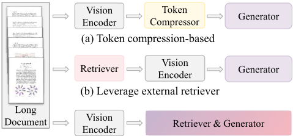
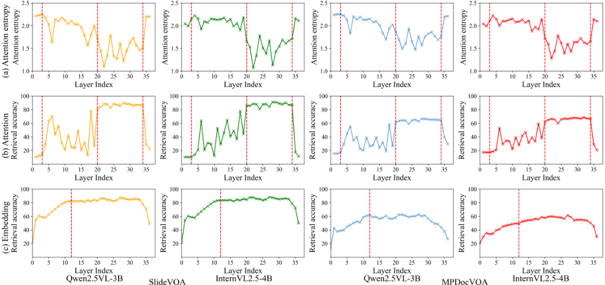
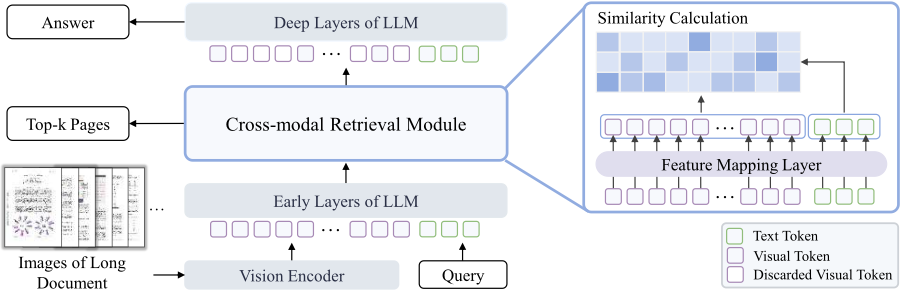

## URaG: Unified Retrieval and Generation in Multimodal LLMs for Efficient Long Document Understanding

Yongxin Shi 1*, Jiapeng Wang 1*, Zeyu Shan 1 , Dezhi Peng 2† , Zening Lin 1 , Lianwen Jin 1 † ,

1 South China University of Technology

2 Huawei Technologies Co., Ltd.

yongxin shi@foxmail.com, eelwjin@scut.edu.cn

## Abstract

Recent multimodal large language models (MLLMs) still struggle with long document understanding due to two fundamental challenges: information interference from abundant irrelevant content, and the quadratic computational cost of Transformer-based architectures. Existing approaches primarily fall into two categories: token compression, which sacrifices fine-grained details; and introducing external retrievers, which increase system complexity and prevent endto-end optimization. To address these issues, we conduct an in-depth analysis and observe that MLLMs exhibit a humanlike coarse-to-fine reasoning pattern: early Transformer layers attend broadly across the document, while deeper layers focus on relevant evidence pages. Motivated by this insight, we posit that the inherent evidence localization capabilities of MLLMs can be explicitly leveraged to perform retrieval during the reasoning process, facilitating efficient long document understanding. To this end, we propose URaG, a simple-

yet-effective framework that Unifies Retrieval and Generation within a single MLLM. URaG introduces a lightweight crossmodal retrieval module that converts the early Transformer layers into an efficient evidence selector, identifying and preserving the most relevant pages while discarding irrelevant content. This design enables the deeper layers to concentrate computational resources on pertinent information, improving both accuracy and efficiency. Extensive experiments demonstrate that URaG achieves state-of-the-art performance while reducing computational overhead by 44-56%.

Code - https://github.com/shi-yx/URaG

## Introduction

Document understanding plays a pivotal role in a wide range of real-world applications, such as information extraction, contract analysis, and report processing. While recent multimodal large language models (MLLMs) have shown impressive performance in processing single-page documents (Zhu et al. 2025; Bai et al. 2025), the transition from singlepage to multi-page document understanding introduces fundamental scalability and efficiency challenges that remain largely unresolved. The main challenges are twofold. First, Figure 1: Comparison of different methods for long document understanding. Our method unifies retrieval and generation within a single MLLM, leveraging early-layer features for evidence retrieval during reasoning, which achieves efficient and accurate long document understanding.

* These authors contributed equally.

† Corresponding author.

Copyright © 2026, Association for the Advancement of Artificial Intelligence (www.aaai.org). All rights reserved.

**(c) Unified retrieval and generation (ours)**  [open image](assets/28569-AAAI26.ShiY-ML/figure_01.png)
> **Detailed description:**
> **Type:** flowchart
> 
> **Overview:** The figure compares different methods for long document understanding, specifically focusing on the integration of retrieval and generation within a single multimodal large language model (MLLM).
> 
> **Components:**
> 
> 1. **Title:** Comparison of different methods for long document understanding
> 2. **Legend Entries:**
>    - (a) Token compression-based
>    - (b) Leverage external retriever
>    - (c) Unified retrieval and generation (ours)
> 3. **Color Meanings:**
>    - (a) Token compression-based: Yellow
>    - (b) Leverage external retriever: Pink
>    - (c) Unified retrieval and generation (ours): Purple
> 
> **Data and Values:**
> - Not readable
> 
> **Trends and Comparisons:**
> - The figure shows three different approaches to long document understanding.
> - Approach (a) uses token compression-based methods.
> - Approach (b) leverages an external retriever.
> - Approach (c) unifies retrieval and generation within a single MLLM.
> 
> **Key Takeaway:**
> The authors conclude that their unified retrieval and generation approach (c) achieves efficient and accurate long document understanding, as evidenced by the improved performance compared to the other methods.

the presence of a large volume of irrelevant content often leads to information interference. Second, due to the quadratic computational complexity of Transformer-based architectures with respect to sequence length, processing excessively long sequences results in prohibitively high computational costs, significantly limiting the scalability of existing approaches.

To address these challenges, existing MLLM-based approaches primarily follow two technical routes: (1) The first route involves compressing the input tokens fed into the LLM. These methods (Hu et al. 2025; Jia et al. 2024) typically apply uniform compression to visual tokens across all pages of the document, thus reducing the token count and alleviating the computational burden. However, this strategy inevitably sacrifices certain visual details during the compression process, potentially impairing the model's capacity for fine-grained visual understanding. (2) The second technical approach involves the introduction of an external retriever. These methods (Zhang, Yu, and Zhang 2024; Chen et al. 2025) employ text-based or vision-based retrievers to extract the most relevant content from long documents, feeding only the retrieved subset into the MLLM. While effective in reducing computational overhead, it introduces high system complexity in real-world deployment, due to the reliance on a separate retrieval module. More importantly, it lacks end-to-end optimization: Since the retriever is typically trained independently from the MLLM, such systems are prone to suboptimal coordination and error propagation.

When processing long documents, humans rarely read every word carefully and sequentially. Instead, they adopt a coarse-to-fine comprehension strategy (Le´on et al. 2019; Zou et al. 2023). (1) Coarse-grained retrieval: Based on an initial understanding of the question (e.g., keywords, intent, and contextual cues), humans first leverage structural features of the document (e.g., layout, titles, and figures) to rapidly identify pages or regions that are likely to contain relevant information. (2) Fine-grained reading: After locating candidate regions, humans engage in detailed reading to extract precise answers. Motivated by this human reading behavior, we hypothesize that MLLMs exhibit a similar coarse-to-fine reasoning pattern when processing long documents. To verify this hypothesis, we conduct a systematic empirical study. Our analysis reveals that attention distribution evolves progressively across the Transformer layers of the LLM component: early layers tend to distribute attention uniformly across pages, whereas deeper layers increasingly concentrate attention on pages containing answer evidence. This shift in attention patterns provides compelling empirical support that MLLMs inherently perform human-like hierarchical reasoning for long document understanding.

Building on this insight, we posit that the inherent evidence localization capabilities of MLLMs can be explicitly leveraged to perform retrieval during the reasoning process, facilitating efficient long document understanding. To this end, we propose a simple-yet-effective framework, URaG, which Unifies Retrieval and Generation within a single MLLM. The key innovation of our framework lies in transforming the early layers (e.g., the first 6 layers) of the MLLM into an efficient retrieval system through a lightweight cross-modal retrieval module. This module consists of two linear layers with minimal additional parameters, processes the hidden states of the early layer to extract visual features and textual features from each page and the question, respectively. Using a contextualized late interaction mechanism (Khattab and Zaharia 2020), it computes relevance scores between text and vision to identify the topk most relevant pages. These selected pages are preserved in the hidden states and propagated to the deeper layers for answer generation, while irrelevant content is discarded. By unifying retrieval and generation within a single model, our framework enables precise evidence localization, which effectively mitigates information interference and substantially reduces computational overhead.

The effectiveness of URaG is extensively verified on several commonly used benchmarks. Without bells and whistles, experimental results show that URaG achieves stateof-the-art performance. In addition, its computational efficiency is also empirically validated, further underscoring its practical advantages in real-world deployment.

In summary, our main contributions are as follows.

- We present a systematic empirical study revealing that MLLMs inherently exhibit a human-like coarse-to-fine reasoning pattern when processing long documents.
- We propose URaG, an elegant framework that seamlessly integrates evidence retrieval and answer generation within a single MLLM, eliminating the need for external retrieval systems. Equipped with a lightweight crossmodal retrieval module, URaG explicitly leverages the inherent evidence localization capabilities of MLLMs to perform efficient and integrated retrieval.
- Extensive experiments demonstrate the effectiveness of our method, which enhances MLLMs' long document comprehension capability while reducing computational overhead by 44-56%.
## Related Work

## Long Document Understanding

Existing methods for long document understanding can be primarily categorized into encoder-decoder-based and MLLM-based approaches. Encoder-decoder-based methods are built upon encoder-decoder Transformer architectures, such as T5 (Raffel et al. 2020). Representative methods include: Hi-VT5 (Tito, Karatzas, and Valveny 2023) summarizes key information from each page into special [PAGE] tokens for hierarchical decoding. GRAM (Blau et al. 2024) integrates local single-page encoding with global document-level layers, using learnable tokens and bias adaptation to enhance cross-page reasoning. RM-T5 (Dong, Kang, and Karatzas 2024) employs recurrent memory to propagate information across pages sequentially. MLLMbased methods primarily focus on optimizing the performance of multimodal large language models in longsequence reasoning, with two main strategies: (1) Compressing input tokens. To alleviate computational costs, these methods focus on compressing the visual inputs before feeding them into the language model. For instance, mPLUG-DocOwl2 (Hu et al. 2025) introduces a highresolution DocCompressor module that reduces each document image to 324 tokens. Similarly, Leopard (Jia et al. 2024) proposes an adaptive high-resolution multi-image encoder, which dynamically allocates visual token sequences based on the resolution and aspect ratios of the input images. (2) Incorporating external retrievers. These approaches employ retrieval mechanisms to pre-select relevant content prior to MLLM inference. For example, CREAM (Zhang, Yu, and Zhang 2024) adopts a coarse-to-fine retrieval pipeline that combines embedding-based similarity search, multi-round grouping, and LLM-based re-ranking to extract the most relevant text segments. SV-RAG (Chen et al. 2025) leverages the final hidden states of MLLMs for questionguided evidence retrieval, feeding only the selected content into the model for answer generation. M3DocRAG (Cho et al. 2024) employs a multimodal retriever to identify relevant content prior to the MLLM.

## Document Retrieval

Document retrieval approaches can be broadly categorized into text-based and vision-based methods. Text-Based retrieval methods typically rely on Optical Character Recognition (OCR) to extract textual content from documents, followed by similarity computation between the extracted text

2.5

2.5

SlideVQA

**Figure 2: Analysis of MLLMs on long document understanding. (a) Attention entropy. (b) Attention-based retrieval accuracy. (c) Embedding-based retrieval accuracy.**  [open image](assets/28569-AAAI26.ShiY-ML/figure_02.png)
> **Detailed description:**
> **Type:** Line graph
> 
> **Overview:** The figure analyzes the behavior of MLLMs (Large Language Models) across different layers of their architectures in the context of long document understanding. It specifically examines three metrics: attention entropy, attention-based retrieval accuracy, and embedding-based retrieval accuracy.
> 
> **Components:**
> - **Title:** "Figure 2: Analysis of MLLMs on long document understanding."
> - **Axes:**
>   - **Layer Index:** The x-axis represents the layer index of the MLLM model.
>   - **Attention Entropy:** The y-axis represents the attention entropy, which measures how tokens attend over input pages.
>   - **Attention-Based Retrieval Accuracy:** The y-axis represents the retrieval accuracy using attention weights.
>   - **Embedding-Based Retrieval Accuracy:** The y-axis represents the retrieval accuracy using hidden states as embeddings.
> - **Legend Entries:** Each subplot has a legend indicating the model being analyzed (e.g., "Qwen2.5VL-3B", "SlideVOA", etc.).
> - **Legend Entries and Color Meanings:** The colors in each subplot represent different models or datasets being compared.
> 
> **Data and Values:**
> - **Attention Entropy:** The graphs show varying attention entropy across different layers, with some layers showing higher entropy than others.
> - **Attention-Based Retrieval Accuracy:** The graphs show fluctuating retrieval accuracy, with some layers showing higher accuracy than others.
> - **Embedding-Based Retrieval Accuracy:** The graphs show varying retrieval accuracy, with some layers showing higher accuracy than others.
> 
> **Trends and Comparisons:**
> - **Attention Entropy:** The attention entropy generally decreases as the layer index increases, indicating a coarser-to-finer reading behavior.
> - **Attention-Based Retrieval Accuracy:** The retrieval accuracy shows a general increase as the layer index increases, suggesting that deeper layers are better at identifying evidence pages.
> - **Embedding-Based Retrieval Accuracy:** The retrieval accuracy shows a general decrease as the layer index increases, indicating that deeper layers are less effective in embedding-based retrieval.
> 
> **Key Takeaway:** The figure demonstrates that MLLMs exhibit a human-like coarsen-to-fine reading behavior, with deeper layers being more effective in identifying evidence pages and less effective in embedding-based retrieval.

2.5

MPDocVQA

and the query. These methods can be further categorized into sparse and dense retrieval techniques. Widely used sparse retrievers include: TF-IDF (Salton, Fox, and Wu 1983) calculates term relevance using word frequency and inverse document frequency; BM25 (Robertson et al. 1995) improves upon TF-IDF by introducing non-linear term frequency saturation and document length normalization, enhancing ranking robustness. Dense retrieval methods encode text into continuous vector spaces, enabling semantic similarity matching. DPR (Karpukhin et al. 2020) uses a dualencoder architecture to independently encode questions and passages. SBERT (Reimers and Gurevych 2019) produces sentence-level embeddings via a siamese BERT (Devlin et al. 2019). BGE (Xiao et al. 2024) improves dense retrieval quality through self-knowledge distillation and careful curation of training data. NV-Embed-v2 (Lee et al. 2025) introduces a latent attention-based pooling mechanism for aggregating token representations. Vision-based retrieval methods directly encode document images, preserving both textual and layout information. CLIP (Radford et al. 2021) and SigLIP (Zhai et al. 2023) are commonly used to extract retrieval embeddings. Some approaches further leverage MLLMs to jointly encode document images and textual queries for multimodal retrieval. For instance, ColPali (Faysse et al. 2025) utilizes PaliGemma (Beyer et al. 2024) to obtain token-level embeddings for each document page. DSE (Ma et al. 2025) employs Phi-3-V (Abdin et al. 2024) to encode each page into a single dense embedding, facilitating compact yet effective document representation. MM-Embed (Lin et al. 2025) fine-tunes MLLM-based universal multimodal retrievers and prompts pre-trained MLLMs for zero-shot reranking over retrieved candidates.

## Analysis

To investigate whether MLLMs exhibit a human-like coarseto-fine reading behavior, we conduct a systematic empirical study on two representative MLLMs across the subsets of two long document understanding benchmarks. Specifically, we visualize the attention entropy across LLM layers, measuring how the generated tokens attend over input pages, as shown in Figure 2 (a). We further evaluate the retrieval accuracy using attention weights as retrieval scores to identify evidence pages, as shown in Figure 2 (b). In addition, we compute query-to-visual similarity using hidden states from each layer as embeddings, enabling embeddingbased retrieval, as shown in Figure 2 (c). From the visualizations and metrics, we observe the following trends: (1) In the early layers (e.g., the first 3 layers), the attention entropy is high and attention-based retrieval accuracy is correspondingly low. This indicates that the model distributes attention relatively uniformly across all pages, reflecting a global and coarse-level reading stage. (2) In the early-middle layers (e.g., layers 3-20), attention entropy exhibits a declining trend with fluctuations, while attention-based retrieval accuracy shows a corresponding upward trend. This suggests the model is progressively attempting to identify and focus on relevant evidence pages. (3) In deeper layers (e.g., layers 20-34), the attention entropy remains low and attentionbased retrieval accuracy stays consistently high, indicating a fine-grained reading stage where attention becomes highly concentrated on evidence pages. (4) In the final two layers, attention entropy increases again while attention-based retrieval accuracy slightly drops. This indicates the model revisits all input pages before the final answer, which is similar to how humans recheck the full document to ensure cor-

2.5

**Figure 3: Overview of our URaG framework.**  [open image](assets/28569-AAAI26.ShiY-ML/figure_03.png)
> **Detailed description:**
> **Type:** diagram
> 
> **Overview:** The figure illustrates the architecture of the Unified Retrieval and Generation (URaG) framework, which integrates both retrieval and generation within a single model. The framework consists of a multimodal large language model (MLLM) and a lightweight cross-modal retrieval module.
> 
> **Components:**
> 
> 1. **Deep Layers of LLM:** This section represents the top layers of the LLM, where the answer is generated. The text tokens are shown in different colors, indicating different layers or types of tokens.
> 
> 2. **Cross-modal Retrieval Module:** This module retrieves the top-k (k=5) pages most relevant to the query. The text tokens are shown in different colors, indicating different types of tokens.
> 
> 3. **Feature Mapping Layer:** This layer processes the visual tokens from the vision encoder and maps them to a feature representation. The text tokens are shown in different colors, indicating different types of tokens.
> 
> 4. **Similarity Calculation:** This section calculates the similarity between the retrieved pages and the query. The text tokens are shown in different colors, indicating different types of tokens.
> 
> 5. **Early Layers of LLM:** This section represents the lower layers of the LLM, where the query is processed. The text tokens are shown in different colors, indicating different types of tokens.
> 
> 6. **Query:** This section represents the user query, which is tokenized and input into the LLM.
> 
> 7. **Vision Encoder:** This section processes the images of the long document into visual tokens.
> 
> **Data and values:** The figure does not provide specific numerical values or data points.
> 
> **Trends and comparisons:** The figure shows the flow of information between different modules and layers of the LLM, as well as the retrieval of relevant pages based on the query.
> 
> **Key takeaway:** The URaG framework is a unified method that integrates retrieval and generation within a single model, improving the efficiency and accuracy of information retrieval and generation tasks.

rectness. In summary, these findings provide strong empirical evidence that MLLMs inherently follow a human-like coarse-to-fine reasoning pattern when processing long documents. This insight motivates us to explicitly harness their intrinsic evidence localization ability for unified retrievalgeneration approaches.

Moreover, we find that embedding-based retrieval reaches consistently high accuracy (e.g., around layer 12) earlier than attention-based. This implies that semantic representations formed at mid-level layers are already sufficiently discriminative for evidence selection. In addition, embedding-based retrieval shows more stable performance across layers. These two observations motivate us to adopt embedding-based retrieval to develop our method.

## Methodology

## Framework

The proposed URaG is a unified method that integrates both retrieval and generation within a single model. As illustrated in Figure 3, the framework consists of a multimodal large language model (MLLM) and a lightweight cross-modal retrieval module. Specifically, given a long document composed of pages {p1, p2, . . . , pn}, where n denotes the number of pages, and a user query Q, each page image is processed by the vision encoder and the projector to obtain a sequence of visual tokens. The query Q is tokenized by a text tokenizer and then input into the LLM along with the visual tokens. The retrieval module operates on the hidden states from an early layer (the sixth layer in our implementation) of the LLM to retrieve the top-k (k is set to 5 by default) pages most relevant to the query. The visual tokens corresponding to non-retrieved pages are directly discarded from the hidden states. Subsequently, the deeper LLM layers attend only to the retained pages for answer generation.

## Cross-modal Retrieval Module

The retrieval module is designed to identify the most relevant pages from multi-page inputs with respect to the query. It is implemented with a lightweight structure consisting of two linear projections with GELU activation. Formally, given the early-layer hidden states H ∈ RL×D , the feature mapping layer is applied to reduce the dimensionality, yielding H′ ∈ RL×D′ , followed by L2 normalization to enhance feature consistency. From H′ , the visual feature sequences for each document pages {E(1) v , E(2) v , . . . , E(n) v } and the textual feature sequence of the query Eq, are extracted based on positional indices. The similarity between the query text and each document page is computed using the widely adopted contextualized late interaction (Khattab and Zaharia 2020):

$$
s _ { q , v ^ { ( p ) } } = \sum _ { i \in [ | E _ { q } | ] } \max _ { j \in [ | E _ { v } ^ { ( p ) } | ] } E _ { q _ { i } } \cdot E _ { v _ { j } } ^ { ( p ) T } . \quad ( 1 )
$$

Based on the similarity scores, the top-k pages are retained while others are discarded directly from hidden states, enabling subsequent layers to focus on relevant content, significantly reducing computational overhead.

## Training strategy

We adopt a two-stage training strategy to optimize our framework. In the first stage, we pretrain the retrieval module to adapt it for the retrieval task. All model parameters are frozen except for those in the retrieval module, which is optimized using the retrieval loss (Khattab and Zaharia 2020):

$$
\mathcal { L } _ { r e t r i v e a l } = \log \left ( 1 + \exp ( S _ { n e g } - S _ { p o s } ) \right ) ,
$$

where Spos and Sneg represent the scores of positive and negative samples, respectively. They are calculated as follows.

$$
S _ { \text {pos} } = \sum _ { i \in P } s _ { i }
$$

$$
S _ { \text {neg} } = \begin{cases} \sum _ { j \in N } s _ { j } & \text {if $N < P$} \\ \sum _ { j \in \text {Top} K ( \{ s _ { k } | k \in N \} , P ) } s _ { j } & \text {if $N \geq P$} \end{cases}
$$

Here, P and N indicate the number of positive and negative samples, respectively, and s denotes the similarity score between the query and a document page.

Table 1: Retrieval performance comparison with different methods. MMLong refers to MMLongBench-Doc.

| Method             | #Param   |   SlideVQA - Top1 |   SlideVQA - Top5 |   MMLong - Top1 |   MMLong - Top5 | DUDE - Top1   | DUDE - Top5   | MPDocVQA - Top1   | MPDocVQA - Top5   |
|--------------------|----------|-------------------|-------------------|-----------------|-----------------|---------------|---------------|-------------------|-------------------|
| Text-based         |          |                   |                   |                 |                 |               |               |                   |                   |
| BM25 (1995)        | -        |              69.3 |              91.1 |            25.3 |            47.6 | 58.4          | 89.8          | 59.7              | 87.8              |
| SBERT (2019)       | -        |              73.0 |              91.0 |            44.7 |            70.2 | 61.7          | 90.2          | 67.8              | 93.3              |
| BGE-M3 (2024a)     | 568M     |              74.3 |              92.0 |            42.7 |            66.6 | 60.1          | 90.1          | 66.8              | 92.7              |
| BGE-large (2024)   | 326M     |              81.3 |              93.3 |            47.4 |            71.5 | 60.1          | 90.1          | 66.8              | 92.7              |
| NV-Embed-v2 (2025) | 7B       |              82.2 |              94.3 |            47.4 |            69.0 | 68.8          | 93.9          | 74.3              | 95.2              |
| Vision-based       |          |                   |                   |                 |                 |               |               |                   |                   |
| CLIP (2021)        | 428M     |              58.4 |              86.9 |            32.4 |            63.4 | 61.0          | 89.5          | 67.8              | 93.7              |
| SigLIP (2023)      | 878M     |              66.2 |              90.1 |            44.9 |            69.4 | 59.4          | 89.7          | 64.9              | 91.9              |
| ColPali (2025)     | 3B       |              90.2 |              98.2 |            60.3 |            80.2 | 68.5          | 93.3          | 73.6              | 95.6              |
| MM-Embed (2025)    | 7B       |              70.9 |              91.8 |            42.9 |            74.7 | 65.6          | 91.9          | 69.5              | 94.0              |
| SV-RAG (2025)      | 4B       |              90.6 |              98.8 |            64.8 |            84.8 | -             | -             | -                 | -                 |
| URaG-3B (ours)     | 3B       |              92.1 |              98.9 |            63.0 |            85.4 | 83.0          | 97.0          | 84.4              | 98.0              |
| URaG-7B (ours)     | 7B       |              92.9 |              99.0 |            68.3 |            86.0 | 83.9          | 96.9          | 84.5              | 98.0              |

[open table image](assets/28569-AAAI26.ShiY-ML/table_01.png)
> **Detailed description:**
> **Overview:** This table compares the retrieval performance of various methods on different datasets, including SlideVQA, MMLong, DUDE, and MPDocVQA. The methods are categorized into two groups: text-based and vision-based.
> 
> **Structure:** The table has two main sections: "Text-based" and "Vision-based." Each section contains methods and their respective parameters. The columns measure the performance of the methods on different datasets, with "Top1" and "Top5" indicating the top retrieval results.
> 
> **Contents:**
> 
> | Method             | #Param   |   SlideVQA - Top1 |   SlideVQA - Top5 |   MMLong - Top1 |   MMLong - Top5 | DUDE - Top1   | DUDE - Top5   | MPDocVQA - Top1   | MPDocVQA - Top5   |
> |--------------------|----------|-------------------|-------------------|-----------------|-----------------|---------------|---------------|-------------------|-------------------|
> | Text-based         |          |                   |                   |                 |                 |               |               |                   |                   |
> | BM25 (1995)        | -        |              69.3 |              91.1 |            25.3 |            47.6 | 58.4          | 89.8          | 59.7              | 87.8              |
> | SBERT (2019)       | -        |              73.0 |              91.0 |            44.7 |            70.2 | 61.7          | 90.2          | 67.8              | 93.3              |
> | BGE-M3 (2024a)     | 568M     |              74.3 |              92.0 |            42.7 |            66.6 | 60.1          | 90.1          | 66.8              | 92.7              |
> | BGE-large (2024)   | 326M     |              81.3 |              93.3 |            47.4 |            71.5 | 60.1          | 90.1          | 66.8              | 92.7              |
> | NV-Embed-v2 (2025) | 7B       |              82.2 |              94.3 |            47.4 |            69.0 | 68.8          | 93.9          | 74.3              | 95.2              |
> | Vision-based       |          |                   |                   |                 |                 |               |               |                   |                   |
> | CLIP (2021)        | 428M     |              58.4 |              86.9 |            32.4 |            63.4 | 61.0          | 89.5          | 67.8              | 93.7              |
> | SigLIP (2023)      | 878M     |              66.2 |              90.1 |            44.9 |            69.4 | 59.4          | 89.7          | 64.9              | 91.9              |
> | ColPali (2025)     | 3B       |              90.2 |              98.2 |            60.3 |            80.2 | 68.5          | 93.3          | 73.6              | 95.6              |
> | MM-Embed (2025)    | 7B       |              70.9 |              91.8 |            42.9 |            74.7 | 65.6          | 91.9          | 69.5              | 94.0              |
> | SV-RAG (2025)      | 4B       |              90.6 |              98.8 |            64.8 |            84.8 | -             | -             | -                 | -                 |
> | URaG-3B (ours)     | 3B       |              92.1 |              98.9 |            63.0 |            85.4 | 83.0          | 97.0          | 84.4              | 98.0              |
> | URaG-7B (ours)     | 7B       |              92.9 |              99.0 |            68.3 |            86.0 | 83.9          | 96.9          | 84.5              | 98.0              |

In the second stage, the LoRA (Hu et al. 2022) adapter is added to both the LLM and retrieval module, with other parameters kept frozen. The model is jointly optimized through the retrieval loss and generation loss.

$$
\mathcal { L } _ { t o t a l } = \mathcal { L } _ { r e t r i e v a l } + \mathcal { L } _ { g e n e r a t i o n } , \quad \quad ( 5 )
$$

where Lgeneration is the cross-entropy loss for answer generation. To facilitate adaptation to fine-grained visual features, we retain at most five pages after retrieval. Ground-truth evidence pages are always kept to ensure information completeness, while remaining pages are selected by the highest retrieval scores.

## Experiments

## Implementation Details

Our model is available in two sizes: URaG-3B and URaG7B, both built upon Qwen2.5-VL (Bai et al. 2025). The retrieval module consists of two linear projection layers with GELU activation, which sequentially reduce the dimension of hidden states to 1024 and then to 512. The model is trained with a batch size of 4 and 8 gradient accumulation steps with AdamW optimizer. During pretraining, the initial learning rate is set to 1 × 10-4 with a warm-up ratio of 0.03, followed by a cosine decay schedule. For fine-tuning, we adopt LoRA (Hu et al. 2022) with a rank of 32, alpha of 64, and a dropout rate of 0.1. The loss weights of retrieval and generation are set to 1:1. The warm-up and learning rate settings are the same as in pretraining. The datasets for training including MPDocVQA (Tito, Karatzas, and Valveny 2023), DUDE (Van Landeghem et al. 2023), and SlideVQA (Tanaka et al. 2023). Both retrieval pretraining and joint fine-tuning are conducted for 1 epoch, respectively. Following prior work (Xie et al. 2024; Chen et al. 2025), we retain the top-5 pages in the retrieval module by default. All experiments are conducted on 4 NVIDIA A6000 GPUs.

## Evaluation Metrics

Following previous work (Chen et al. 2025), the evaluation involves retrieval and generation metrics. The retrieval metrics include Top1 and Top5 accuracy. The generation metrics include Average Normalized Levenshtein Similarity (ANLS) (Tito, Karatzas, and Valveny 2023) for MPDocVQA and DUDE, Exact Match (EM) (Tanaka et al. 2023) for SlideVQA, Generalized Accuracy and F1-score (Ma et al. 2024) for MMLongBench-Doc, and Generalized Accuracy score (Deng et al. 2025) for LongDocURL.

## Evidence Page Retrieval

We evaluate the evidence retrieval performance of URaG on MPDocVQA (Tito, Karatzas, and Valveny 2023), DUDE (Van Landeghem et al. 2023), SlideVQA (Tanaka et al. 2023), and MMLongBench-Doc (Ma et al. 2024), and compare it with both the text-based and vision-based retrievers. For text-based methods, we employ Paddle-OCR (Cui et al. 2025) to extract textual content from document images for retrieval, except on MMLongBench-Doc, where the PDF parser is used. As shown in Table 1, our URaG consistently outperforms all compared methods across datasets. This highlights the effectiveness of our integrated retrieval mechanism, which explicitly leverages the inherent capabilities of MLLMs via a lightweight retrieval module, without requiring complex designs or extensive training.

## Main Results

We evaluate the performance of URaG on various long document understanding benchmarks, including MPDocVQA, DUDE, SlideVQA, LongDocURL, and MMLongBenchDoc. The results are demonstrated in Table 2 and 3, respectively. Based on the results, we draw the following key conclusions. Firstly, our method demonstrates strong effectiveness in long document understanding, achieving state-ofthe-art performance across multiple benchmarks. Notably, our method significantly outperforms previous methods on SlideVQA and MMLongBench-Doc, which contain substantially long inputs with average lengths of 20 and 47.5 pages, respectively. This highlights the robustness and scalability of URaG in handling extended document contexts. Secondly, from the perspective of evidence types, URaG shows superior performance on single-page questions, indicating that evidence localized within a single page is more accurately retrieved. This can also be attributed to the distribution of training data, where questions with single-page evidence are more prevalent. Thirdly, URaG performs particularly well on visually intensive question types such as charts (CHA) and images (IMG). This indicates the effectiveness of the cross-modal retrieval module in performing semantic matching between textual and visual content.

Table 2: Performance comparison with different methods on MPDocVQA, DUDE, SlideVQA, and LongDocURL benchmarks.

| Method                        | #Param   |   MPDocVQA |   DUDE | SlideVQA   | LongDocURL   |
|-------------------------------|----------|------------|--------|------------|--------------|
| LayoutLMv3 (2022)             | 125M     |       55.1 |   20.3 | -          | -            |
| Hi-VT5 (2023)                 | 316M     |       61.8 |   35.7 | -          | -            |
| DocFormerv2 (2024)            | 784M     |       76.4 |   48.4 | -          | -            |
| GRAM (2024)                   | 859M     |       83.0 |   53.4 | -          | -            |
| Llama-3.2 (2024)              | 11B      |       57.6 |   20.8 | -          | 9.2          |
| LLaVA-Next-Interleave (2024a) | 7B       |       39.9 |   24.0 | -          | 14.1         |
| Idefics3 (2023)               | 8B       |       67.2 |   38.7 | 39.9       | -            |
| mPLUG-DocOwl2 (2025)          | 8B       |       69.4 |   46.7 | 24.6       | 5.3          |
| CREAM (2024)                  | 14B      |       65.3 |   52.5 | -          | -            |
| Qwen2-VL (2024)               | 7B       |       82.1 |   45.9 | 59.9       | 30.6         |
| InternVL2.5 (2024b)           | 4B       |       74.9 |   40.7 | 45.2       | 24.1         |
| InternVL3 (2025)              | 8B       |       80.8 |   47.4 | 54.4       | 38.7         |
| PDF-WuKong (2024)             | 8.5B     |       76.9 |   56.1 | -          | -            |
| Qwen2.5-VL (2025)             | 3B       |       84.4 |   50.6 | 59.1       | 40.0         |
| Qwen2.5-VL (2025)             | 7B       |       87.2 |   55.0 | 66.4       | 51.1         |
| URaG-3B (ours)                | 3B       |       86.0 |   54.1 | 63.8       | 41.5         |
| URaG-7B (ours)                | 7B       |       88.2 |   57.6 | 72.1       | 52.2         |

[open table image](assets/28569-AAAI26.ShiY-ML/table_02.png)
> **Detailed description:**
> **Overview:** This table compares the performance of various methods on four different benchmarks: MPDocVQA, DUDE, SlideVQA, and LongDocURL. The methods are evaluated based on their accuracy scores for each benchmark.
> 
> **Structure:** The table has two main columns: "Method" and "MPDocVQA." The "Method" column lists different models and their respective years of publication. The "MPDocVQA" column shows the accuracy scores for each method on the MPDocVQA benchmark.
> 
> **Contents:**
> - **LayoutLMv3 (2022):** 55.1
> - **Hi-VT5 (2023):** 61.8
> - **DocFormerv2 (2024):** 76.4
> - **GRAM (2024):** 83.0
> - **Llama-3.2 (2024):** 57.6
> - **LLaVA-Next-Interleave (2024a):** 39.9
> - **Idefics3 (2023):** 67.2
> - **mPLUG-DocOwl2 (2025):** 69.4
> - **CREAM (2024):** 65.3
> - **Qwen2-VL (2024):** 82.1
> - **InternVL2.5 (2024b):** 74.9
> - **InternVL3 (2025):** 80.8
> - **PDF-WuKong (2024):** 76.9
> - **Qwen2.5-VL (2025):** 84.4
> - **Qwen2.5-VL (2025):** 87.2
> - **URaG-3B (ours):** 86.0
> - **URaG-7B (ours):** 88.2
> 
> **Best and Worst Results:**
> - **Best Results:** URaG-7B (ours) with 88.2 on MPDocVQA.
> - **Worst Results:** LLaVA-Next-Interleave (2024a) with 39.9 on MPDocVQA.
> 
> **Comparisons and Trends:**
> - **URaG-7B (ours):** Significantly outperforms other methods, achieving the highest scores on all benchmarks.
> - **URaG-3B (ours):** Performs well, achieving high scores on MPDocVQA and DUDE, but slightly lower than URaG-7B on LongDocURL.
> 
> **Key Takeaway:** The proposed method, URaG-7B, achieves the highest performance across all benchmarks, outperforming other models significantly.

Table 3: Performance comparison with different methods on MMLongBench-Doc. Generalized accuracy across 5 evidence sources: pure text (TXT), layout (LAY), charts (CHA), tables (TAB), and images (IMG). Results are further categorized by the number of evidence pages: single-page (SIN), cross-page (MUL), and unanswerable (UNA) questions.

| Method                   | #Param   |   Evidence Modalities - TXT |   Evidence Modalities - LAY |   Evidence Modalities - CHA |   Evidence Modalities - TAB |   Evidence Modalities - IMG |   Evidence Locations - SIN |   Evidence Locations - MUL |   Evidence Locations - UNA |   Overall - ACC |   Overall - F1 |
|--------------------------|----------|-----------------------------|-----------------------------|-----------------------------|-----------------------------|-----------------------------|----------------------------|----------------------------|----------------------------|-----------------|----------------|
| DeepSeek-VL (2024)       | 7B       |                         7.2 |                         6.5 |                         1.6 |                         5.2 |                         7.6 |                        5.2 |                        7.0 |                       12.8 |             7.4 |            5.4 |
| Idefics2 (2024)          | 8B       |                         9.0 |                        10.6 |                         4.8 |                         4.1 |                         8.7 |                        7.7 |                        7.2 |                        5.0 |             7.0 |            6.8 |
| MiniCPM-V2.5 (2024)      | 8B       |                        11.9 |                        10.8 |                         5.1 |                         5.9 |                        12.2 |                        9.5 |                        9.5 |                        4.5 |             8.5 |            8.6 |
| InternLM-XC2-4KHD (2024) | 8B       |                         9.9 |                        14.3 |                         7.7 |                         6.3 |                        13.0 |                       12.6 |                        7.6 |                        9.6 |            10.3 |            9.8 |
| mPLUG-DocOwl 1.5 (2024)  | 8B       |                         8.2 |                         8.4 |                         2.0 |                         3.4 |                         9.9 |                        7.4 |                        6.4 |                        6.2 |             6.9 |            6.3 |
| Qwen-VL(2023)            | 10B      |                         5.5 |                         9.0 |                         5.4 |                         2.2 |                         6.9 |                        5.2 |                        7.1 |                        6.2 |             6.1 |            5.4 |
| Monkey (2024b)           | 10B      |                         6.8 |                         7.2 |                         3.6 |                         6.7 |                         9.4 |                        6.6 |                        6.2 |                        6.2 |             6.2 |            5.6 |
| CogVLM2-LLaMA3 (2024)    | 19B      |                         3.7 |                         2.7 |                         6.0 |                         3.2 |                         6.9 |                        3.9 |                        5.3 |                        3.7 |             4.4 |            4.0 |
| InternVL2.5 (2024c)      | 4B       |                        20.4 |                        15.1 |                         8.9 |                        12.5 |                        16.6 |                       19.7 |                       12.4 |                       13.5 |            15.9 |           15.6 |
| InternVL3 (2025)         | 8B       |                        28.4 |                        26.7 |                        13.1 |                        20.7 |                        24.9 |                       29.0 |                       16.3 |                       26.2 |            24.1 |           23.1 |
| SV-RAG (2025)            | 4B       |                        26.3 |                        22.1 |                        25.0 |                        20.7 |                        25.2 |                       34.0 |                       10.6 |                       15.7 |            23.0 |           24.2 |
| M3DocRAG (2024)          | 10B      |                        30.0 |                        23.5 |                        18.9 |                        20.1 |                        20.8 |                       32.4 |                       14.8 |                        5.8 |            21.0 |           22.6 |
| Qwen2.5-VL (2025)        | 3B       |                        29.0 |                        26.8 |                        18.6 |                        17.4 |                        22.4 |                       31.8 |                       15.7 |                       27.8 |            25.5 |           24.1 |
| Qwen2.5-VL (2025)        | 7B       |                        30.0 |                        26.9 |                        22.4 |                        20.6 |                        22.9 |                       33.4 |                       17.5 |                       24.7 |            26.2 |           25.1 |
| URaG-3B (ours)           | 3B       |                        27.9 |                        24.2 |                        23.4 |                        25.2 |                        21.4 |                       36.9 |                       13.5 |                       48.9 |            31.1 |           28.7 |
| URaG-7B (ours)           | 7B       |                        33.6 |                        27.7 |                        29.3 |                        27.5 |                        27.2 |                       42.7 |                       16.9 |                       43.5 |            33.8 |           32.8 |

[open table image](assets/28569-AAAI26.ShiY-ML/table_03.png)
> **Detailed description:**
> **Overview:** The table compares the performance of various methods on the MMLongBench-Doc dataset, focusing on generalized accuracy across five evidence sources: pure text (TXT), layout (LAY), charts (CHA), tables (TAB), and images (IMG). It also categorizes the results by the number of evidence pages: single-page (SIN), cross-page (MUL), and unanswerable (UNA) questions.
> 
> **Structure:**
> - **Column Headers:**
>   - **Method:** Different machine learning models or methods.
>   - **#Param:** Number of parameters in the model.
>   - **Evidence Modalities - TXT:** Accuracy for pure text evidence.
>   - **Evidence Modalities - LAY:** Accuracy for layout evidence.
>   - **Evidence Modalities - CHA:** Accuracy for chart evidence.
>   - **Evidence Modalities - TAB:** Accuracy for table evidence.
>   - **Evidence Modalities - IMG:** Accuracy for image evidence.
>   - **Evidence Locations - SIN:** Accuracy for single-page questions.
>   - **Evidence Locations - MUL:** Accuracy for cross-page questions.
>   - **Evidence Locations - UNA:** Accuracy for unanswerable questions.
>   - **Overall - ACC:** Generalized accuracy across all evidence sources.
>   - **Overall - F1:** F1 score for overall accuracy.
> 
> **Contents:**
> - **DeepSeek-VL (2024):** 7B, 7.2, 6.5, 1.6, 5.2, 7.6, 5.2, 7.0, 12.8, 7.4, 5.4.
> - **Idefics2 (2024):** 8B, 9.0, 10.6, 4.8, 4.1, 8.7, 7.7, 7.2, 5.0, 7.0, 6.8.
> - **MiniCPM-V2.5 (2024):** 8B, 11.9, 10.8, 5.1, 5.9, 12.2, 9.5, 9.5, 4.5, 8.5, 8.6.
> - **InternLM-XC2-4KHD (2024):** 8B, 9.9, 14.3, 7.7, 6.3, 13.0, 12.6, 7.6, 9.6, 10.3, 9.8.
> - **mPLUG-DocOwl 1.5 (2024):** 8B, 8.2, 8.4, 2.0, 3.4, 9.9, 7.4, 6.4, 6.2, 6.9, 6.3.
> - **Qwen-VL(2023):** 10B, 5.5, 9.0, 5.4, 2.2, 6.9, 5.2, 7.1, 6.2, 6.1, 5.4.
> - **Monkey (2024b):** 10B, 6.8, 7.2, 3.6, 6.7, 9.4, 6.6, 6.2, 6.2, 6.2, 5.6.
> - **CogVLM2-LLaMA3 (2024):** 19B, 3.7, 2.7, 6.0, 3.2, 6.9, 3.9, 5.3, 3.7, 4.4, 4.0.
> - **InternVL2.5 (2024c):** 4B, 20.4, 15.1, 8.9, 12.5, 16.6, 19.7, 12.4, 13.5, 15.9, 15.6.
> - **InternVL3 (2025):** 8B, 28.4, 26.7, 13.1, 20.7, 24.9, 29.0, 16.3, 26.2, 24.1, 23.1.
> - **SV-RAG (2025):** 4B, 26.3, 22.1, 25.0, 20.7, 25.2, 34.0, 10.6, 15.7, 23.0, 24.2.
> - **M3DocRAG (2024):** 10B, 30.0, 23.5, 18.9, 20.1, 20.8, 32.4, 14.8, 5.8, 21.0, 22.6.
> - **Qwen2.5-VL (2025):** 3B, 29.0, 26.8, 18.6, 17.4, 22.4, 31.8, 15.7, 27.8, 25.5, 24.1.
> - **Qwen2.5-VL (2025):** 7B, 30.0, 26.9, 22.4, 20.6, 22.9, 33.4, 17.5, 24.7, 26.2, 25.1.
> - **URaG-3B (ours):** 3B, 27.9, 24.2, 23.4, 25.2, 21.4, 36.9, 13.5, 48.9, 31.1, 28.7.
> - **URaG-7B (ours):** 7B, 33.6, 27.7, 29.3, 27.5, 27.2, 42.7, 16.9, 43.5, 33.8, 32.8.
> 
> **Best and Worst Results:**
> - **Best Overall ACC:** URaG-7B (ours) with 33.8.
> - **Best Overall F1:** URaG-7B (ours) with 32.8.
> - **Worst Overall ACC:** CogVLM2-LLaMA3 (2024) with 4.0.
> - **Worst Overall F1:** CogVLM2-LLaMA3 (2024) with 4.0.
> 
> **Comparisons and Trends:**
> - **URaG-7B (ours):** Shows significant improvements over other methods, especially in overall accuracy and F1 score, indicating better performance across all evidence sources and question types.
> - **URaG-3B (ours):** Also shows notable improvements, particularly in overall accuracy and F1 score, suggesting robustness and effectiveness across different evidence modalities and question categories.
> 
> **Key Takeaway:**
> - **URaG-7B (ours)** demonstrates superior performance compared to other methods, achieving the highest overall accuracy and F1 score across all evidence sources and question types.

## Comparison with Baseline Method

To ensure a fair comparison, we fine-tune the baseline model (Bai et al. 2025) using the same training data and settings as URaG. As shown in Table 4, our method significantly outperforms the baseline, demonstrating its effectiveness. Notably, even without any fine-tuning of the MLLM backbone, by simply inserting a pretrained retrieval module, URaG already surpasses the fully fine-tuned baseline. This highlights the strength of our cross-modal retrieval module, which effectively exploits the MLLM's inherent evidence localization ability to perform retrieval. With this simple and lightweight design, URaG achieves strong performance without large-scale training. Moreover, on LongDocURL, fine-tuning leads to degraded performance. We attribute this to potential overfitting or domain mismatch between training and evaluation data. In contrast, URaG without any finetuning maintains robust performance, further demonstrating its generalization ability and practical applicability.

Table 4: Comparison with baseline method. MMLong and LongDoc refer to MMLongBench-Doc and LongDocURL, respectively.

| Method               |   SlideVQA |   MMLong |   LongDoc |
|----------------------|------------|----------|-----------|
| Baseline             |       59.1 |     25.5 |      40.0 |
| Baseline w/ SFT      |       61.9 |     29.1 |      37.3 |
| URaG-3B w/o finetune |       62.1 |     29.4 |      43.1 |
| URaG-3B              |       63.8 |     31.1 |      41.5 |

[open table image](assets/28569-AAAI26.ShiY-ML/table_04.png)
> **Detailed description:**
> **Overview:** This table compares the performance of different methods on three datasets: SlideVQA, MMLong, and LongDoc. The methods compared include a baseline method, a baseline method with SFT (Self-Training Fine-Tuning), and two versions of URaG-3B, one without finetuning and one with finetuning.
> 
> **Structure:** 
> - **Column Headers:** 
>   - Method: The different methods being compared.
>   - SlideVQA: Performance on the SlideVQA dataset.
>   - MMLong: Performance on the MMLong dataset.
>   - LongDoc: Performance on the LongDoc dataset.
> - **Rows/Row Groups:**
>   - Baseline: The baseline method without any modifications.
>   - Baseline w/ SFT: The baseline method with SFT applied.
>   - URaG-3B w/o finetune: The URaG-3B method without finetuning.
>   - URaG-3B: The URaG-3B method with finetuning.
> 
> **Contents:**
> - **Baseline:**
>   - SlideVQA: 59.1
>   - MMLong: 25.5
>   - LongDoc: 40.0
> - **Baseline w/ SFT:**
>   - SlideVQA: 61.9
>   - MMLong: 29.1
>   - LongDoc: 37.3
> - **URaG-3B w/o finetune:**
>   - SlideVQA: 62.1
>   - MMLong: 29.4
>   - LongDoc: 43.1
> - **URaG-3B:**
>   - SlideVQA: 63.8
>   - MMLong: 31.1
>   - LongDoc: 41.5
> 
> **Best and Worst Results:**
> - **Best Results:**
>   - SlideVQA: URaG-3B (63.8)
>   - MMLong: URaG-3B (31.1)
>   - LongDoc: URaG-3B (41.5)
> - **Worst Results:**
>   - SlideVQA: Baseline (59.1)
>   - MMLong: Baseline w/ SFT (29.1)
>   - LongDoc: Baseline (40.0)
> 
> **Comparisons and Trends:**
> - **URaG-3B w/o finetune vs. Baseline:**
>   - SlideVQA: 62.1 (URaG-3B w/o finetune) vs. 59.1 (Baseline) = 3.0 improvement
>   - MMLong: 29.4 (URaG-3B w/o finetune) vs. 25.5 (Baseline) = 3.9 improvement
>   - LongDoc: 43.1 (URaG-3B w/o finetune) vs. 40.0 (Baseline) = 3.1 improvement
> - **URaG-3B vs. Baseline w/ SFT:**
>   - SlideVQA: 63.8 (URaG-3B) vs. 61.9 (Baseline w/ SFT) = 1.9 improvement
>   - MMLong: 31.1 (URaG-3B) vs. 29.1 (Baseline w/ SFT) = 2.0 improvement
>   - LongDoc: 41.5 (URaG-3B) vs. 37.3 (Baseline w/ SFT) = 4.2 improvement
> 
> **Key Takeaway:**
> The URaG-3B method, both with and without finetuning, consistently outperforms the baseline method across all three datasets. The best improvements are observed when comparing URaG-3B to the baseline, with the largest improvements in LongDoc.

## Ablation Study

The Position of Retrieval Module. We investigate the impact of inserting the cross-modal retrieval module at different layers of the LLM using the 3B-size model. As shown in Table 5, the results reveal that inserting the retrieval module at early to mid layers (e.g., layer 6) leads to the best overall performance. This can be attributed to two main factors. First, although the top1 retrieval accuracy continues to improve slightly at deeper layers (e.g., layer 12 or 18), the top5 accuracy already reaches saturation at layer 6, and moving the retrieval module deeper yields only marginal gains. Second, placing the retrieval module at earlier layers allows the subsequent LLM layers to concentrate on reasoning over a reduced set of visual features, effectively filtering out irrelevant information and improving the final answer generation quality. In summary, these results support our design choice: inserting the retrieval module at early layers captures sufficiently discriminative semantic representations for evidence selection, while leaving deeper layers to focus on reasoning.

Table 5: Ablation study of the cross-modal retrieval module insertion at different layers within the LLM. ∗ indicates metrics evaluated on the single-page subset of SlideVQA while retaining only the top-1 page after the retrieval module.

|   Layer |   SlideVQA - Top1 |   SlideVQA - Top5 |   SlideVQA - EM∗ |   SlideVQA - EM |   MMLong - Top5 |   MMLong - GACC |
|---------|-------------------|-------------------|------------------|-----------------|-----------------|-----------------|
|       2 |              89.0 |              98.4 |             67.4 |            63.7 |            82.0 |            31.0 |
|       6 |              92.1 |              98.9 |             68.5 |            63.8 |            85.4 |            31.1 |
|      12 |              93.1 |              99.2 |             67.1 |            62.9 |            85.6 |            31.0 |
|      18 |              93.5 |              99.2 |             67.1 |            62.3 |            85.4 |            30.6 |

[open table image](assets/28569-AAAI26.ShiY-ML/table_05.png)
> **Detailed description:**
> **Overview:** This table presents an ablation study of the cross-modal retrieval module insertion at different layers within a Large Language Model (LLM). The study evaluates the performance of the module on two datasets: SlideVQA and MMLong. The metrics evaluated include Top1, Top5, EM (Exact Match), EM∗ (Exact Match with a different threshold), Top5 for MMLong, and GACC (Generalized Average Case Accuracy). The table also notes that metrics evaluated on the single-page subset of SlideVQA are retained, but only the top-1 page is kept after the retrieval module.
> 
> **Structure:** The table has two main columns: "Layer" and "Metric." The "Layer" column lists the different layers of the LLM where the cross-modal retrieval module is inserted. The "Metric" column lists the specific metrics evaluated for each layer.
> 
> **Contents:**
> - **Layer 2:**
>   - SlideVQA - Top1: 89.0
>   - SlideVQA - Top5: 98.4
>   - SlideVQA - EM*: 67.4
>   - SlideVQA - EM: 63.7
>   - MMLong - Top5: 82.0
>   - MMLong - GACC: 31.0
> - **Layer 6:**
>   - SlideVQA - Top1: 92.1
>   - SlideVQA - Top5: 98.9
>   - SlideVQA - EM*: 68.5
>   - SlideVQA - EM: 63.8
>   - MMLong - Top5: 85.4
>   - MMLong - GACC: 31.1
> - **Layer 12:**
>   - SlideVQA - Top1: 93.1
>   - SlideVQA - Top5: 99.2
>   - SlideVQA - EM*: 67.1
>   - SlideVQA - EM: 62.9
>   - MMLong - Top5: 85.6
>   - MMLong - GACC: 31.0
> - **Layer 18:**
>   - SlideVQA - Top1: 93.5
>   - SlideVQA - Top5: 99.2
>   - SlideVQA - EM*: 67.1
>   - SlideVQA - EM: 62.3
>   - MMLong - Top5: 85.4
>   - MMLong - GACC: 30.6
> 
> **Best and Worst Results:**
> - **Best for SlideVQA - Top1:** Layer 18 (93.5)
> - **Best for SlideVQA - Top5:** Layer 18 (99.2)
> - **Best for SlideVQA - EM:** Layer 18 (67.1)
> - **Best for SlideVQA - EM*: Layer 18 (67.1)
> - **Best for MMLong - Top5:** Layer 18 (85.4)
> - **Best for MMLong - GACC:** Layer 18 (30.6)
> - **Worst for SlideVQA - Top1:** Layer 2 (89.0)
> - **Worst for SlideVQA - Top5:** Layer 2 (98.4)
> - **Worst for SlideVQA - EM:** Layer 2 (67.4)
> - **Worst for SlideVQA - EM*: Layer 2 (67.4)
> - **Worst for MMLong - Top5:** Layer 2 (82.0)
> - **Worst for MMLong - GACC:** Layer 2 (31.0)
> 
> **Comparisons and Trends:**
> - The performance of the cross-modal retrieval module generally improves as the layer number increases, as indicated by the higher Top1, Top5, and EM scores for layers 12 and 18 compared to layer 2.
> - The GACC score shows a slight decrease from layer 12 to layer 18, suggesting a trade-off between retrieval accuracy and generalization.
> - The EM score shows a slight decrease from layer 6 to layer 18, indicating a slight degradation in exact match performance as the layer number increases.
> 
> **Key Takeaway:** The cross-modal retrieval module insertion at layer 18 shows the best performance across all metrics evaluated, indicating that this layer is optimal for the task of cross-modal retrieval within the LLM.

Two-stage Training Strategy. We conduct an ablation study to evaluate the effectiveness of our two-stage training strategy. As shown in Table 6, the results demonstrate that both the retrieval pretraining stage and the joint fine-tuning stage contribute to the final performance. Concretely, the retrieval capability of the model is limited without pretraining, as the retrieval module is trained from random initialization. Moreover, fine-tuning on the pretrained model further improves both retrieval accuracy and overall understanding.

Table 6: Ablation study of our two-stage training strategy. MMLong refers to MMLongBench-Doc.

| Pretrain   | Fintune   |   SlideVQA - Top5 |   SlideVQA - EM |   MMLong - Top5 |   MMLong - GACC |
|------------|-----------|-------------------|-----------------|-----------------|-----------------|
| ×          | ✓         |              98.5 |            62.6 |            82.0 |            30.7 |
| ✓          | ×         |              98.8 |            62.1 |            84.0 |            29.4 |
| ✓          | ✓         |              98.9 |            63.8 |            85.4 |            31.1 |

[open table image](assets/28569-AAAI26.ShiY-ML/table_06.png)
> **Detailed description:**
> **Overview:** This table presents an ablation study of a two-stage training strategy for a model, specifically focusing on the performance of the model on two datasets: SlideVQA and MMLong. The study aims to understand the impact of different pretraining and fine-tuning strategies on the model's performance.
> 
> **Structure:** The table has three columns and three rows. The columns represent different aspects of the model's training strategy:
> 1. **Pretrain**: Indicates whether the model was pre-trained or not.
> 2. **Fintune**: Indicates whether the model was fine-tuned or not.
> 3. **Metric**: Represents the performance metric being evaluated, either "Top5" or "GACC".
> 
> The rows represent different combinations of pretraining and fine-tuning:
> 1. **× ✓**: No pretraining, fine-tuning.
> 2. **✓ ×**: Fine-tuning, no pretraining.
> 3. **✓ ✓**: Both pretraining and fine-tuning.
> 
> **Contents:**
> - **Pretrain × ✓**: No pretraining, fine-tuning.
>   - SlideVQA - Top5: 98.5
>   - SlideVQA - EM: 62.6
>   - MMLong - Top5: 82.0
>   - MMLong - GACC: 30.7
> - **Pretrain ✓ ×**: Fine-tuning, no pretraining.
>   - SlideVQA - Top5: 98.8
>   - SlideVQA - EM: 62.1
>   - MMLong - Top5: 84.0
>   - MMLong - GACC: 29.4
> - **Pretrain ✓ ✓**: Both pretraining and fine-tuning.
>   - SlideVQA - Top5: 98.9
>   - SlideVQA - EM: 63.8
>   - MMLong - Top5: 85.4
>   - MMLong - GACC: 31.1
> 
> **Best and worst results:**
> - **SlideVQA - Top5**: Best: 98.9 (✓ ✓)
> - **SlideVQA - EM**: Best: 63.8 (✓ ✓)
> - **MMLong - Top5**: Best: 85.4 (✓ ✓)
> - **MMLong - GACC**: Best: 31.1 (✓ ✓)
> 
> **Comparisons and trends:**
> - The combination of both pretraining and fine-tuning (✓ ✓) consistently outperforms the other combinations in terms of both top-5 accuracy and GACC.
> - The combination of fine-tuning without pretraining (✓ ×) shows a slight improvement in top-5 accuracy compared to no pretraining (× ✓), but the GACC remains lower.
> - The combination of no pretraining and fine-tuning (× ✓) shows a slight improvement in top-5 accuracy compared to no pretraining (× ×), but the GACC remains lower.
> 
> **Key takeaway:** The combination of both pretraining and fine-tuning significantly improves the model's performance across both datasets, particularly in terms of GACC.

Table 7: Computational efficiency comparison with different methods in terms of FLOPs (T).

| Method               | Pages - 20   | Pages - 60   | Pages - 100   |
|----------------------|--------------|--------------|---------------|
| Baseline             | 415.9        | 1246.4       | 2076.9        |
| mPLUG-DocOwl2 (2025) | 208.3        | 624.5        | 1040.7        |
| SV-RAG (2025)        | 393.1        | 969.5        | 1546.0        |
| URaG-7B (ours)       | 232.8        | 574.9        | 917.0         |
| Reduction            | -44.0%       | -53.9%       | -55.8%        |

[open table image](assets/28569-AAAI26.ShiY-ML/table_07.png)
> **Detailed description:**
> **Overview:** This table compares the computational efficiency of different methods in terms of FLOPs (floating-point operations) across three different page counts: 20, 60, and 100. The methods evaluated include a baseline, mPLUG-DocOwl2 (2025), SV-RAG (2025), and URaG-7B (ours).
> 
> **Structure:** 
> - **Column Headers:**
>   - **Method:** The methods being compared.
>   - **Pages - 20:** The number of pages for 20 pages.
>   - **Pages - 60:** The number of pages for 60 pages.
>   - **Pages - 100:** The number of pages for 100 pages.
> - **Rows/Row Groups:**
>   - **Baseline:** The baseline method.
>   - **mPLUG-DocOwl2 (2025):** The method evaluated in 2025.
>   - **SV-RAG (2025):** The method evaluated in 2025.
>   - **URaG-7B (ours):** The proposed method evaluated in this study.
> 
> **Contents:**
> - **Baseline:** 
>   - 20 pages: 415.9
>   - 60 pages: 1246.4
>   - 100 pages: 2076.9
> - **mPLUG-DocOwl2 (2025):**
>   - 20 pages: 208.3
>   - 60 pages: 624.5
>   - 100 pages: 1040.7
> - **SV-RAG (2025):**
>   - 20 pages: 393.1
>   - 60 pages: 969.5
>   - 100 pages: 1546.0
> - **URaG-7B (ours):**
>   - 20 pages: 232.8
>   - 60 pages: 574.9
>   - 100 pages: 917.0
> 
> **Best and Worst Results:**
> - **Best (Lowest FLOPs):**
>   - **URaG-7B (ours):** 20 pages: 232.8
>   - **URaG-7B (ours):** 60 pages: 574.9
>   - **URaG-7B (ours):** 100 pages: 917.0
> - **Worst (Highest FLOPs):**
>   - **Baseline:** 20 pages: 415.9
>   - **Baseline:** 60 pages: 1246.4
>   - **Baseline:** 100 pages: 2076.9
> 
> **Comparisons and Trends:**
> - **URaG-7B (ours):** Significantly lower FLOPs compared to the baseline method across all page counts.
> - **mPLUG-DocOwl2 (2025):** Lower FLOPs than the baseline but higher than URaG-7B (ours) for 20 and 60 pages.
> - **SV-RAG (2025):** Higher FLOPs than the baseline and mPLUG-DocOwl2 (2025) for all page counts.
> 
> **Key Takeaway:**
> The proposed URaG-7B method achieves the lowest computational efficiency (highest FLOPs) compared to the baseline and other evaluated methods across all page counts, indicating its superior efficiency in terms of computational resources.

## Computational Efficiency

To evaluate the computational efficiency of URaG, we conduct experiments on SlideVQA, where each question is associated with 20 pages. To simulate longer input sequences, we duplicate the pages for each question. We compare URaG with two representative approaches: the tokencompression-based mPLUG-DocOwl2 (Hu et al. 2025) and the external-retriever-based SV-RAG (Chen et al. 2025), by integrating their techniques into a common baseline. Model computational cost is measured in floating-point operations (FLOPs). As shown in Table 7, URaG achieves higher computational efficiency on longer inputs compared with other methods. When the number of input pages increases from 20 to 100, URaG reduces FLOPs by 44.0% to 55.8% compared to the baseline. These results demonstrate the effectiveness of our method in reducing computational complexity for long document inputs. In addition, we analyze the number of parameters introduced by the cross-modal retrieval module and find that it accounts for only 0.05% to 0.07% of the total model parameters, which is nearly negligible.

## Conclusion

In this paper, we propose URaG, a unified framework that unifies retrieval and generation within a single multimodal large language model (MLLM) for efficient long document understanding. URaG introduces a lightweight cross-modal retrieval module that explicitly leverages the inherent evidence localization capabilities of early layers of MLLMs, enabling it to identify and retain only the most relevant pages during the reasoning process. Extensive experiments across multiple long document understanding benchmarks demonstrate that URaG not only achieves state-of-the-art performance but also significantly reduces computational overhead by 44-56%. We believe this work not only provides a practical solution but also valuable insights into a novel paradigm for long document understanding.

## Acknowledgments

This research is supported in part by the National Natural Science Foundation of China (Grant No.:62476093) and Huawei-SCUT Research Project Fund (No. TC20250611036).

## References

- Abdin, M.; Aneja, J.; Awadalla, H.; Awadallah, A.; Awan, A. A.; Bach, N.; Bahree, A.; Bakhtiari, A.; Bao, J.; Behl, H.; et al. 2024. Phi-3 technical report: A highly capable language model locally on your phone. arXiv preprint arXiv:2404.14219.
- Appalaraju, S.; Tang, P.; Dong, Q.; Sankaran, N.; Zhou, Y.; and Manmatha, R. 2024. DocFormerv2: Local features for document understanding. In Proc. AAAI, volume 38, 709718.
- Bai, J.; Bai, S.; Chu, Y.; Cui, Z.; Dang, K.; Deng, X.; Fan, Y.; Ge, W.; Han, Y.; Huang, F.; et al. 2023. Qwen technical report. arXiv preprint arXiv:2309.16609.
- Bai, S.; Chen, K.; Liu, X.; Wang, J.; Ge, W.; Song, S.; Dang, K.; Wang, P.; Wang, S.; Tang, J.; et al. 2025. Qwen2.5-VL technical report. arXiv preprint arXiv:2502.13923.
- Beyer, L.; Steiner, A.; Pinto, A. S.; Kolesnikov, A.; Wang, X.; Salz, D.; Neumann, M.; Alabdulmohsin, I.; Tschannen, M.; Bugliarello, E.; et al. 2024. PaliGemma: A versatile 3B VLM for transfer. arXiv preprint arXiv:2407.07726.
- Blau, T.; Fogel, S.; Ronen, R.; Golts, A.; Ganz, R.; Ben Avraham, E.; Aberdam, A.; Tsiper, S.; and Litman, R. 2024. GRAM: Global reasoning for multi-page VQA. In Proc. CVPR, 15598-15607.
- Chen, J.; Xiao, S.; Zhang, P.; Luo, K.; Lian, D.; and Liu, Z. 2024a. BGE M3-Embedding: Multilingual, multi-functionality, multi-granularity text embeddings through self-knowledge distillation. arXiv preprint arXiv:2402.03216.
- Chen, J.; Zhang, R.; Zhou, Y.; Yu, T.; Dernoncourt, F.; Gu, J.; Rossi, R. A.; Chen, C.; and Sun, T. 2025. SV-RAG: LoRA-contextualizing adaptation of large multimodal models for multi-page document Understanding. In Proc. ICLR.
- Chen, Z.; Wang, W.; Cao, Y.; Liu, Y.; Gao, Z.; Cui, E.; Zhu, J.; Ye, S.; Tian, H.; Liu, Z.; et al. 2024b. Expanding performance boundaries of open-source multimodal models with model, data, and test-time scaling. arXiv preprint arXiv:2412.05271.
- Chen, Z.; Wu, J.; Wang, W.; Su, W.; Chen, G.; Xing, S.; Zhong, M.; Zhang, Q.; Zhu, X.; Lu, L.; et al. 2024c. InternVL: Scaling up vision foundation models and aligning for generic visual-linguistic tasks. In Proc. CVPR, 2418524198.
- Cho, J.; Mahata, D.; Irsoy, O.; He, Y.; and Bansal, M. 2024. M3DocRAG: Multi-modal retrieval is what you need for multi-page multi-document understanding. arXiv preprint arXiv:2411.04952.
- Cui, C.; Sun, T.; Lin, M.; Gao, T.; Zhang, Y.; Liu, J.; Wang, X.; Zhang, Z.; Zhou, C.; Liu, H.; Zhang, Y.; Lv, W.; Huang, K.; Zhang, Y.; Zhang, J.; Zhang, J.; Liu, Y.; Yu,
- D.; and Ma, Y. 2025. PaddleOCR 3.0 Technical Report. arXiv:2507.05595.
- Deng, C.; Yuan, J.; Bu, P.; Wang, P.; Li, Z.-Z.; Xu, J.; Li, X.- H.; Gao, Y.; Song, J.; Zheng, B.; et al. 2025. LongDocURL: a comprehensive multimodal long document benchmark integrating understanding, reasoning, and locating. In Proc. ACL.
- Devlin, J.; Chang, M.-W.; Lee, K.; and Toutanova, K. 2019. BERT: Pre-training of deep bidirectional Transformers for language understanding. In Proc. NAACL, 4171-4186.
- Dong, Q.; Kang, L.; and Karatzas, D. 2024. Multi-page document VQA with recurrent memory Transformer. In Proc. ICDAR Workshop, 57-70. Springer.
- Dong, X.; Zhang, P.; Zang, Y.; Cao, Y.; Wang, B.; Ouyang, L.; Zhang, S.; Duan, H.; Zhang, W.; Li, Y.; et al. 2024. InternLM-XComposer2-4KHD: A pioneering large visionlanguage model handling resolutions from 336 pixels to 4K HD. Proc. NeurIPS, 37: 42566-42592.
- Faysse, M.; Sibille, H.; Wu, T.; Omrani, B.; Viaud, G.; Hudelot, C.; and Colombo, P. 2025. Colpali: Efficient document retrieval with vision language models. In Proc. ICLR.
- Hong, W.; Wang, W.; Ding, M.; Yu, W.; Lv, Q.; Wang, Y.; Cheng, Y.; Huang, S.; Ji, J.; Xue, Z.; et al. 2024. CogVLM2: Visual language models for image and video understanding. arXiv preprint arXiv:2408.16500.
- Hu, A.; Xu, H.; Ye, J.; Yan, M.; Zhang, L.; Zhang, B.; Li, C.; Zhang, J.; Jin, Q.; Huang, F.; et al. 2024. mPLUG-DocOwl 1.5: Unified structure learning for ocr-free document understanding. In Proc. EMNLP.
- Hu, A.; Xu, H.; Zhang, L.; Ye, J.; Yan, M.; Zhang, J.; Jin, Q.; Huang, F.; and Zhou, J. 2025. mPLUG-DocOwl2: Highresolution compressing for OCR-free multi-page document understanding. In Proc. ACL, 5817-5834.
- Hu, E. J.; Shen, Y.; Wallis, P.; Allen-Zhu, Z.; Li, Y.; Wang, S.; Wang, L.; Chen, W.; et al. 2022. LoRA: Low-rank adaptation of large language models. In Proc. ICLR.
- Huang, Y.; Lv, T.; Cui, L.; Lu, Y.; and Wei, F. 2022. LayoutLMv3: Pre-training for document ai with unified text and image masking. In Proc. ACM MM, 4083-4091.
- Jia, M.; Yu, W.; Ma, K.; Fang, T.; Zhang, Z.; Ouyang, S.; Zhang, H.; Jiang, M.; and Yu, D. 2024. Leopard: A vision language model for text-rich multi-image tasks. arXiv preprint arXiv:2410.01744.
- Karpukhin, V.; Oguz, B.; Min, S.; Lewis, P. S.; Wu, L.; Edunov, S.; Chen, D.; and Yih, W.-t. 2020. Dense passage retrieval for open-domain question answering. In Proc. EMNLP, 6769-6781.
- Khattab, O.; and Zaharia, M. 2020. ColBERT: Efficient and effective passage search via contextualized late interaction over BERT. In Proc. SIGIR, 39-48.
- Laurenc¸on, H.; Saulnier, L.; Tronchon, L.; Bekman, S.; Singh, A.; Lozhkov, A.; Wang, T.; Karamcheti, S.; Rush, A.; Kiela, D.; et al. 2023. OBELICS: An open web-scale filtered dataset of interleaved image-text documents. Proc. NeurIPS, 36: 71683-71702.
Laurenc¸on, H.; Tronchon, L.; Cord, M.; and Sanh, V. 2024. What matters when building vision-language models? Proc. NeurIPS, 37: 87874-87907.

Lee, C.; Roy, R.; Xu, M.; Raiman, J.; Shoeybi, M.; Catanzaro, B.; and Ping, W. 2025. Nv-Embed: Improved techniques for training LLMs as generalist embedding models. In Proc. ICLR.

Le´on, J. A.; Moreno, J. D.; Escudero, I.; and Kaakinen, J. K. 2019. Selective attention to question-relevant text information precedes high-quality summaries: Evidence from eye movements. Journal of Eye Movement Research, 12(1): 1016910.

Li, F.; Zhang, R.; Zhang, H.; Zhang, Y.; Li, B.; Li, W.; Ma, Z.; and Li, C. 2024a. LLaVA-NeXT-Interleave: Tackling multi-image, video, and 3D in large multimodal models. arXiv preprint arXiv:2407.07895.

Li, Z.; Yang, B.; Liu, Q.; Ma, Z.; Zhang, S.; Yang, J.; Sun, Y.; Liu, Y.; and Bai, X. 2024b. Monkey: Image resolution and text label are important things for large multi-modal models. In Proc. CVPR, 26763-26773.

Lin, S.-C.; Lee, C.; Shoeybi, M.; Lin, J.; Catanzaro, B.; and Ping, W. 2025. MM-Embed: Universal Multimodal Retrieval with Multimodal LLMs. In Proc. ICLR.

Lu, H.; Liu, W.; Zhang, B.; Wang, B.; Dong, K.; Liu, B.; Sun, J.; Ren, T.; Li, Z.; Yang, H.; et al. 2024. DeepSeek-VL: towards real-world vision-language understanding. arXiv preprint arXiv:2403.05525.

Ma, X.; Lin, S.-C.; Li, M.; Chen, W.; and Lin, J. 2025. Unifying multimodal retrieval via document screenshot embedding. In Proc. EMNLP.

Ma, Y.; Zang, Y.; Chen, L.; Chen, M.; Jiao, Y.; Li, X.; Lu, X.; Liu, Z.; Ma, Y.; Dong, X.; et al. 2024. MMLongBenchDoc: Benchmarking long-context document understanding with visualizations. Proc. NeurIPS, 37: 95963-96010.

Meta AI. 2024. LLaMA 3.2: Revolutionizing Edge AI and Vision with Open, Customizable Models. https://ai.meta.com/blog/llama-3-2-connect-2024-visionedge-mobile-devices/.

Radford, A.; Kim, J. W.; Hallacy, C.; Ramesh, A.; Goh, G.; Agarwal, S.; Sastry, G.; Askell, A.; Mishkin, P.; Clark, J.; et al. 2021. Learning transferable visual models from natural language supervision. In Proc. ICML, 8748-8763. PmLR.

Raffel, C.; Shazeer, N.; Roberts, A.; Lee, K.; Narang, S.; Matena, M.; Zhou, Y.; Li, W.; and Liu, P. J. 2020. Exploring the limits of transfer learning with a unified textto-text Transformer. Journal of machine learning research, 21(140): 1-67.

Reimers, N.; and Gurevych, I. 2019. Sentence-BERT: Sentence embeddings using siamese BERT-networks. In Proc. EMNLP, 3982-3992.

Robertson, S. E.; Walker, S.; Jones, S.; Hancock-Beaulieu, M. M.; Gatford, M.; et al. 1995. Okapi at TREC-3. Nist Special Publication Sp, 109: 109.

Salton, G.; Fox, E. A.; and Wu, H. 1983. Extended boolean information retrieval. Communications of the ACM, 26(11): 1022-1036.

Tanaka, R.; Nishida, K.; Nishida, K.; Hasegawa, T.; Saito, I.; and Saito, K. 2023. SlideVQA: A dataset for document visual question answering on multiple images. In Proc. AAAI, volume 37, 13636-13645.

Tito, R.; Karatzas, D.; and Valveny, E. 2023. Hierarchical multimodal Transformers for multipage DocVQA. Pattern Recognition, 144: 109834.

Van Landeghem, J.; Tito, R.; Borchmann, Ł.; Pietruszka, M.; Joziak, P.; Powalski, R.; Jurkiewicz, D.; Coustaty, M.; Anckaert, B.; Valveny, E.; et al. 2023. Document understanding dataset and evaluation (DUDE). In Proc. ICCV, 1952819540.

Wang, P.; Bai, S.; Tan, S.; Wang, S.; Fan, Z.; Bai, J.; Chen, K.; Liu, X.; Wang, J.; Ge, W.; et al. 2024. Qwen2-VL: Enhancing vision-language model's perception of the world at any resolution. arXiv preprint arXiv:2409.12191.

Xiao, S.; Liu, Z.; Zhang, P.; Muennighoff, N.; Lian, D.; and Nie, J.-Y. 2024. C-Pack: Packed resources for general Chinese embeddings. In Proc. SIGIR, 641-649.

Xie, X.; Yan, H.; Yin, L.; Liu, Y.; Ding, J.; Liao, M.; Liu, Y.; Chen, W.; and Bai, X. 2024. WuKong: A large multimodal model for efficient long PDF reading with end-to-end sparse sampling. arXiv preprint arXiv:2410.05970.

Yao, Y.; Yu, T.; Zhang, A.; Wang, C.; Cui, J.; Zhu, H.; Cai, T.; Li, H.; Zhao, W.; He, Z.; et al. 2024. MiniCPMV: A GPT-4V level MLLM on your phone. arXiv preprint arXiv:2408.01800.

Zhai, X.; Mustafa, B.; Kolesnikov, A.; and Beyer, L. 2023. Sigmoid loss for language image pre-training. In Proc. ICCV, 11975-11986.

Zhang, J.; Yu, Y.; and Zhang, Y. 2024. CREAM: Coarse-tofine retrieval and multi-modal efficient tuning for document VQA. In Proc. ACM MM, 925-934.

Zhu, J.; Wang, W.; Chen, Z.; Liu, Z.; Ye, S.; Gu, L.; Tian, H.; Duan, Y.; Su, W.; Shao, J.; et al. 2025. InternVL3: Exploring advanced training and test-time recipes for open-source multimodal models. arXiv preprint arXiv:2504.10479.

Zou, J.; Zhang, Y.; Li, J.; Tian, X.; and Ding, N. 2023. Human attention during goal-directed reading comprehension relies on task optimization. Elife, 12: RP87197.
